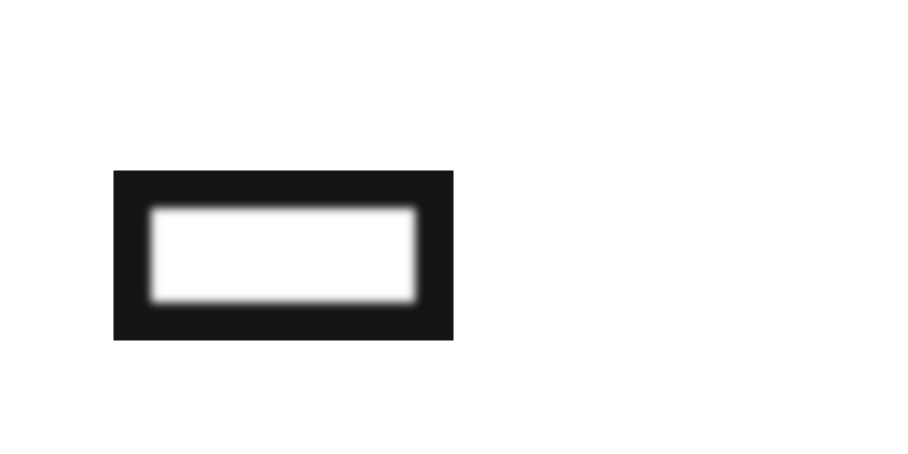

# Saved CDR bitmap effects

The reader imports a version 27 vector object's saved Gaussian blur from
its style string. The original path, fill, outline and transform stay
editable. Properties > FX lists Gaussian Blur with its saved radius and
visibility. The existing Edit, Hide, Remove and undo actions work on it.
No new commands, shortcuts or default settings are introduced.

The observed `Radius` value is in hundredths of the displayed setting:
`1500` becomes radius 15.0 in the existing bitmap-effect model. This is a
pixel radius at the drawing's effect resolution, not 15 millimetres.
Native TraceDraw blur uses sigma = radius / 2. The source drawing's
independent 300 dpi export has a wider edge spread: about 13.5 pixels at
radius 15, rather than the native filter's 7.5 pixels. Imported settings
therefore keep `kernel_extent: 2` alongside the displayed radius. This
selects a finite Gaussian with sigma = radius and support near two sigma,
an interpretation inferred from that reference, not a published kernel
specification. The default effect resolution is 300 dpi. Full pixel
identity, other radii and other document resolutions remain unverified.

The app generates its ordinary cached effect picture. Headless conversion
also prepares Gaussian-only vector effect pictures, using premultiplied
alpha and the same shared finite-kernel implementation (a separable kernel
below sigma 2, three box passes matching the truncated normal's variance
above it). Native blur behavior stays unchanged. Each headless picture
has at most approximately four million pixels, including rounding, and
transparent room for the filter's spread. At that limit the processing
radius follows the actual resolution. Only missing or stale pictures are
made. Unaffected artwork stays vector in PDF and SVG.

Native saves keep the geometry, settings and picture. A CDR save writes
the cached appearance as a bitmap, while versions 14 and later also keep
the source in TraceDraw's private `tracedraw/effects.json`. This is not a
native filter record another application can edit. Earlier CDR versions
have the picture alone. A low-level writer called without a prepared
picture warns and writes the plain source instead.

## Verified scope and remaining work

One original version 27 drawing with a blurred white rectangle over a
dark rectangle confirms the style layout and radius 15.0. Synthetic
tests additionally exercise zero and boundary radii, hidden and deleted
settings, bad flags, missing parameters, non-finite values, malformed
JSON, native round trips and PNG/PDF/SVG/CDR conversion. They are not
independent evidence of other authoring versions or filter types.

The supported record has `Resampled` 0, explicit visibility/deletion
flags and a nonnegative stack index. Deleted effects are omitted; hidden
ones keep their settings. Other resampling modes, unknown parameters,
other file versions and effects on bitmap objects are reported and left
unmapped. Bitmap source/cached-pixel semantics require a separate real
sample before blur can safely be applied without double filtering.
Unknown filters are reported individually. Only Gaussian blur is mapped,
so general filter order or arbitrary mixed stacks are not claimed.

For unsupported effects, keep an editable original and bake the affected
object alone to a transparent bitmap before transfer. Compare it with a
reference render at the intended output resolution. This keeps the rest
of the drawing editable but sacrifices the baked effect's settings.

## Original synthetic example

[Download the synthetic drawing, images and reproduction notes](../samples/cdr-gaussian-blur.zip).

Before (official v0.46.0):


With parameter import and TraceDraw's bitmap filter:



These are original synthetic renders, not reference images exported by
the source application's filter. Exact kernel fidelity is unverified.

Run `python3 scripts/samples/cdr_gaussian_blur.py` to reproduce
`crates/cdr/tests/fixtures/gaussian-blur.cdr`. This minimal CDR27 parser
fixture contains two original rectangles, one sharp dark background and
one white rectangle carrying radius 15.0. It contains no private member,
font, source drawing metadata or proprietary application content.
Its minimal container has not been verified in another application.

```sh
tracedraw-cli convert crates/cdr/tests/fixtures/gaussian-blur.cdr blur.png
tracedraw-cli convert crates/cdr/tests/fixtures/gaussian-blur.cdr blur.svg
tracedraw-cli convert crates/cdr/tests/fixtures/gaussian-blur.cdr blur.pdf
tracedraw-cli convert crates/cdr/tests/fixtures/gaussian-blur.cdr blur.tdraw
```

Use cases include soft highlights, edge fades over coloured artwork and
keeping a blurred graphic beside sharp vector text. Bitmap defocus and
mixed filter stacks remain sample-driven follow-ups.
