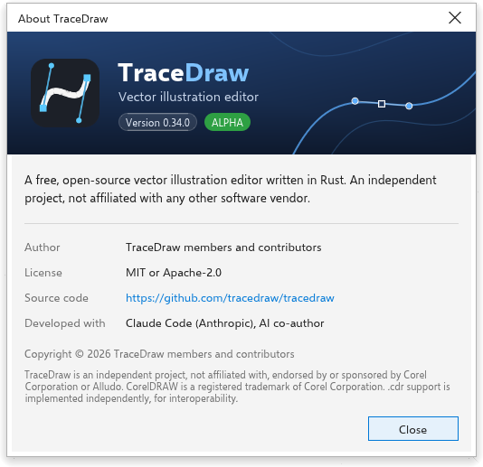

# TraceDraw সম্পর্কে ও আপডেট

TraceDraw বিনামূল্যের ও ওপেন সোর্স। এই পৃষ্ঠা ব্যাখ্যা করে আপনার কোন সংস্করণ
আছে তা কীভাবে দেখবেন, নতুন সংস্করণ কীভাবে পাবেন এবং কোথায় সাহায্য চাইবেন।

## পরিচিতি বক্স {#about}

চলমান সংস্করণ, লেখক, লাইসেন্স, সোর্স কোডের লিঙ্ক এবং প্রোগ্রামটি কী দিয়ে
তৈরি তা দেখতে [[menu.help > menu.help.about]] বেছে নিন। বন্ধ করতে
[[dialog.close]], <kbd>Enter</kbd> বা <kbd>Esc</kbd> চাপুন।

## আপডেট পরীক্ষা {#updates}

ডেস্কটপে TraceDraw নতুন সংস্করণ প্রকাশিত হলে আপনাকে জানাতে পারে।

এখনই পরীক্ষা করতে:

1. [[menu.help > menu.help.updates]] বেছে নিন।
2. TraceDraw প্রকল্পের রিলিজ পৃষ্ঠায় সর্বশেষ সংস্করণ জিজ্ঞাসা করে এবং জানায়
   সেটি আপনার সংস্করণের চেয়ে নতুন কি না। পরীক্ষামূলক ও নাইটলি বিল্ড কখনও
   দেওয়া হয় না।
3. নতুন সংস্করণ থাকলে কী করবেন বেছে নিন:
   - **ডাউনলোড** আপনার সিস্টেমের ফাইলের ডাউনলোড খোলে (Windows-এ ইনস্টলার বা
     পোর্টেবল আর্কাইভ, Mac-এর প্রসেসরের জন্য ডিস্ক ইমেজ, Linux-এ AppImage বা
     আর্কাইভ)। তারপর আপনার সিস্টেমের ইনস্টলার ইনস্টল করে।
   - **রিলিজ নোট** সেই সংস্করণের পরিবর্তনের তালিকা খোলে।
   - **এই সংস্করণ বাদ দিন** সেই সংস্করণ আর দেখায় না।
   - [[dialog.close]] বক্স বন্ধ করে।

TraceDraw যখন Linux AppImage হিসেবে চলে, বক্সটি **ইনস্টল** বিকল্পও দিতে পারে:
এটি চলমান AppImage-এর পাশে নতুন AppImage ডাউনলোড করে, ডাউনলোড সম্পূর্ণ ও খাঁটি
কি না যাচাই করে, এবং পুরনো ফাইলের জায়গায় বসায়। পরের বার TraceDraw খুললে নতুন
সংস্করণ চালু হয়। কিছু না মিললে পুরনো ফাইল যেমন ছিল তেমনই থাকে এবং বক্স কারণ
জানায়।

পরীক্ষা ব্যর্থ হলে (যেমন ইন্টারনেট সংযোগ ছাড়া), বক্স তা জানায় এবং রিলিজ
পৃষ্ঠা দেখায়।

### স্বয়ংক্রিয় পরীক্ষা {#automatic-check}

[[menu.tools > menu.tools.options > menu.tools.options_global]], পৃষ্ঠা
[[options.general]], শুরুতে আপডেট পরীক্ষার একটি সেটিং রাখে। শুরুতে এটি চালু
থাকে: দিনে একবার TraceDraw চালু হওয়ার সময় চুপচাপ পরীক্ষা করে এবং কেবল তখনই
জানায় যখন এমন নতুন সংস্করণ আসে যা আপনি বাদ দেননি।

প্রথমবার চালু হলে TraceDraw জিজ্ঞেস করে আপডেট খুঁজবে কিনা: [[updates.policy_always]] অথবা [[updates.policy_never]]। আপনি উত্তর না দেওয়া পর্যন্ত TraceDraw নিজে থেকে কোনো সংযোগ করে না। আপনার উত্তর এই বিকল্পটি ঠিক করে, যা আপনি এখানে যেকোনো সময় বদলাতে পারেন।

> **দ্রষ্টব্য:** ব্রাউজার সংস্করণ সবসময় সর্বশেষ। সেখানে
> [[menu.help > menu.help.updates]] রিলিজ পৃষ্ঠা খোলে।

## স্বাগত স্ক্রিন {#welcome-screen}

TraceDraw চালু হলে স্বাগত স্ক্রিন প্রথম ট্যাব। সেখান থেকে আপনি অঙ্কন তৈরি
করতে, সম্প্রতি ব্যবহৃত অঙ্কনগুলির একটি খুলতে (প্রতিটি থাম্বনেইলসহ;
[[menu.file.clear_recent]] সেগুলি ভুলে যায়), টেমপ্লেট থেকে শুরু করতে, খবর
পড়তে ও শেখার উপকরণ খুঁজে পেতে পারেন। এটি ফিরিয়ে আনতে
[[menu.help > menu.help.welcome_screen]] বেছে নিন।
[[menu.help > menu.help.video_tutorials]], [[menu.help.quick_start_guide]] ও
[[menu.help.user_guide]] এর শেখার পৃষ্ঠা খোলে, আর [[menu.help.whats_new]] এর
খবর।

## কমিউনিটি ও সহায়তা {#community}

- [[menu.help > menu.help.community]] প্রকল্পের আলোচনা ফোরাম খোলে, যেখানে আপনি
  প্রশ্ন করতে ও ধারণা ভাগ করতে পারেন।
- [[menu.help > menu.help.support]] সমস্যা ট্র্যাকার খোলে, যেখানে আপনি কোনো
  সমস্যার কথা জানাতে পারেন।
- [[menu.help > menu.help.message_settings]] সেই বিকল্পগুলি খোলে যেখানে
  TraceDraw-এর বার্তা নির্ধারণ করা হয়।

## যখন TraceDraw সাড়া দেওয়া বন্ধ করে {#problem-reports}

TraceDraw-এর কোনো ধাপ 10 সেকেন্ডের বেশি নিলে, এটি কী করছিল তার একটি রিপোর্ট সংরক্ষণ করে (সংস্করণ, সিস্টেম, টুল, শেষ কমান্ড, অঙ্কনের আকার এবং লগের শেষ অংশ), অঙ্কনের নাম বা বিষয়বস্তু কখনো নয়। TraceDraw আবার সাড়া দিলে, অথবা এটি বন্ধ করতে হলে বা ত্রুটিতে বন্ধ হলে পরের বার খোলার সময়, একটি বার্তা এটি পাঠানোর প্রস্তাব দেয়।

1. রিপোর্ট পড়তে **[[report.show]]** ক্লিক করুন।
2. **[[report.send]]** ক্লিক করুন: সারসংক্ষেপসহ একটি নতুন GitHub ইস্যু এবং রিপোর্টের ফোল্ডার খোলে।
3. রিপোর্টটি ইস্যুতে টেনে আনুন, আপনি কী করছিলেন লিখুন এবং পাঠান। এর আগে কিছুই পাঠানো হয় না।

**[[report.not_now]]** বার্তাটি বন্ধ করে। প্রতিটি রিপোর্ট একবারই প্রস্তাব করা হয়।
