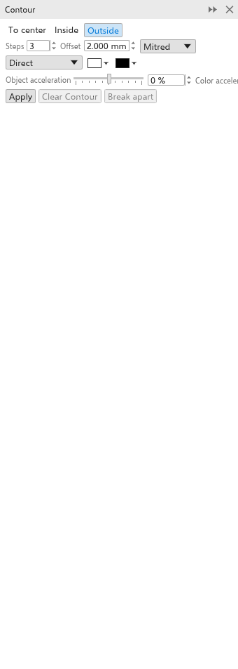

# Konturen

Eine Kontur zeichnet gleichmäßig beabstandete Kopien des Umrisses eines Objekts
nach innen, nach außen oder bis zu seiner Mitte, wie die Linien einer Karte.
Sie ist ein Live-Effekt: Ändern Sie das Objekt, folgt die Kontur.

## Eine Kontur hinzufügen {#create}

Mit dem Werkzeug:

1. Wählen Sie das Werkzeug [[tool.contour]] aus dem Flyout für Effekte.
2. Ziehen Sie von einem Objekt aus: von seiner Mitte weg für eine äußere
   Kontur, zu ihr hin für eine innere. Je weiter Sie ziehen, desto größer der
   Abstand.

Mit dem Andockfenster:

1. Wählen Sie ein Objekt aus.
2. Öffnen Sie das Andockfenster [[docker.contour]] mit
   [[menu.effects > menu.effects.contour]] (<kbd>Ctrl+F9</kbd>).
3. Stellen Sie die Optionen ein und klicken Sie auf [[docker.apply]].

Gruppen und Bitmaps können keine Kontur erhalten.

## Anfasser auf der Zeichnung {#handles}

Mit dem Konturwerkzeug zeigt ein Objekt mit Kontur eine Linie von der Mitte
seiner rechten Kante: nach außen bei einer äußeren Kontur, nach innen bei
einer inneren oder einer Kontur zur Mitte.

- Ziehen Sie das **Quadrat** am Ende der Linie, um die Reichweite der Kontur
  zu ändern. Die Zahl der Schritte bleibt, sie rücken auseinander oder
  zusammen.
- Ziehen Sie den **Balken** auf der Linie, beim ersten Schritt, um die Zahl
  der Schritte zu ändern: zum Objekt hin für mehr Schritte, davon weg für
  weniger. Der letzte Schritt bleibt, wo er ist. Eine Kontur zur Mitte hat
  keinen Balken, da sie so viele Schritte nimmt, wie hineinpassen.

Die Kontur folgt beim Ziehen, und jedes Ziehen lässt sich in einem Schritt
rückgängig machen.

## Kontureinstellungen {#settings}

Die Eigenschaftsleiste und das Andockfenster zeigen die Einstellungen der
ausgewählten Kontur und ändern sie sofort.

- **Zur Mitte**, **Innen** oder **Außen** (anfangs).
- **Schritte**: anfangs 3, bis zu 999. Zur Mitte erstellt so viele, wie
  hineinpassen.
- **Versatz**: der Abstand zwischen den Schritten (anfangs 2 mm).
- **Ecken**: spitz (anfangs), rund oder abgeschrägt.
- **Farbrichtung**: direkt, im Uhrzeigersinn oder gegen den Uhrzeigersinn um
  den Farbkreis, von den Farben des Objekts zu denen des letzten Schritts.
- Die **Füll- und Umrissfarben des letzten Schritts** (anfangs Weiß und
  Schwarz). Ein Objekt ohne Füllung ergibt ungefüllte Schritte.
- **Objektbeschleunigung** und **Farbbeschleunigung** (-100 bis 100 %)
  drängen die Schritte oder die Farben zum Objekt oder zum letzten Schritt hin.

Äußere Schritte werden hinter dem Objekt gezeichnet, innere davor.

**Kontur entfernen** entfernt die Kontur; **Kombination aufheben** wandelt die
Schritte in Objekte um.
Die Schritte werden neben dem Objekt gruppiert. [[menu.object > menu.object.break_contour_apart]] (<kbd>Strg+K</kbd>, auch
im Kontextmenü) bewirkt dasselbe.
