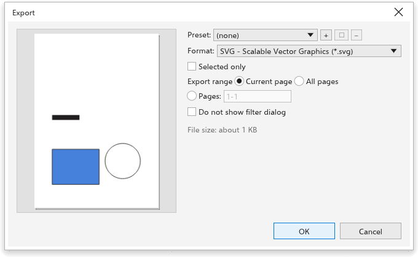

# Exportieren

> *Maschinelle Übersetzung: Diese Seite kann hinter der englischen Fassung zurückliegen.*

[[menu.file > menu.file.export]] (<kbd>Ctrl+E</kbd>) schreibt die Zeichnung,
eine Seite oder die Auswahl in einem anderen Format. Das Dialogfeld Exportieren
zeigt links eine Vorschau und rechts die Einstellungen.

## Exportieren {#export}

1. Wählen Sie [[menu.file > menu.file.export]] (<kbd>Ctrl+E</kbd> oder die
   Schaltfläche der Symbolleiste).
2. Wählen Sie im Dialogfeld **Speichern** den Ordner, geben Sie den Namen ein
   und wählen Sie das Format unter **Dateityp**. Jedes Format wird angeboten,
   das zuletzt verwendete zuerst; die Endung des Namens bestimmt das Format.
   Der Ordner des letzten Exports wird geöffnet.
3. Das Dialogfeld Exportieren öffnet sich mit den Optionen dieses Formats;
   sein Titel nennt die Datei (etwa „Poster.png exportieren“). Die Wahl eines
   Formats holt die Einstellungen zurück, mit denen es zuletzt exportiert
   wurde. Wählen Sie eine **Vorgabe**, um von gespeicherten Einstellungen
   auszugehen, oder ein anderes **Format**: Die Endung der Datei ändert sich
   mit. Die gängigen Formate (JPG, PDF, AI, PNG) stehen zuerst.
4. Stellen Sie die Optionen des Formats ein (siehe unten).
5. Aktivieren Sie **Nur Auswahl**, um nur die Auswahl zu exportieren, oder
   **Alle Seiten**, um jede Seite zu exportieren.
6. Klicken Sie auf [[dialog.ok]], um die Datei zu schreiben.
   [[dialog.cancel]] schreibt nichts.

Im Browser, der kein Dialogfeld Speichern hat, kommt das Dialogfeld
Exportieren zuerst, und [[dialog.ok]] lädt die Datei herunter; unter Android
öffnet [[dialog.ok]] die Dateiauswahl des Systems.

Das Dialogfeld schätzt die Größe der Datei und nennt bei Bitmap-Formaten, was
herauskommt, etwa „1240 x 1754 pixels, 150 dpi, sRGB“.

## Optionen überspringen {#skip}

Aktivieren Sie unten im Dialogfeld Exportieren [[dialog.skip_export_dialog]]
und klicken Sie auf [[dialog.ok]]: Die nächsten Exporte schreiben die Datei
gleich nach dem Dialogfeld Speichern mit den Optionen des letzten Exports, und
die Statusleiste meldet „Mit den letzten Optionen exportiert“. So sehen Sie die
Optionen wieder:

- Halten Sie <kbd>Shift</kbd> gedrückt, während Sie
  [[menu.file > menu.file.export]] wählen oder auf die Schaltfläche der
  Symbolleiste klicken, oder wählen Sie
  [[menu.file > menu.file.export_with_options]] (<kbd>Ctrl+Shift+E</kbd>),
  und deaktivieren Sie das Kästchen; oder
- deaktivieren Sie [[options.skip_export_dialog]] auf der Seite
  [[options.file_formats]] der globalen Optionen (ein Klick auf die Meldung
  der Statusleiste öffnet sie).

## Formatoptionen {#options}

| Format | Optionen |
|---|---|
| PNG, WebP, GIF | Auflösung (oder Größe in Pixeln), transparenter Hintergrund; bei WebP auch Qualität |
| JPEG | Auflösung, Qualität (1 bis 100) |
| BMP, TIFF, PSD | Auflösung |
| PDF | Standard (PDF 1.4, PDF/X-1a, PDF/X-3 oder PDF/X-4), Beschnittzugabe, Ausgabebedingung für PDF/X |
| PDF, AI | Titel und Schlagwörter |
| SVG, EPS, AI, DXF, HTML, EMF, WMF, PLT, PS, PRN | keine |

## Größe von Bitmaps {#size}

Bei Bitmap-Formaten hat **Größe** eine Breite, eine Höhe und deren Einheit
(px, mm, cm oder in); die andere Seite folgt den Proportionen der Seite.

- In Pixeln setzt eine eingegebene Breite oder Höhe die Auflösung, die sie
  ergibt; so geben Sie die Größe eines Symbols (32 x 32 Pixel) direkt ein.
- In einer Länge ist die Größe die Druckgröße: Eine eingegebene Breite oder
  Höhe skaliert die Grafik bei der eingestellten Auflösung, von 1 % bis
  10000 %. Eine Schaltfläche mit dem Maßstab (etwa „200 %“) erscheint, wenn er
  nicht 100 % ist, und setzt ihn zurück.

PNG-, JPEG- und BMP-Dateien speichern ihre Auflösung und öffnen daher in der
gewählten Größe. PostScript- und PRN-Dateien enthalten jede exportierte Seite.

## Vorgaben {#presets}

Die Liste **Vorgabe** enthält jede gespeicherte Vorgabe, jeweils mit ihrem
Format in Klammern, etwa „Web PNG (PNG)“. Eine Vorgabe eines anderen Formats
schaltet das Dialogfeld auf dieses Format um; ein Formatwechsel lässt keine
Vorgabe gewählt. **+** speichert die aktuellen Einstellungen unter einem Namen
(derselbe Name ersetzt diese Vorgabe), der Stift benennt die gewählte Vorgabe
um und **-** löscht sie.

## Anfangswerte {#defaults}

Die Anfangswerte werden auf der Seite [[options.file_formats]] der globalen
Optionen festgelegt; dort lässt **Die Einstellungen des letzten Exports
merken** (anfangs an) das Dialogfeld mit Format, Auflösung und Qualität des
letzten Exports beginnen, auch in der nächsten Sitzung. [[menu.file.export_for]] hat Vorgaben für das Web und für
Office-Dokumente; siehe [Für das Web exportieren](../web-graphics/export-for-web.md).
Für PDF-Dateien mit Lesezeichen und Sicherheit verwenden Sie
[Als PDF veröffentlichen](publish-pdf.md).
