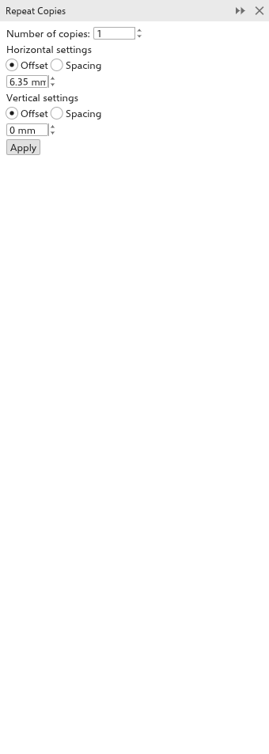

# Kopien mit Schritt und Wiederholung erstellen

Das Andockfenster [[docker.step_and_repeat]] erstellt mehrere Kopien der
Auswahl, jede um denselben Abstand von der vorigen verschoben: eine Reihe von
Schaltflächen, eine Spalte von Linien, ein Raster von Kacheln. Öffnen Sie es
mit [[menu.edit > menu.edit.step_and_repeat]] (<kbd>Ctrl+Shift+D</kbd>).

## Kopien erstellen {#copies}

1. Wählen Sie die zu kopierenden Objekte aus.
2. Legen Sie die Anzahl der [[docker.copies]] fest (1 bis 999).
3. Wählen Sie unter [[docker.horizontal_settings]], wie die Kopien in der
   Breite verteilt werden:
   - [[docker.offset]]: der Abstand von einer Kopie zur nächsten, gemessen vom
     selben Punkt jeder Kopie;
   - [[docker.spacing]]: die Lücke zwischen einer Kopie und der nächsten,
     sodass sich die Kopien unabhängig von ihrer Größe nie überlappen.

   Geben Sie dann den Abstand ein. 0 hält die Kopien in einer Linie.
4. Gehen Sie unter [[docker.vertical_settings]] genauso vor.
5. Klicken Sie auf [[docker.apply]].

Während Sie im Andockfenster arbeiten (der Zeiger ist darauf, Sie tippen in
eines seiner Felder oder Ihr letzter Klick war darin), werden die Kopien, die
[[docker.apply]] anlegen würde, auf der Seite blau gestrichelt umrandet und
folgen jedem geänderten Wert. Nichts wird hinzugefügt, bis Sie auf
[[docker.apply]] klicken, und ein [[menu.edit.undo]] entfernt alle Kopien
wieder. Ein Klick an anderer Stelle oder das Schließen oder Ausblenden des
Andockfensters entfernt die Umrisse. Sehr viele Kopien eines detaillierten
Objekts werden als ihre Rahmen umrandet.

Die Kopien werden der aktiven Ebene hinzugefügt. Abstände werden in den
Einheiten der Zeichnung angegeben.

## Die Seite füllen {#fill-page}

[[docker.sr_mode_fill]] kachelt die Auswahl in einem Raster über die
Seite, so viele Kopien wie passen: Etiketten, Aufkleber, Visitenkarten
und Anhänger, die zusammen auf einem Bogen gedruckt werden.

1. Wählen Sie das Objekt (oder die Objekte) aus, das wiederholt werden soll.
2. Wählen Sie oben im Andockfenster [[docker.sr_mode_fill]]. Es zeigt die
   Seitengröße.
3. Füllen Sie die [[docker.fillpage_area_page]] oder einen
   [[docker.fillpage_area_custom]] davon, festgelegt durch linken und
   unteren Rand, Breite und Höhe.
4. Legen Sie die [[docker.fillpage_margins]] innerhalb der Kanten fest
   (ein Wert für alle Seiten, oder [[docker.fillpage_same]] ausschalten,
   um jede Seite einzeln einzustellen) und den [[docker.fillpage_gap]]
   zwischen den Kopien (ein Wert, oder [[docker.fillpage_gap_x]] und
   [[docker.fillpage_gap_y]]).
5. Für versetzte Reihen stellen Sie [[docker.fillpage_row_shift]] ein.
6. Unter [[docker.fillpage_turn]] zeigt jede Wahl, wie viele Kopien
   passen, etwa „4 x 6 = 24 Kopien“. Wählen Sie
   [[docker.fillpage_as_is]], [[docker.fillpage_turned]] oder
   [[docker.fillpage_best]].
7. Kreuzen Sie [[docker.fillpage_marks]] an, um an jeder Schnittlinie
   außerhalb der Kopien Marken zu setzen, und stellen Sie Länge und
   Abstand ein.
8. Klicken Sie auf [[docker.apply]].

Die Auswahl rückt an die erste Stelle des Rasters, Kopien füllen die
übrigen, mittig im Raum innerhalb der Ränder; ein [[menu.edit.undo]] stellt
alles wieder her. Während Sie im Andockfenster arbeiten, ist jede Stelle
auf der Seite umrandet.

Um bei jedem Schritt mit einer Drehung oder Skalierung zu kopieren, verwenden
Sie das Feld [[dialog.copies]] des Andockfensters [[docker.transformations]];
siehe [Verschieben, Skalieren, Drehen und Neigen](transforming.md#transformations-docker).
