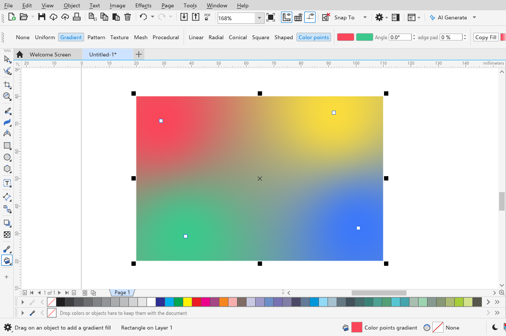
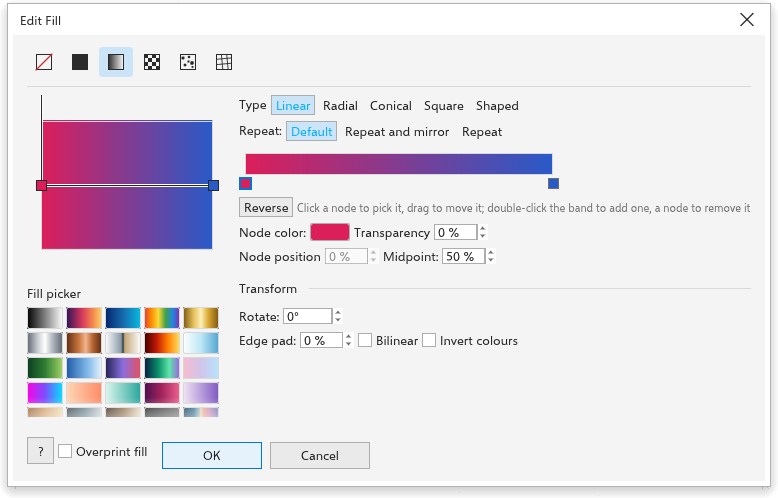
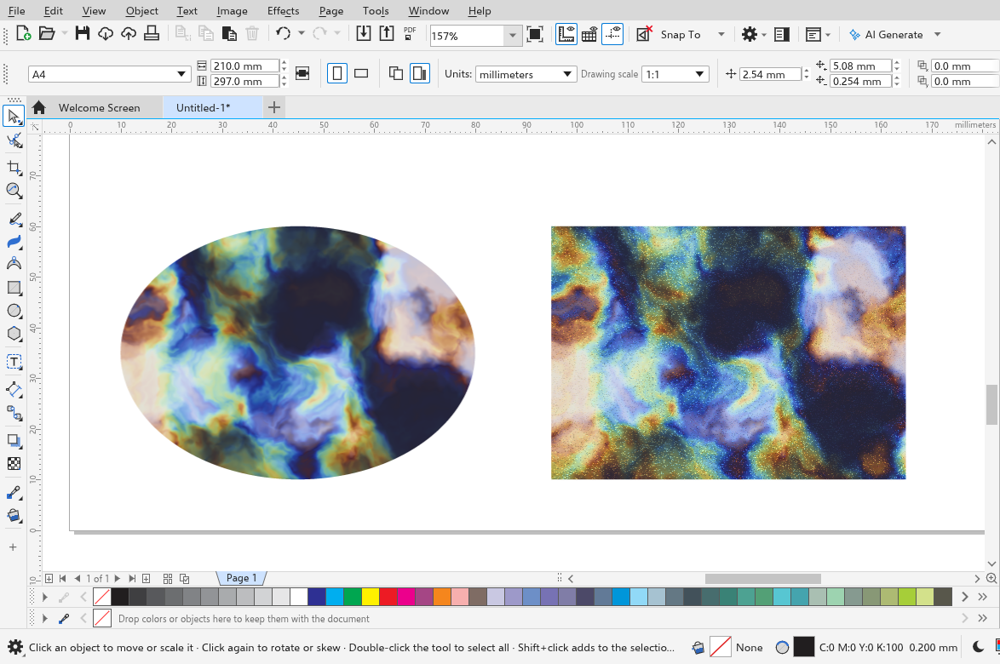

# Fills

A fill paints the inside of a closed object. TraceDraw has six kinds of
fill: [[docker.fill_none]], [[docker.fill_uniform]] (one flat color),
[[docker.fill_fountain]] (colors that blend into each other),
[[docker.fill_pattern]], [[docker.fill_texture]] and [[docker.fill_mesh]]
(colors that flow between the nodes of a grid).

## Ways to fill an object {#ways}

- Click a color of the palette to give the selection a uniform fill.
- Press <kbd>F11</kbd> for the [[edit_fill.title]] dialog box (see
  [below](#edit-fill)), or use the [[docker.fill]] section of the
  [[docker.properties]] panel: choose the kind of fill with the row of
  pictures, then its settings.
- Use the [[tool.interactive_fill]] tool (<kbd>G</kbd>) to set gradients on
  the object itself.
- Use the [[tool.area_fill]] tool to fill an area enclosed by several objects.
- Use the [[tool.mesh_fill]] tool (<kbd>M</kbd>) for a mesh fill.

With nothing selected, the fill you choose becomes the fill of new objects.

## Uniform fills {#uniform}

A uniform fill is one color, in any color model. Choose it from the palette,
the [[docker.color]] panel (see [The Color panel](color-docker.md)) or the
fill section of the [[docker.properties]] panel.

## Gradient fills {#gradient}

A gradient blends two or more colors. Its settings, in the fill section of
the [[docker.properties]] panel:

- The type: [[fill.linear]] (along a line), [[fill.radial]] (from the center
  out), [[fill.conical]] (around the center), [[fill.square]] (in growing
  squares), [[fill.shaped]] (following the outline of the object, from the
  edge inwards) or **Color points** (each color at a point of its own
  anywhere in the object, blending into the others around it). With the
  Interactive Fill or Shape tool the color points show on the object: drag
  one to move it, click one and then a palette color to recolor it,
  double-click inside the object to add one, and press Delete to remove the
  chosen one (two always stay).
- [[docker.gradient_presets]]: ready-made gradients to start from.
- The **stops**: the colors and where they sit along the gradient, 2 to 64.
  Select a stop to change its color or position; [[docker.add_stop]] and
  [[docker.remove_stop]] add and remove stops. [[docker.import_gradient]]
  takes the colors from a `.ggr` gradient file.
- The **angle** of linear, conical and square gradients, the
  [[docker.edge_pad]] (how much of each end is solid color) and the center
  offset of radial, conical and square gradients.
- [[docker.repeat]]: [[docker.repeat_none]], [[docker.repeat_sawtooth]] (the
  colors run again from the start) or [[docker.repeat_mirror]] (they run back
  and forth), with the number of [[docker.repeat_count]].
- [[docker.bilinear]]: the colors run from the first to the last and back.
- [[docker.invert_colours]]: the colors run in reverse order.

A strip under the type shows the whole run of colors as it will be drawn.

## The Edit Fill dialog box {#edit-fill}

<kbd>F11</kbd> opens the [[edit_fill.title]] dialog box on the fill of the
selection (or of new objects, with nothing selected).

- The row of pictures at the top picks the kind of fill.
- A uniform fill shows the color viewer.
- A gradient shows a preview of the fill and the [[edit_fill.fill_picker]]
  with the built-in gradients on the left. On the right: the type, how it
  repeats, and the band of colors with its nodes. Click a node to pick it and
  drag it to move it; double-click the band to add a node and a node to
  remove it. <kbd>Alt</kbd> and a drag on a node copies it and moves the
  copy: two nodes of one color make a solid band, and two nodes of different
  colors side by side make a hard edge. The picked node's color, transparency, position and
  [[edit_fill.midpoint]] are under the band, with [[edit_fill.reverse]].
  [[edit_fill.transform]] has the rotation, the center (for radial, conical
  and square gradients), the edge pad, mirror and inversion. The preview has
  the object's proportions and shows the start, end and skew nodes: drag them
  to move, turn and stretch the gradient as on the canvas (<kbd>Ctrl</kbd>
  turns in steps of 15 degrees).
- **OK** changes only what you changed on every selected object, with
  [[edit_fill.overprint]].
- While the dialog box is open, the selection shows the fill as you change it; **Cancel** or <kbd>Esc</kbd> puts the old fill back.

## The Interactive Fill tool {#interactive-fill}

The [[tool.interactive_fill]] tool (<kbd>G</kbd>) edits fills on the object.

1. Choose the tool and drag across an object: the gradient starts where you
   press and ends where you release, keeping the colors of a gradient the
   object has already. Hold <kbd>Ctrl</kbd> to keep the angle to steps of 15
   degrees. A click on an object without a gradient gives the default fill.
2. Drag the nodes to change the gradient: the start node moves it, the end
   node sets its length and direction, and the round skew node tilts the
   bands (or makes a radial gradient an ellipse).
3. Double-click the line between the nodes to add a color node there;
   double-click a color node to remove it. Drag a color node along the line,
   or the short bar between two nodes to move the point where their colors
   meet half way. Hold <kbd>Alt</kbd> as you start to drag a node to copy it
   and drag the copy, for bands of solid color with hard edges.
4. Click a node to pick it: a small bar opens under it with the node's color
   (click the swatch for the color picker) and its transparency. A palette
   color clicked while a node is picked goes to that node, and the property
   bar shows the node's color, transparency and position.
5. Drag a palette color onto a node to recolor it, or onto the line between
   the nodes to add a color there.

The property bar has the kind of fill and its settings: the color of a
uniform fill; for a gradient the type, the start and end colors, the angle
and the edge pad.

## The Area Fill tool {#area-fill}

The [[tool.area_fill]] tool fills any closed area, even one formed by several
overlapping objects, by making a new object of that area. The objects around
it stay as they are.

1. Choose the [[tool.area_fill]] tool.
2. Choose the fill and outline on the property bar: **Specify** (the color,
   and for the outline the width, beside it), **Use default** (the fill and
   outline of new objects; a color when that is no fill, so the area shows)
   or **None**.
3. Click inside the area.

The new object goes on top of the active layer and is selected. A click on an
outline, or in an area that nothing encloses, makes nothing.

With **Up to outline edges** on the property bar, outlines count as wide as
they are drawn: the area stops at their inner edges, and lines that only touch
through their width still close it.

Inside a [symmetry](../objects/symmetry.md), a click in one copy fills the same
area in every copy: the new object becomes part of the symmetry.

With **Live** on, a click inside a group paints the area its lines close off
as a live fill of the group (the selected group, or else the topmost group
under the click) instead of making a new object. When you move or reshape
the lines of the group, the fills follow them. Click a painted area again to
give it the bar's fill color, or with the Fill set to None to take the fill
away. Each click is one undo step.

**Fill All Areas** on the property bar fills every closed area at once: each
area the outlines of the selected objects close off (of everything on the page
when nothing is selected) becomes an object with the bar's fill and outline,
all on a new layer over the others, in one undo step.

## Mesh fills {#mesh-fill}

A mesh fill is a grid of nodes over an object, each node with its own color
and transparency; the colors flow smoothly between the nodes. It suits
realistic shading.

1. Choose the [[tool.mesh_fill]] tool (<kbd>M</kbd>) and set the rows and
   columns on the property bar (2 by 2 at first, up to 50).
2. Click an object. It gets a mesh in the color of its fill.
3. Click a node to select it, then click a color of the palette to color it.
   Drag nodes to bend the flow of colors.
4. Double-click inside the mesh to add a node exactly there, on a new row
   and column through that point; select a node and press <kbd>Delete</kbd> to remove its row and
   column.

The property bar also has **Smooth color**, which blends the colors more
softly, the **transparency** of the selected node, and **Clear mesh**, which
removes the mesh fill. Changing the rows and columns of a mesh keeps its
colors.

For a quick colorful background, choose a color set in the **Colors** list
(Aurora, Sunset, Ocean, Candy, Forest, Neon or the document palette) and
click **Shuffle**: every selected object gets a random mesh of those colors,
with its nodes nudged off the grid. Click again for another mix, or undo to
go back.

## Pattern and texture fills {#pattern-texture}

- A [[docker.fill_pattern]] fill repeats a tile: two colors, a vector
  pattern or a bitmap. See [Pattern fills](patterns.md).
- A [[docker.fill_texture]] fill is a generated, natural-looking texture:
  [[texture.clouds]], [[texture.marble]], [[texture.noise]] or
  [[texture.wood]], with its colors and scale.
- [[texture.holographic]] and [[texture.holo_glitter]] give a fixed holographic foil look: rainbow colors flowing
  through dark and light patches (colors A and B), the glitter with
  sparkling grains. It does not change with the viewing angle; PDF and SVG
  carry it as a picture.

## Several fills on one object {#several-fills}

In the fill section of the [[docker.properties]] panel, [[docker.add_fill]]
paints another fill over the object's own, starting as a copy to change.
Further fills show as "Fill 2", "Fill 3" and so on, each with its own editor
and a button to remove it. The outline section can add further outlines the
same way.

The arrows beside each further fill or outline paint it one place earlier or
later; the second trades places with the first, so any of them can go
bottom or top.

Under each further fill, Grow, Move and Blur give it a look of its own:
its area grown (or shrunk, below zero), moved and blurred, while the
object and its other fills stay as they are. A smaller fill of another colour,
moved and blurred a little, makes a soft highlight, for example.

Fills can also be painted on outlines; see
[Setting outlines](../lines-shapes/outlines.md#outline-pen).
