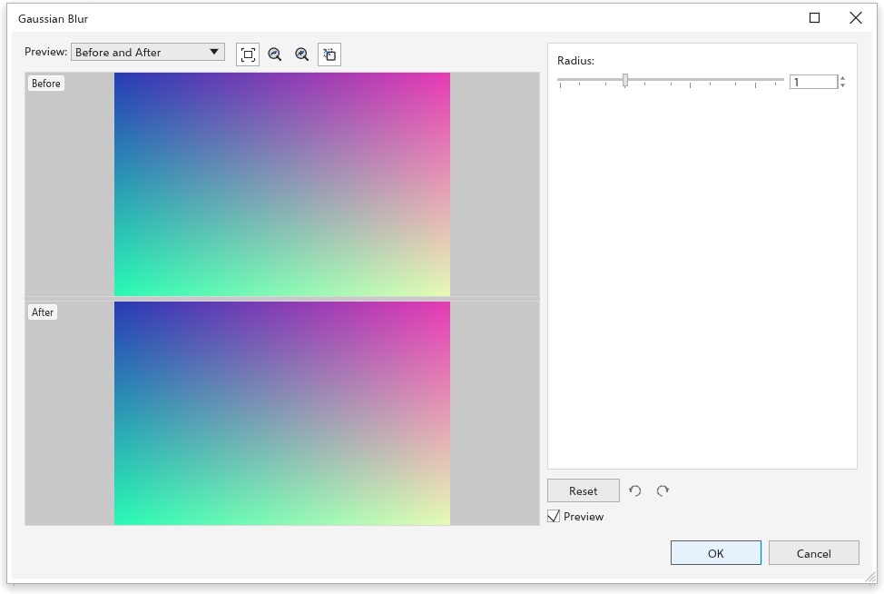

# Bitmap effects

Bitmap effects change pixels: blur, sharpen, adjust colors, add textures and
artistic strokes. They work on bitmaps and also on vector objects, which are
then drawn as the picture the effects make while keeping their own shape,
fill and outline.

Effects are kept apart from the original pixels: you can edit, hide, reorder
or remove any of them later, and removing the last one gives the original
back.

## To apply a bitmap effect {#apply}

1. Select one or more objects.
2. Choose a group in the [[menu.effects]] menu and an effect.
3. Effects without settings apply at once. The others open a dialog box you
   can size, with the first selected object before and after in the
   [Before and After preview](../bitmaps/before-after-preview.md) and the
   settings on the right. The effect also shows on the drawing and follows
   every value as it changes (untick **Preview** to switch that off); the
   work is done in the background, so the window keeps answering on large
   pictures. Click [[dialog.ok]] to keep what the drawing shows as one undo
   step; **Cancel** or <kbd>Esc</kbd> put the drawing back exactly as it was.
   The settings sit in a panel at the right; under it **Reset** puts every
   setting back to its default, and the two arrows undo and redo the changes
   made in the dialog box.
   With **Settings in the Effects panel** ticked, effects open in the Effects panel
   beside the drawing instead: pick the effect from the list at its top, set
   the sliders while the drawing shows the result, then click
   **Apply** (one undo step) or **Cancel**. Untick the box there to
   go back to the dialog box. Image Adjustments and Tone Curve keep their
   dialog boxes.

The change to the whole selection is one undo step. With a bitmap selected,
<kbd>Ctrl+B</kbd> opens [[fx.brightness_contrast_intensity]], <kbd>Ctrl+Shift+B</kbd>
[[fx.color_balance]] and <kbd>Ctrl+Shift+U</kbd> [[fx.hue_saturation_lightness]].

## The effect groups {#groups}

| Group | Effects |
|---|---|
| [[menu.effects.3d]] | [[fx.cylinder]], [[fx.emboss]], [[fx.page_curl]], [[fx.pinch_punch]], [[fx.sphere]] |
| [[menu.effects.adjust]] | [[fx.auto_adjust]], [[fx.image_adjustments]], [[fx.contrast_enhancement]], [[fx.local_equalization]], [[fx.target_balance]], [[fx.tone_curve]], [[fx.brightness_contrast_intensity]], [[fx.color_balance]], [[fx.gamma]], [[fx.hue_saturation_lightness]], [[fx.selective_color]], [[fx.replace_colors]], [[fx.desaturate]], [[fx.channel_mixer]] |
| [[menu.effects.art_strokes]] | [[fx.charcoal]], [[fx.conte_crayon]], [[fx.crayon]], [[fx.cubist]], [[fx.impressionist]], [[fx.palette_knife]], [[fx.pastels]], [[fx.pen_ink]], [[fx.pointillist]], [[fx.scraperboard]], [[fx.sketch_pad]], [[fx.watercolor]], [[fx.felt_marker]], [[fx.paper_grain]], [[fx.paper_layers]], [[fx.bristle_paint]], [[fx.mural_paint]], [[fx.luminous_wash]], [[fx.inked_poster]], [[fx.diagonal_smear]], [[fx.blotted_color]], [[fx.primed_canvas]], [[fx.chalked_edges]], [[fx.diagonal_hatching]], [[fx.pencil_weave]], [[fx.light_shadow_strokes]], [[fx.spray_streaks]], [[fx.ink_wash]], [[fx.copier_toner]], [[fx.rubber_print]], [[fx.wet_fiber_paper]] |
| [[menu.effects.blur]] | [[fx.directional_smooth]], [[fx.gaussian_blur]], [[fx.jagged_edges]], [[fx.low_pass]], [[fx.motion_blur]], [[fx.radial_blur]], [[fx.smart_blur]], [[fx.smooth]], [[fx.soften]], [[fx.zoom]] |
| [[menu.effects.camera]] | [[fx.colorize]], [[fx.diffuse]], [[fx.lens_correction]], [[fx.photo_filter]], [[fx.sepia_toning]], [[fx.tilt_shift]], [[fx.vintage_photo]] |
| [[menu.effects.color_transform]] | [[fx.bit_planes]], [[fx.halftone]], [[fx.psychedelic]], [[fx.solarize]], [[fx.dither]], [[fx.gradient_map]], [[fx.riso_print]], [[fx.newsprint]], [[fx.grit_screen]] |
| [[menu.effects.contour_group]] | [[fx.edge_detect]], [[fx.find_edges]], [[fx.trace_contour]], [[fx.neon_outline]] |
| [[menu.effects.correction]] | [[fx.dust_and_scratch]] |
| [[menu.effects.creative]] | [[fx.crystallize]], [[fx.fabric]], [[fx.frame]], [[fx.glass_tiles]], [[fx.mosaic]], [[fx.scatter]], [[fx.tinted_glass]], [[fx.stained_glass]], [[fx.vignette]], [[fx.vortex]] |
| [[menu.effects.custom]] | [[fx.bump_map]] |
| [[menu.effects.distort]] | [[fx.blocks]], [[fx.displace]], [[fx.mesh_warp]], [[fx.offset]], [[fx.pixelate]], [[fx.ripple]], [[fx.swirl]], [[fx.tile]], [[fx.wet_paint]], [[fx.whirlpool]], [[fx.wind]], [[fx.polar_coordinates]] |
| [[menu.effects.glitch]] | [[fx.rgb_split]], [[fx.scanlines]], [[fx.pixel_sort]], [[fx.compression_blocks]], [[fx.band_shift]] |
| [[menu.effects.light]] | [[fx.lighting]], [[fx.lens_flare]], [[fx.light_rays]], [[fx.bloom]], [[fx.light_leak]] |
| [[menu.effects.noise]] | [[fx.add_noise]], [[fx.maximum]], [[fx.median]], [[fx.minimum]], [[fx.remove_moire]], [[fx.remove_noise]] |
| [[menu.effects.sharpen]] | [[fx.adaptive_unsharp]], [[fx.directional_sharpen]], [[fx.high_pass]], [[fx.sharpen]], [[fx.unsharp_mask]] |
| [[menu.effects.texture]] | [[fx.cobblestone]], [[fx.wrinkles]], [[fx.etching]], [[fx.plastic]], [[fx.relief_sculpture]], [[fx.stone]], [[fx.embossed_paper]], [[fx.gypsum_cast]], [[fx.film_clumping]], [[fx.cracked_surface]], [[fx.quilt_squares]] |
| [[menu.effects.transform]] | [[fx.deinterlace]], [[fx.invert_colors]], [[fx.posterize]], [[fx.broadcast_safe]] |

## Special dialogs {#special-dialogs}

- **[[fx.image_adjustments]]** opens a larger dialog box: a large preview you can
  zoom, pan and rotate, shown alone, side by side or split; **Auto adjust**
  and pickers for the white and black points; sliders for temperature, tint,
  saturation, brightness, contrast, highlights, shadows and midtones, with a
  histogram; undo and redo inside the dialog; and snapshots of settings to
  compare.
- **[[fx.contrast_enhancement]]** shows the histogram with markers to drag for the
  input and output levels, eyedroppers for black and white, and **Auto
  adjust**.
- **[[fx.tone_curve]]** edits a curve per channel (master, red, green, blue) in four
  styles (curve, straight, freehand, gamma), over the histogram; curves can
  be saved and loaded.
- Colors of the picture, such as in [[fx.replace_colors]], have an eyedropper: click
  a preview to take the color under the pointer.

## Editing the effects of an object {#fx-section}

The [[docker.fx]] section of the [[docker.properties]] panel lists the
effects of the selected object, first applied at the top: the live effects
of its stack (contour, envelope, extrusion, shadows, glows and the others of
the Effects panel) above its bitmap effects. Each row has an eye that shows or
hides the effect (a hidden effect keeps its place and settings), **Edit**
(opens its dialog box, or for a live effect the panel that sets it),
**Move up**, **Move down** and **Delete**. **Add effect** opens the effect
groups.

[[menu.effects > menu.effects.flatten]] makes the effects permanent: a bitmap
keeps what it shows, and a vector object becomes a bitmap.

### On all pages

In a drawing of several pages, the dialog box of an effect shows an
[[dialog.fx_all_pages]] box while a picture is selected. With it ticked, OK
gives the effect to every picture on every page as well, in one undo step.
Locked pictures, and pictures on locked layers, stay as they are.

[[menu.effects > menu.effects.all_pages]] does the same with the effects the
selected picture already has, effects without a dialog box included: every
other picture takes the same list of effects, in one undo step.

## The Effect Picker {#effect-picker}

[[menu.effects > menu.effects.picker]] opens a window that stays open while
you work, with every effect as a small picture. Type in the search field to
find effects, or choose a group or **Recent** from the list. With something
selected, click a tile to apply the effect. You can also apply an effect as a
[lens](lens.md).

## Effects that spread past the edges {#inflate}

Blurs and similar effects can reach past the edges of a bitmap. With
[[menu.bitmaps > menu.bitmaps.inflate > menu.bitmaps.inflate_auto]] on (as at
first), the bitmap grows to make room for them. See
[Resampling and straightening](../bitmaps/resample-and-straighten.md#inflate).

To save a bitmap with its effects as a PNG file, right-click it and choose
[[menu.bitmaps.save_bitmap_as]].
