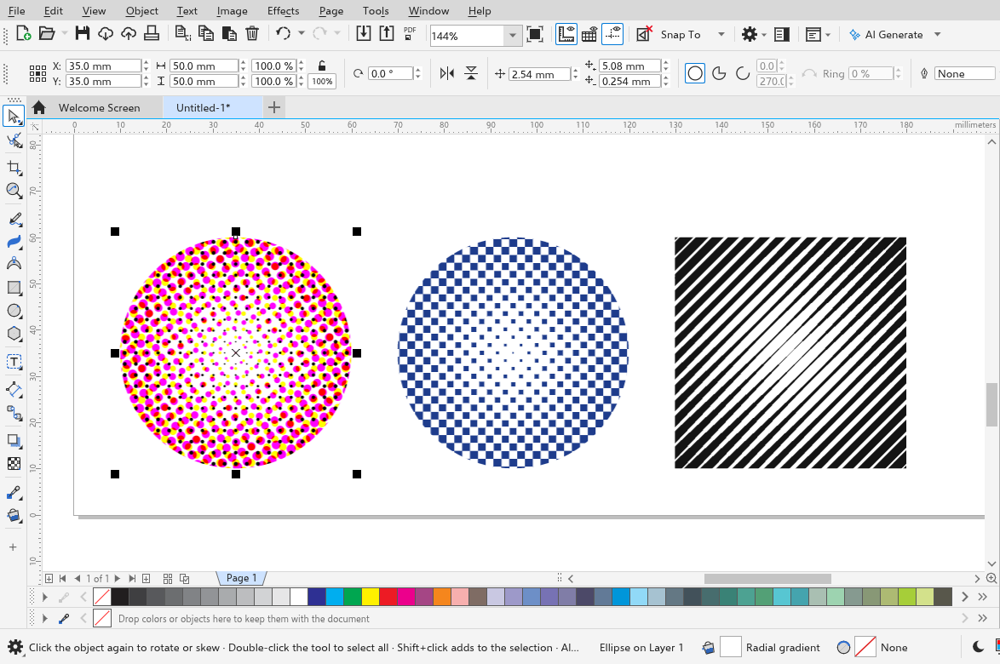
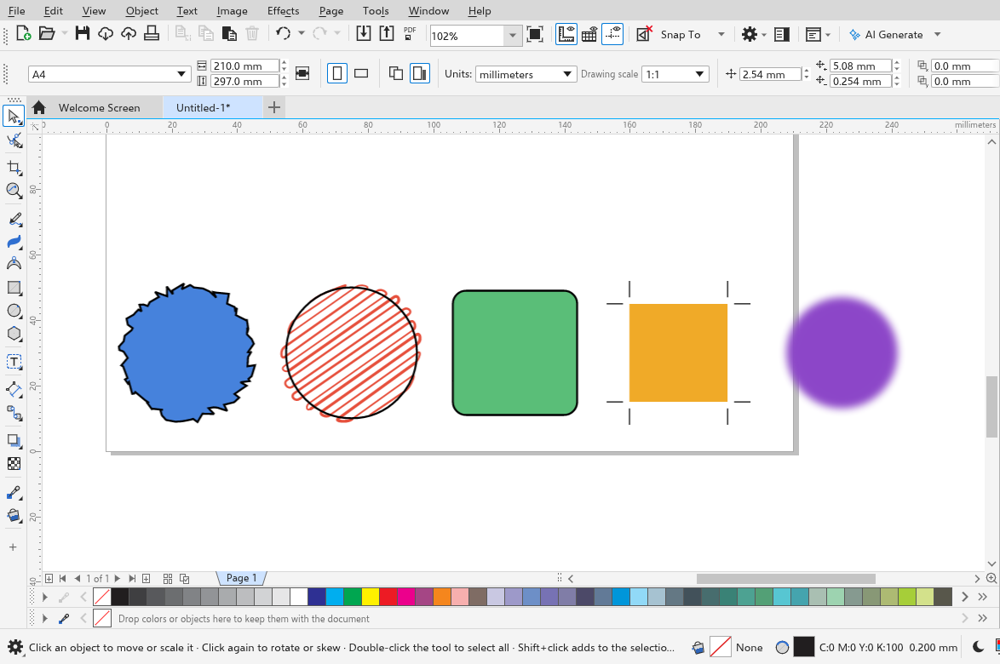

# The Effects panel

## Round corners and Slice {#outline-effects}

Two entries of the layer effects at the top of the panel rebuild the
outline as it is drawn while the object itself stays as it was, so a text
can still be edited:

- **[[effect.round_corners]]** rounds every corner of a curve, of the curves
  in a group or of the letters of a text with one radius. **Up to** limits
  it to corners sharper than an angle (180° takes every corner), and the
  **Corners** buttons take all of them, only the outer ones or only the
  inner ones.
- **[[effect.slice]]** cuts the object into parallel strips. Set how many
  strips, the angle of the cuts and the gap between them; **Shift** slides
  each strip along its cut, one way and the other with **Alternate** or by a
  random amount otherwise; **Turn** turns each strip a little, at random;
  **Seed** picks another random variation; **Round** rounds the corners of
  every strip.

[[menu.object.convert_to_curves]] (or Break Apart) makes the result plain
curves.

An object can carry several live effects at once, applied one after the
other. The [[docker.effects]] panel lists the effects of the selected object in
the order they apply, from the top down. Open it with
[[menu.window > menu.window.dockers > menu.window.dockers_effects]].

## Managing effects {#stack}

Each row of the list has:

- an eye that turns the effect on or off. An effect turned off keeps its
  place and settings, but is not drawn, exported or printed;
- the effect's name, dimmed while it is off;
- up and down arrows that move the effect earlier or later, which changes the
  result (for example a contour of an envelope, or an envelope of a contour);
- a pencil that opens the panel that sets the effect (its own panel, such as
  Contour or Envelope, else this one);
- a cross that removes the effect.

Every change is one undo step. Each effect is still edited with its own tool
or panel. The **FX** section of the Properties panel shows the same
rows, above the object's bitmap effects.

Above the list, the layer effects are switched on with their boxes and set on
the right, live on the page. **Transform** draws copies of the object,
each one the one before it scaled (**Scale H** and
**V**, in percent), moved, turned by **Angle** about
the object's centre and mirrored with **Reflect X** or
**Reflect Y**; **Copies** sets how many (0 transforms the
object itself). **Turn about H** and **V** move the point the copies turn
about away from the centre, so a turn of 30° and 11 copies set the object
in a ring round that point. **Random** gives each step a random share of those
values. Outlines keep their width unless **Scale outlines** is on. A
thick round-capped ring with an 85% scale, a 15° turn and a dozen copies
makes a spiral of rings. The object stays as it is, so its shape, color and
the effect stay editable; **Effects > Flatten Effects** makes the
copies objects.

**Grid** repeats the object in **Columns** and **Rows**,
to the right and down, the object itself being the top left cell. **Gap H**
and **V** set the space between cells (less than nothing overlaps them),
and **Shift rows** moves every other row to the right for brick and
honeycomb layouts. With the Pick tool, the round handles on the second column
and the second row drag the gaps (near nothing, the cells touch), and the
square past the last corner drags out more or fewer cells. Draw one tile,
color its faces with the Shape Builder, then give it a grid: the tile stays
editable and the whole pattern follows it.

Under the list, the built-in looks give the selected objects a finished
look with one click: chrome, liquid metal, gold, liquid glass (which blurs
what lies beneath it) and clear glass. Each picture shows the selected object
wearing the look; one undo removes it. Your own saved presets come after them.

## Halftone

In the Layer effects list, **Halftone** turns the selected object, as it
looks with its other effects (an inner shadow for a rounded tube look, a
glow, an overlay), into a screen of dots, and stays live: change the object
or its other effects and the dots follow.

- **Dot**: round, square, diamond or line.
- **Color mode**: RGB light makes red, green and blue light dots, as large
  as each color channel, for a dotted look on a dark background; CMYK ink
  prints cyan, magenta, yellow and black dots on white; One color draws dots
  of the color beside it, as large as the darkness.
- **Dot spacing**, **Dot scale** (at 100 % a full tone covers its cell),
  **Softness** of the dot edges and **Angle** of the screen.
- **Center X** and **Center Y** place a dot across the object's width and
  height.
- **Cut by the object's edge**: on, the dots end at the edge; off, whole
  dots, smaller where the object covers less of them.

An inner shadow in the Layer effects list also has **Spread**: it keeps
the shadow solid over that share of its blur before it fades, for a
deeper, rounder edge.

## Other effect commands {#commands}

- [[menu.effects > menu.effects.flatten]] turns the effects of the selected
  objects into plain objects.
- [[menu.effects > menu.effects.merge_shapes]] groups the selected objects
  and gives the group a live [[effect.offset_path]] that joins them into one
  outline, rounded where they meet and painted like the bottom object: move
  an object of the group and the shapes flow together or apart. Set
  **Smooth** in the layer effects at the top of the panel; on any object,
  **Offset** grows the outline (or shrinks it, below zero) live.
  To add objects to a merge, select the merged group and the objects and
  choose Merge Shapes again: they join the same merge. A copy of an object
  of the merge, made with **Duplicate** (Ctrl+D) or copied and pasted
  while that object is selected, stays in the merge too. To take an
  object out of the merge, drag its row in the **Objects** panel out of
  the group; to remove it, Ctrl+click it and press Delete.
  **Convert to Curves** (Ctrl+Q) bakes the merge into one curve in the
  same paint.
- [[menu.effects.picker]] shows a list of effects to apply to the selection.
- [[menu.object > menu.object.clear_effect]] removes the effect of the
  selection.
- [[menu.object > menu.object.copy_effect]] copies an effect from another
  object, and [[menu.object.clone_effect]] makes a clone that follows it; see
  [Copying and cloning effects](copy-and-clone.md).

## Hand-made looks and frames

The layer effects at the top of the panel also hold these, each live and
each changing as you edit the object:

- [[effect.roughen]] redraws the outline with small random bumps. **Size**
  sets how far they reach, **Detail** how many there are per 10 mm, and
  **Smooth** makes them waves instead of points.
- [[effect.jitter_nodes]] moves the nodes the curve already has, at random,
  up to the distances you set; **Handles too** moves each handle on its own.
- [[effect.scribble]] draws the fill as one loose zigzag line in the fill's
  colour, at the angle, spacing and width you set. **Looseness** lets the
  strokes run past or stop short of the edge. **Round turns** curves each
  turn of the line, up to a wide loop like a pastel pencil's; **Past the
  edge** runs every stroke that far beyond the edge (below zero, it stops
  that far inside); **Spacing variation** and **Width variation** make the
  gaps and the strokes uneven, as by hand. The outline stays.
- [[effect.shape_frame]] replaces the outline with a rectangle, rounded
  rectangle or ellipse round the object, with the margin you set. On a group
  it makes one shape painted like the top object.
- [[effect.trim_marks]] draws lines at the corners of the object, outside
  it, for cutting it out after printing.
- [[effect.feather]] fades the object out towards its edge over the radius
  you set.

**Variation** gives the random effects another pattern. The same value always
draws the same result. Convert to Curves makes the outline effects permanent.

