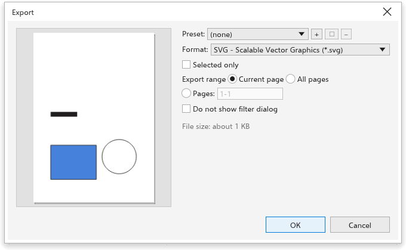

# Exporting

[[menu.file > menu.file.export]] (<kbd>Ctrl+E</kbd>) writes the drawing, a
page or the selection in another format. The Export dialog box shows a
preview on the left and the settings on the right.

## To export {#export}

1. Choose [[menu.file > menu.file.export]] (<kbd>Ctrl+E</kbd>, or the toolbar
   button).
2. In the **Save** dialog box, choose the folder, type the name and choose
   the format under **Save as type**. Every format is offered, the one you
   used last first; the extension of the name decides the format. The
   folder you exported to last is opened.
3. The Export dialog box opens with the options of that format, its title
   naming the file (such as "Export Poster.png"). Choosing a format brings
   back the settings you used for it last. Choose a **Preset** to start
   from saved choices, or another **format**: the file's extension changes
   with it. The common formats (JPG, PDF, AI, PNG) are first.
4. Set the format's options (below).
5. Tick **Selected only** to export only the selection, or **All pages** to
   export every page. For PDF and PostScript, All pages starts ticked;
   untick it to export the current page alone.
6. Click [[dialog.ok]] to write the file. [[dialog.cancel]] writes nothing.

In the browser, which has no Save dialog box, the Export dialog box comes
first and [[dialog.ok]] downloads the file; on Android, [[dialog.ok]] opens
the system's picker to choose where to save.

The dialog box estimates the size of the file and, for bitmap formats, says
what comes out, such as "1240 x 1754 pixels, 150 dpi, sRGB".

## Skipping the options {#skip}

Tick [[dialog.skip_export_dialog]] at the bottom of the Export dialog box
and click [[dialog.ok]]: the next exports write the file right after the
Save dialog box, with the options of the last export, and the status bar
says "Exported with the last options". To see the options again:

- hold <kbd>Shift</kbd> while choosing [[menu.file > menu.file.export]] or
  clicking the toolbar button, or choose
  [[menu.file > menu.file.export_with_options]] (<kbd>Ctrl+Shift+E</kbd>),
  and untick the box; or
- untick [[options.skip_export_dialog]] on the [[options.file_formats]] page
  of the global options (clicking the status bar's note opens it).

## Format options {#options}

| Format | Options |
|---|---|
| PNG, WebP, GIF | resolution (or the size in pixels), transparent background; WebP also quality |
| JPEG | resolution, quality (1 to 100) |
| BMP, TIFF, PSD | resolution |
| PDF | standard (PDF 1.4, PDF/X-1a, PDF/X-3 or PDF/X-4), bleed, output condition for PDF/X |
| PDF, AI | title and tags |
| SVG, EPS, AI, DXF, HTML, EMF, WMF, PLT, PS, PRN | none |

## Size of bitmaps {#size}

For bitmap formats, **Size** has a width, a height and their unit (px, mm,
cm or in); the other side follows the page's proportions.

- In pixels, typing a width or height sets the resolution that gives it, so
  you can type the size of an icon (32 x 32 pixels) directly.
- In a length, the size is the printed size: typing a width or height scales
  the artwork at the resolution you set, from 1 % to 10000 %. A button with
  the scale (such as "200 %") shows when it is not 100 % and puts it back.

PNG, JPEG and BMP files record their resolution, so they open at the size you
chose. PostScript and PRN files hold every exported page.

## Presets {#presets}

The **Preset** list holds every preset you saved, each with its format in
brackets, such as "Web PNG (PNG)". Choosing a preset of another format
switches the dialog to that format; changing the format leaves no preset
chosen. **+** saves the current choices under a name (the same name replaces
that preset), the pencil renames the chosen preset and **-** deletes it.

## Starting choices {#defaults}

The starting choices are set on the [[options.file_formats]] page of the
global options, where **Remember the settings of the last export** (on at
first) makes the dialog start with the format, resolution and quality of the
last export, in the next session too. [[menu.file.export_for]] has presets for the web and for
office documents; see [Exporting for the web](../web-graphics/export-for-web.md).
For PDF files with bookmarks and security, use
[Publishing to PDF](publish-pdf.md).
