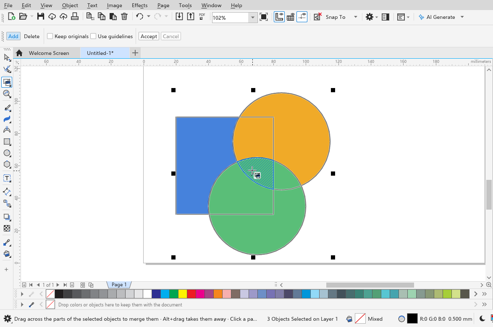
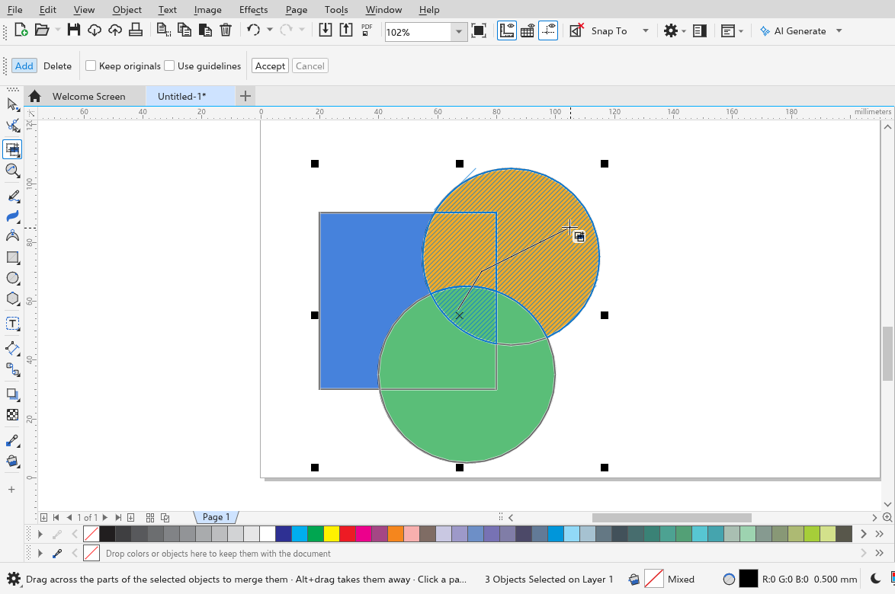
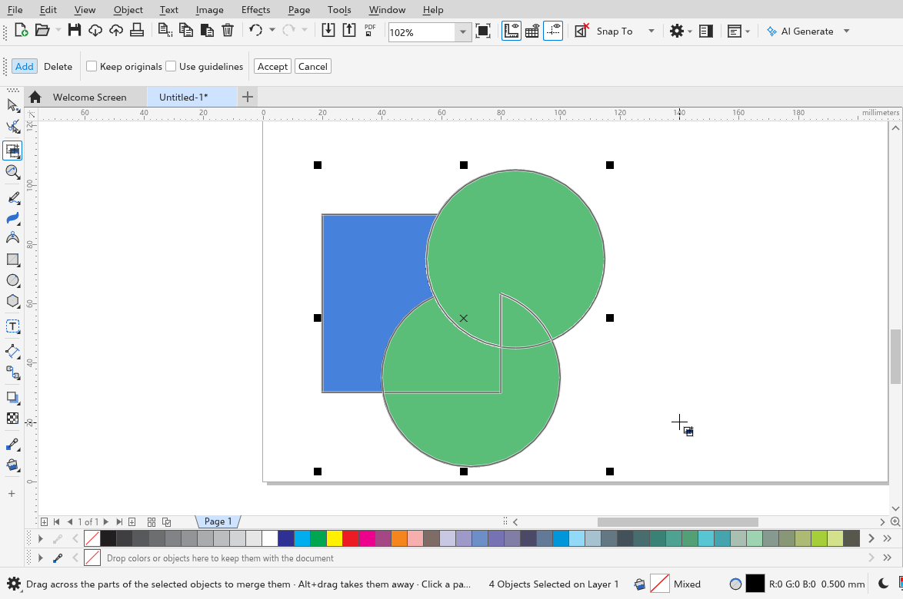

# Cropping, cutting and erasing

Four tools of the Crop flyout take parts of objects away: [[tool.crop]],
[[tool.knife]], [[tool.segment_delete]] and [[tool.eraser]]; the fifth,
[[tool.shape_builder]], merges or removes the parts overlapping objects
cut each other into. Each change is one undo step.

## Crop {#crop}

The [[tool.crop]] tool removes everything outside a rectangle.

1. Select the objects to crop, or select nothing to crop every unlocked
   object on the page.
2. Choose the [[tool.crop]] tool and drag the crop area. The drawing outside
   it is dimmed.
3. Adjust the area: drag inside it to move it, drag one of its eight handles
   to resize it, or type its position and size on the property bar.
4. Double-click inside the area, press <kbd>Enter</kbd> or click **Crop** on
   the property bar.

To give up, press <kbd>Esc</kbd>, click outside the area, click **Clear crop
area**, or choose another tool.

What happens to each object:

- objects wholly inside stay as they are, and objects wholly outside are
  deleted;
- closed shapes are cut to the area, and open curves are cut where they cross
  its edge; text becomes curves first;
- bitmaps, tables and symbols are placed inside a frame of the area, so their
  content stays whole and can be taken out again (see
  [Clip frames](../objects/clip-frames.md));
- groups are cropped member by member.

## Knife {#knife}

The [[tool.knife]] tool splits objects along a cut.

1. Select the objects to cut, or select nothing to cut every visible object
   on the page.
2. Choose the [[tool.knife]] tool and the kind of cut on the property bar:
   **Two-point line** (a straight cut that runs on across the objects) or
   **Freehand** (a cut that follows your drag).
3. Drag across the objects.

On the property bar, **Split** separates the pieces with a hairline gap, so
they still meet, and **Gap** removes a band of the width you type. With
**Keep as one object**, the pieces of each object stay one object made of
several parts. Open curves are split where the cut crosses them. Pieces keep
the fill, outline and transparency and are selected. Bitmaps, groups and text
are not cut.

## Segment Delete {#segment-delete}

The [[tool.segment_delete]] tool deletes the parts of outlines between the
places where they cross other outlines or themselves, for example the bits of
lines that stick out past a crossing.

- Click a part of an outline to delete it.
- Drag a rectangle across outlines to delete every part it touches, on all
  objects at once. Each part goes whole, up to the crossings at its ends, even
  where it reaches past the rectangle; a closed shape that nothing crosses goes
  whole.
- Choose **Freehand** on the property bar and drag a stroke across outlines:
  every part the stroke crosses is deleted, up to the crossings with other
  lines, in one step. Hold <kbd>Alt</kbd> as a drag starts to use the other
  way (stroke or rectangle) for that drag only.

Rectangles, ellipses and polygons become curves; a closed shape that loses a
part opens, and an object with nothing left is deleted.

## Eraser {#eraser}

The [[tool.eraser]] tool (<kbd>X</kbd>) rubs out parts of objects.

1. Select the objects to erase, or select nothing to erase the object you
   start dragging on.
2. Choose the [[tool.eraser]] tool. Set the **thickness** (6.35 mm at first)
   and the **round** or **square** nib on the property bar.
3. Drag over the objects. A click erases one dot.

Erased objects become curves; an object erased completely is deleted.
Double-click an object with the tool to delete it whole. A clip frame is
erased through its frame: the frame loses the band and the contents inside
are hidden along it, so the eraser cuts through the frame and its contents
together. Groups are not erased.

On a picture the eraser makes the pixels transparent along the nib, with a
soft edge: **Hardness** on the property bar is how much of the nib erases
fully before its edge fades out (0 % is all soft edge), and **Strength** how
much of each pixel it takes at most (100 % makes it fully transparent). Use a
wide, soft nib to fade a picture into the background. The defaults of the eraser are on the
[[tool.eraser]] page of the tool options; see
[Tool options](../customize/tool-options.md#eraser).

## Shape Builder {#shape-builder}

The [[tool.shape_builder]] tool builds a new shape out of the parts that
overlapping objects cut each other into, by dragging across them.

1. Select the overlapping objects (rectangles, ellipses, polygons and
   closed curves; a click with the tool selects when nothing is selected).
2. Choose the [[tool.shape_builder]] tool. The part under the pointer is
   hatched: a place inside the same objects and outside the others.
3. Drag across the parts you want as one object. Each part lights up as
   you cross it. When you let go, the parts become one new object with the
   fill and outline of the front object over the first part, and they are
   cut out of the objects they came from. An object left with nothing is
   deleted.

Hold <kbd>Alt</kbd> while you drag to take the parts away instead: they
are cut out and nothing new is made. A click on a part makes it an object
of its own. The objects stay selected, with the new one, so you can go on
building.

Parts about to be taken away (with <kbd>Alt</kbd> or in Delete mode) are
hatched in red; parts about to be merged in the selection colour. A selected
group works as the objects in it: they are cut where they are, in their
group, and the group stays selected.

Tick **Use guidelines** on the property bar to let the guidelines shown
on the page cut the objects into parts too, as if each were a line drawn
across them. The guidelines stay where they are. It is off by default.

