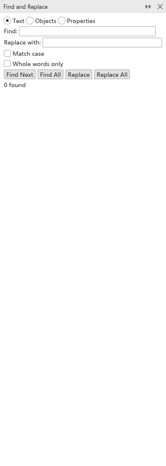

# Finding and replacing

The [[docker.find_replace]] panel (<kbd>Ctrl+F</kbd>) finds text in the
drawing, and replaces it, finds objects by name, or finds objects by their
fill, outline, outline width, font or type and replaces those. Open it with
[[menu.edit > menu.edit.find_and_replace]].

## Finding and replacing text {#text}

1. Choose [[dialog.find_text]].
2. Type what to look for in [[dialog.find]], and the new text in
   [[dialog.replace_with]].
3. Tick [[dialog.match_case]] to tell capitals from small letters, and
   [[dialog.whole_word]] to skip the text when it is part of a longer word.
4. Click [[dialog.find_next]] to select the next text object that holds it,
   or [[dialog.find_all]] to select them all.
5. Click [[dialog.replace]] to replace it in the selected text, or
   [[dialog.replace_all]] to replace it everywhere.

The panel says how many were found.

To find what cannot be typed in the field, right-click it and choose from
[[find.special_character]]: [[find.code_paragraph]] (`^p`),
[[menu.text.code_line_break]] (`^l`), [[find.code_tab]] (`^t`),
[[menu.text.code_nonbreaking_space]] (`^s`) and, in [[dialog.find]],
[[find.code_spaces]] (`^w`). The same codes work in [[dialog.replace_with]]:
for example, find `^w` and replace with `^w` to leave one space wherever
there were several, or find `^p` and replace with a space to join
paragraphs. Type `^^` for a caret. The right-click menu also has
[[menu.edit.cut]], [[menu.edit.copy]], [[menu.edit.paste]] and
[[menu.edit.select_all]].

## Finding objects {#objects}

Choose [[dialog.find_objects]], type part of a name, or a kind of object such
as "Rectangle", and click [[dialog.find_next]] or [[dialog.find_all]]. The
search covers the current page. To name objects, see
[Renaming objects and layers](objects-and-layers.md#rename).

## Finding and replacing by properties {#properties}

1. Choose [[find.properties]].
2. In [[find.look_in]], choose [[find.this_page]] or [[find.whole_drawing]].
3. Under [[find.find_objects_with]], tick what to look for: [[find.object_type]],
   [[find.fill]], [[find.outline]] (a colour, or [[find.none]]),
   [[find.outline_width]] or [[find.font]]. An object is found when it has
   everything ticked. [[find.from_selection]] takes these from the selected
   object, for example to find every object filled with its colour.
4. Click [[find.previous]] or [[dialog.find_next]] to select the objects one
   by one (on other pages too), or [[dialog.find_all]] to select those on
   this page.
5. To change them, tick under [[find.replace_with]] the new fill colour,
   outline colour, outline width or font, and click [[dialog.replace_all]].
   All the changes undo in one step.

A fill colour looked for is replaced wherever it is used, in gradients
too. Locked objects are left as they are.

A new font can go to every character, or with **Numbers only** only
to the numbers (to set the digits of a text in another font) or with
**Letters only** only to the letters. **Digits to 0-9** writes
the digits of other scripts, such as Arabic-Indic or Devanagari digits,
as 0 to 9 and leaves the letters alone.

For every option, how colors are compared and what each replacement does,
see [Finding and replacing by properties](find-by-properties.md).
