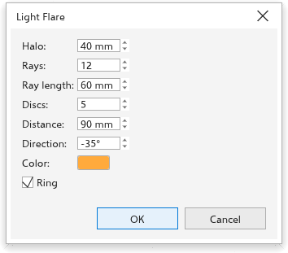
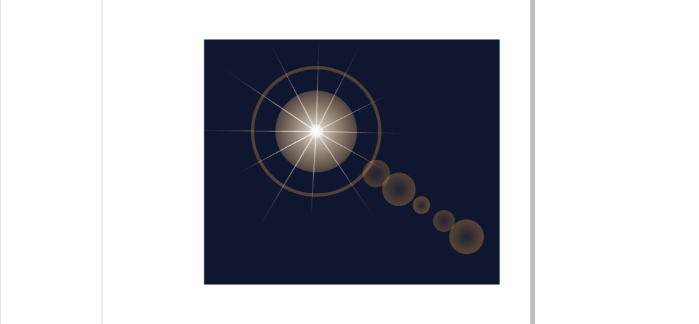

# Light flare

A light flare is the glow a bright light leaves on a picture: a halo, a
bright core, rays, a thin ring and a trail of faint discs. TraceDraw draws it
with vector objects, so it stays sharp at any size and prints like the rest of
the drawing.

## Inserting a flare {#insert}

Choose [[menu.object > menu.object.insert > menu.object.insert_flare]] to
open [[flare.title]]:

- [[flare.halo]] sets the diameter of the halo.
- [[flare.rays]] and [[flare.ray_length]] set how many rays leave the middle
  and how far the longest reach; 0 rays leaves them out.
- [[flare.discs]], [[flare.distance]] and [[flare.angle]] set the trail of
  faint discs: how many, how far from the middle the last one lies, and in
  which direction.
- [[flare.color]] tints the halo, the ring and the discs; the core and the
  rays stay white in the middle.
- [[flare.ring]] adds a thin ring round the halo.

Click OK. The flare comes in as one group in the middle of the page and
selected; move it onto the light in your picture. Each part is an ordinary
object with a see-through gradient, so you can ungroup the flare, recolour
a part, or move a disc on its own. The dialog keeps its settings for the
next flare.

