# Shape Generator

The [[docker.shape_generator]] panel draws patterns, line art, isometric
blocks and cone templates from a few settings, as ordinary curves you can
edit, recolor, cut or export. Open it from
[[menu.object > menu.object.create > menu.object.shape_generator]] or from
[[menu.window > menu.window.dockers]].

Pick a [[shapegen.kind]], change its settings and watch the preview under
them: it shows exactly what [[shapegen.create]] draws. The number under the
preview counts the curves.

## How to use it {#use}

**1.** Choose [[menu.object > menu.object.create > menu.object.shape_generator]].
The panel opens on the right.

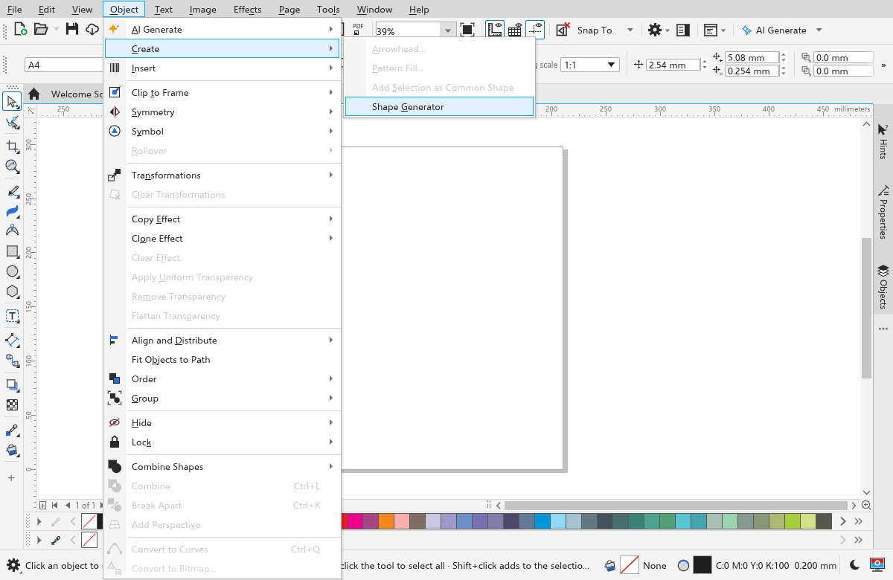

**2.** Open the [[shapegen.kind]] list at the top of the panel and pick what to
draw. The settings under it change with the generator.

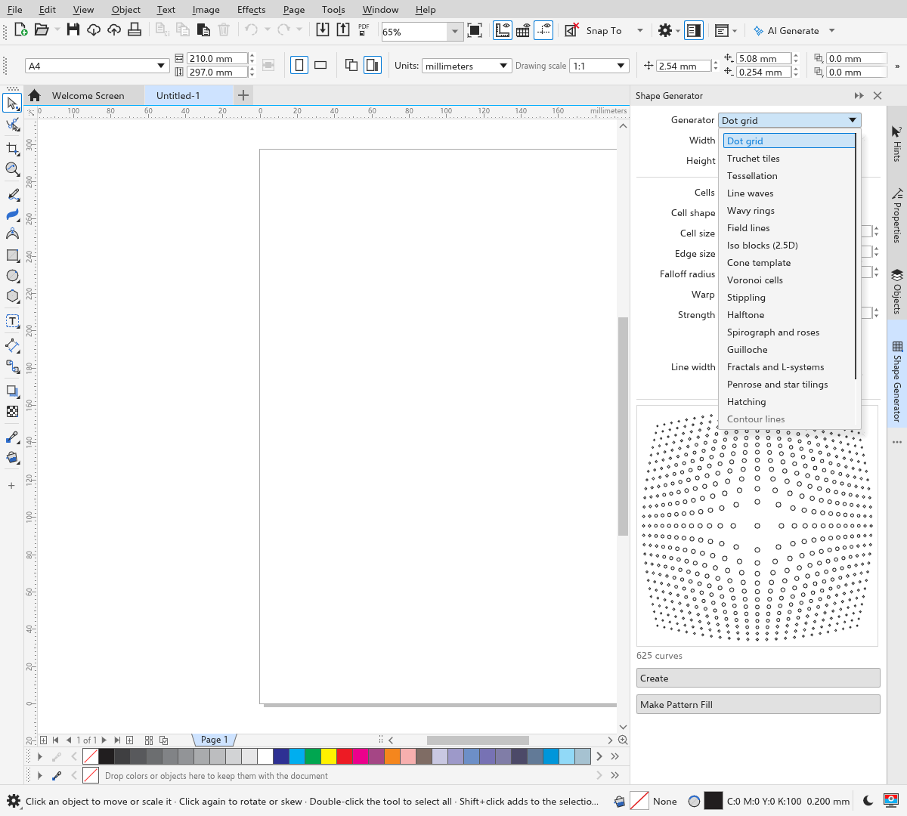

**3.** Change the settings. The preview under them shows the result at once;
here [[shapegen.cell_shape]] is set to [[shapegen.cell_square]]. Nothing
is drawn on the page yet.

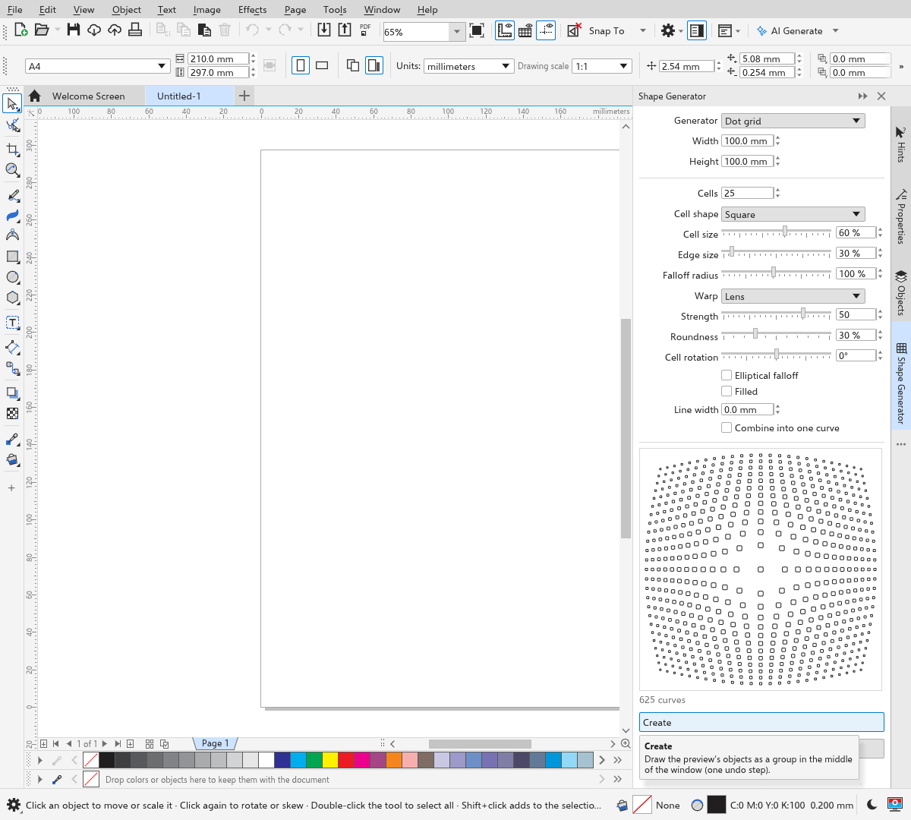

**4.** Click [[shapegen.create]]. The pattern comes in as one group in the middle
of the window, selected, made of ordinary curves.

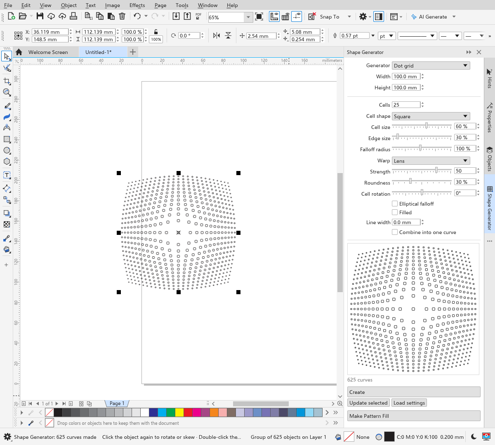

**5.** To change it later, select the group, change the settings and click
[[shapegen.update]]: the group is made again in the same place.
[[shapegen.load]] brings the group's settings back into the panel first.
Here the cells were changed to [[shapegen.cell_diamond]] and the preview
shows them before Update.

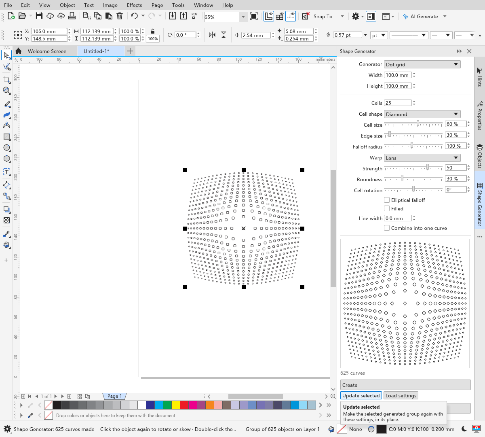

## The tool {#tool}

The [[tool.shape_generator]] tool, with the shape tools in the toolbox,
draws the panel's pattern where you want it and at the size you want:

- Choose the tool. The property bar has the [[shapegen.kind]] list, the
  [[shapegen.seed]] with [[shapegen.new_seed]] for another variation, and
  [[toolbar.shape_gen_options]], which opens the panel with every
  setting of the pattern.
- Drag on the page. The pattern itself follows the box while you drag,
  so you see what you get before letting go. <kbd>Ctrl</kbd> keeps the
  box square, <kbd>Shift</kbd> draws from the center.
- Let go: the pattern fills the box as one selected group, in one undo
  step. The panel takes the box's width and height, so changing a
  setting and clicking [[shapegen.update]] makes it again in place.

The tool always fills the dragged box: a selection picked in the panel
with [[shapegen.use_selection]] is used by [[shapegen.create]] only. A
cone template keeps its own size and is centered in the box.

## Generators {#generators}

Each picture shows the panel with the generator's first settings and, in the
drawing window, what [[shapegen.create]] made from them.

### [[shapegen.kind_dot_grid]] {#dot-grid}

A grid of circles, squares or diamonds whose size changes from the middle
to the [[shapegen.falloff]] edge ([[shapegen.scale_ratio]]), with a
[[shapegen.warp]] (a lens that pushes the cells out or pulls them in, or
ripples) and an optional [[shapegen.elliptical]].

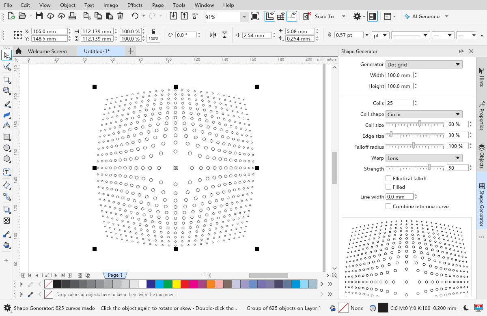

### [[shapegen.kind_truchet]] {#truchet}

Square tiles of quarter arcs (with one or more [[shapegen.bands]]), filled
quarter discs or diagonals, each turned at random. The edges of every tile
meet their neighbours, so the result repeats with no seam.

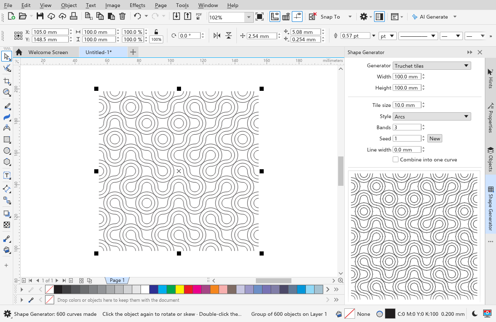

### [[shapegen.kind_tessellation]] {#tessellation}

Triangles, hexagons, scales or chevrons with a [[shapegen.gap]] and a
[[shapegen.rotation]].

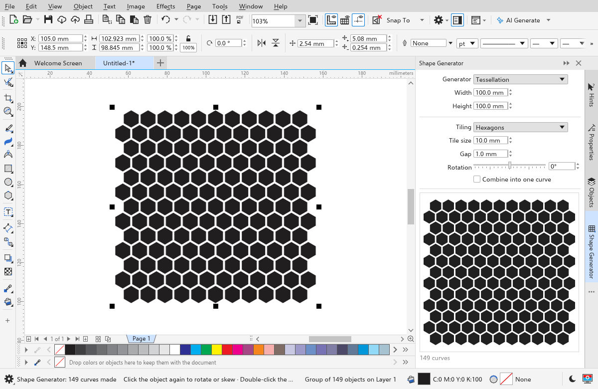

### [[shapegen.kind_line_waves]] {#line-waves}

Lines bent by a smooth noise inside a bump: [[shapegen.wave_width]],
[[shapegen.amplitude]], [[shapegen.noise_x]], [[shapegen.noise_y]],
[[shapegen.spread]], [[shapegen.sharpness]], [[shapegen.fade]] and
[[shapegen.softness]].

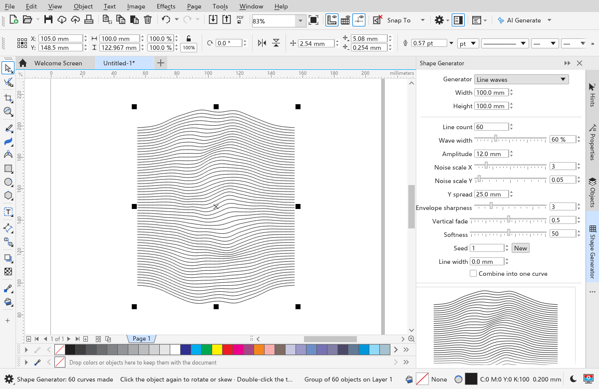

### [[shapegen.kind_rings]] {#rings}

Closed rings between [[shapegen.min_radius]] and [[shapegen.max_radius]],
each wobbled by a noise that goes once round.

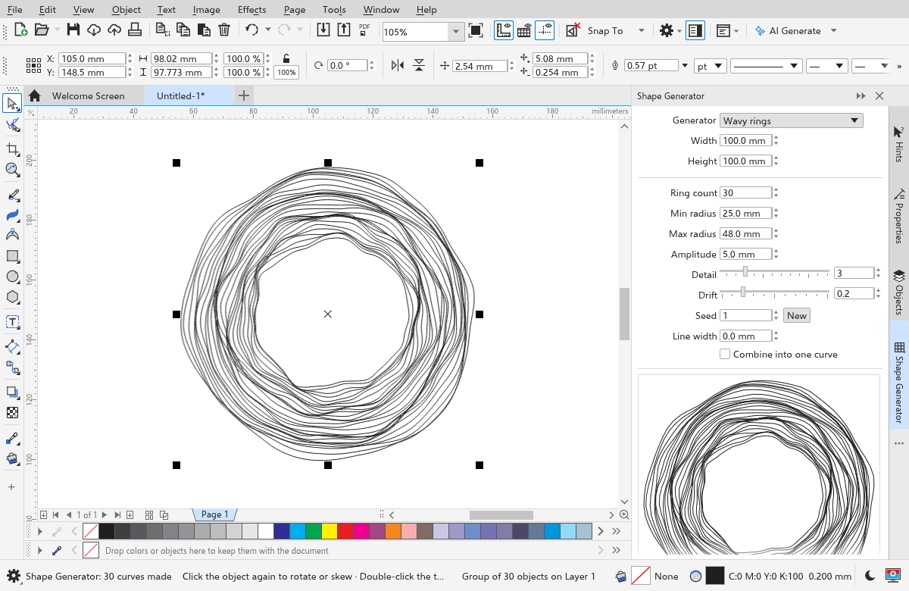

### [[shapegen.kind_field_lines]] {#field-lines}

Evenly spaced lines that flow round a few [[shapegen.poles]], with a
[[shapegen.flow]] across the area and an optional [[shapegen.swirl]].

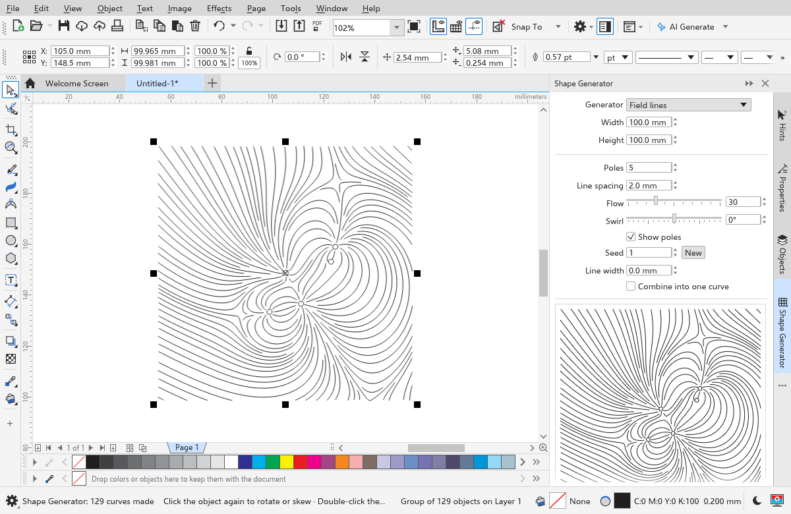

### [[shapegen.kind_iso_blocks]] {#iso-blocks}

Stacks of cubes on an isometric grid, their heights flat, random, a pyramid
or a wave, with three shaded faces.

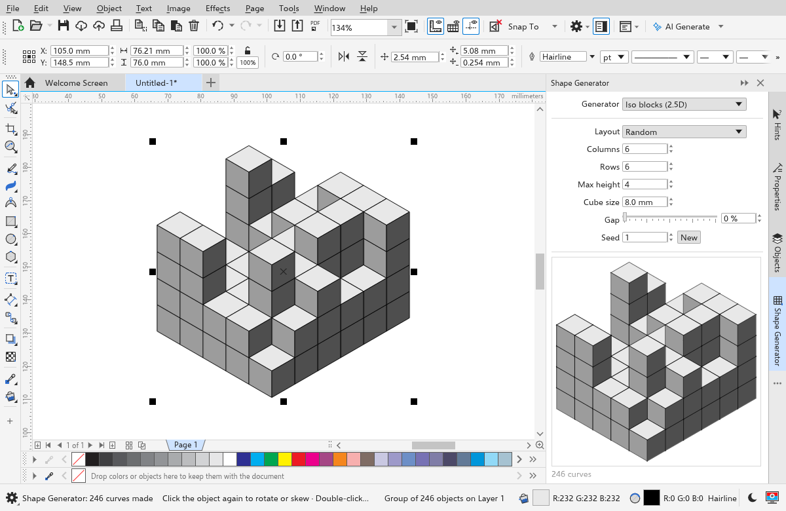

### [[shapegen.kind_spirograph]] {#spirograph}

A wheel rolling inside or outside a ring ([[shapegen.spiro_fixed]],
[[shapegen.spiro_rolling]], [[shapegen.spiro_pen]]), Lissajous figures,
roses and mandalas.

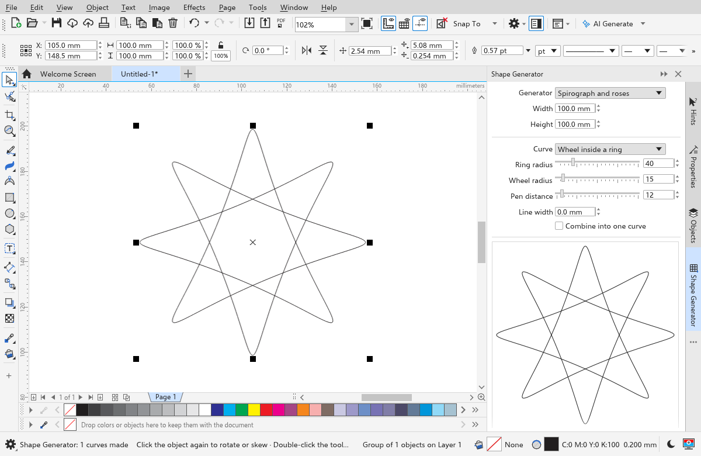

### [[shapegen.kind_guilloche]] {#guilloche}

Rings bent by two waves, each turned by the [[shapegen.guil_twist]] so the
lines weave, as on banknotes.

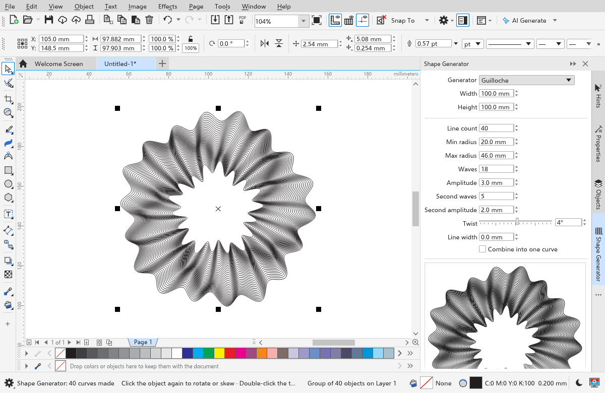

### [[shapegen.kind_tiling]] {#tiling}

Penrose rhombs, which never repeat, and star patterns on squares or hexagons
shaped by the [[shapegen.tile_angle]].

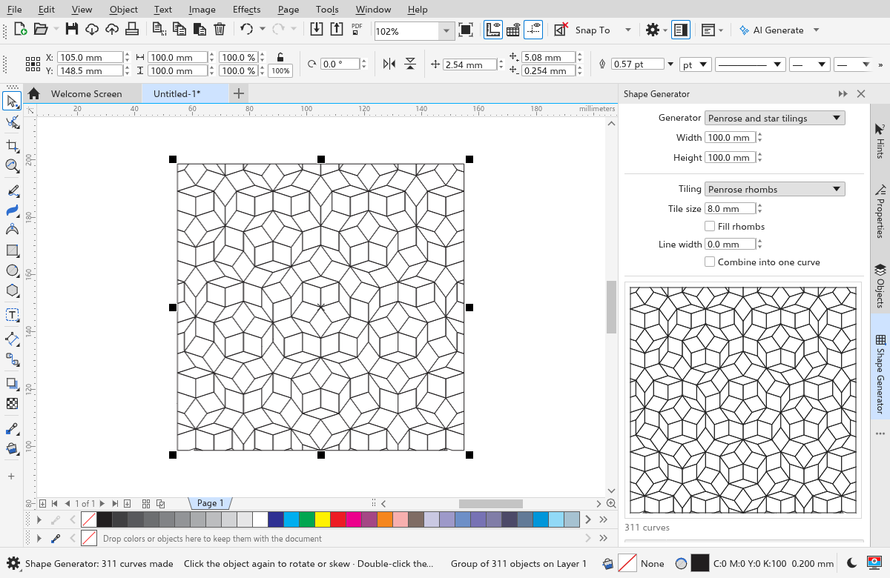

### The other generators {#other-generators}

- [[shapegen.kind_cone]]: the flat template of a cone, a tapered cylinder or
  a cylinder, see [Cone templates](#cone).
- [[shapegen.kind_voronoi]]: cells round scattered sites, see
  [Voronoi cells](#voronoi).
- [[shapegen.kind_stipple]] and [[shapegen.kind_halftone]]: dots and marks
  sized by a picture's tones, see [Pictures as dots](#tones).
- [[shapegen.kind_fractal]]: a branching tree, the Koch snowflake, the
  Sierpinski arrowhead, the dragon curve, a plant or your own L-system,
  see [L-systems](#lsystems).
- [[shapegen.kind_hatch]], [[shapegen.kind_contour]], [[shapegen.kind_maze]]
  and [[shapegen.kind_space_curve]]: lines that fill a shape, see
  [Filling a shape](#fills).
- [[shapegen.kind_slice]]: cuts the selection into strips or a grid and
  moves each piece, see [Slicing a selection](#slice).
- [[shapegen.kind_layer_waves]], [[shapegen.kind_blobs]] and
  [[shapegen.kind_soft_gradient]]: filled backgrounds in the colours you
  choose, see [Backgrounds](#backgrounds).

Generators that make random choices have a [[shapegen.seed]]: the same seed
always gives the same result, and [[shapegen.new_seed]] picks another one.

## Creating and changing {#create}

- [[shapegen.create]] draws the objects as one group in the middle of the
  window. One undo removes it.
- The group keeps its settings. Select it and click [[shapegen.update]] to
  make it again with the panel's settings in the same place, or
  [[shapegen.load]] to bring its settings back into the panel.
- [[shapegen.combine]] makes one curve per color instead of a group of
  separate curves, lighter for large patterns.
- [[shapegen.make_pattern]] creates the objects and turns them into a
  vector pattern fill.

The settings are kept between sessions. One generation makes at most
40,000 curves; past that it is cut and the panel says so.

## Cone templates {#cone}

Type the object's [[shapegen.cone_top]], [[shapegen.cone_bottom]] and
[[shapegen.cone_height]]. The template is a ring segment (a sector when one
diameter is 0, a rectangle when both are the same) at real size, with a
[[shapegen.cone_tab]] on one side and an optional [[shapegen.cone_bleed]]
outline. [[shapegen.cone_pieces]] cuts it into several pieces, each with its
own tab. The panel shows the slant height, the radii and the angle.

To put a design on the object, draw it flat as a strip and select it, then
click [[shapegen.wrap]]: the template is drawn and the strip is bent onto
it, its width going round the object [[shapegen.cone_repeat]] times and its
top along the top edge, so it rolls up straight on the real object.

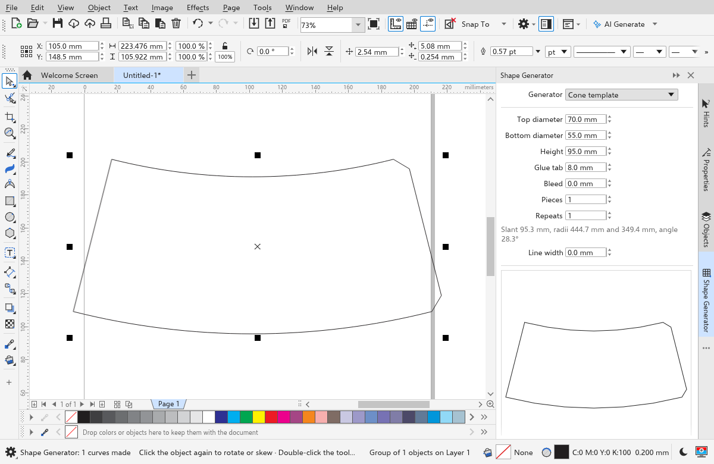

## Voronoi cells {#voronoi}

Each cell holds the part of the area nearer to its site than to any other.
Place the sites with [[shapegen.points]] and [[shapegen.spacing]] (grid
sites move by the [[shapegen.jitter]]), then even the cells out with
[[shapegen.relax]] steps or the [[shapegen.relax_once]] button. A
[[shapegen.gradient]] makes the cells smaller toward the middle or along a
direction. For cutting, [[shapegen.inset]] leaves a gap between cells and
[[shapegen.corner_radius]] rounds them. [[shapegen.show_cells]],
[[shapegen.show_sites]] and [[shapegen.show_delaunay]] choose what is drawn.

Edit the sites right in the preview: drag one to move it and watch its
neighbours follow, double-click to add one, right-click one to delete it.
Sites placed by hand are kept with the settings; [[shapegen.reset_points]]
goes back to generated ones.

To fill a shape, select it and click [[shapegen.use_selection]]: the cells
fill its outline and its holes stay empty, and Create puts the result over
it.

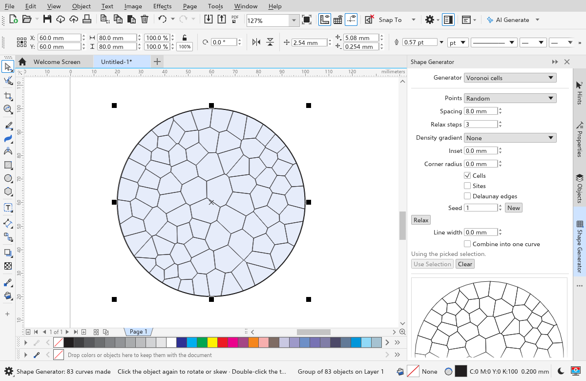

## Pictures as dots {#tones}

Select a picture or any objects and click [[shapegen.use_selection]]: the
selection is drawn to a picture whose darkness sizes the marks, and marks
stay inside its outline. Without a selection a round ramp stands in.

- [[shapegen.kind_stipple]] spreads [[shapegen.dots]] by darkness and
  spaces them evenly over [[shapegen.st_iter]] steps; with
  [[shapegen.st_by_tone]] dark places get bigger dots.
- [[shapegen.kind_halftone]] puts a [[shapegen.ht_shape]] in every
  [[shapegen.ht_cell]] of a screen turned by [[shapegen.ht_angle]], sized
  between [[shapegen.ht_min]] and [[shapegen.ht_max]]; Lines draws bands
  that thicken where it is dark. [[shapegen.ht_cmyk]] makes four screens,
  one per ink, each in its own group.

[[shapegen.invert]] puts the marks in the light places instead.

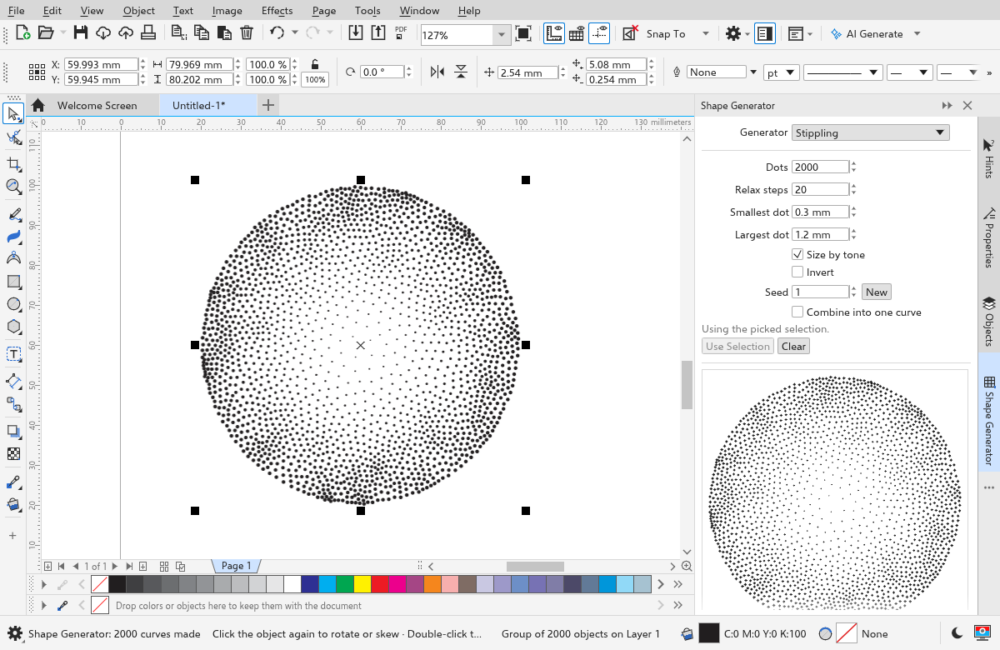

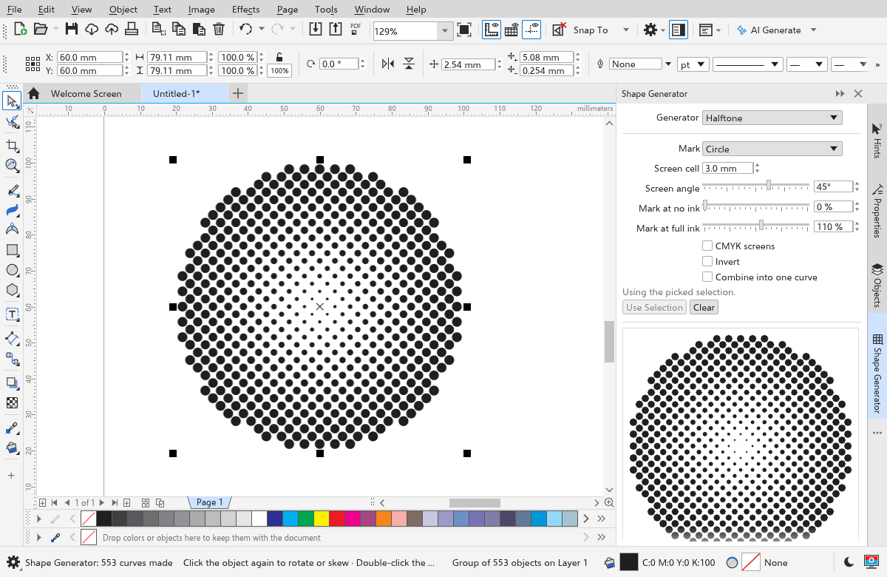

## L-systems {#lsystems}

An L-system starts from the [[shapegen.frac_axiom]] and replaces every
symbol by its rule, once per level. The result is drawn by a turtle: F, G,
A and B draw a step, f moves without drawing, + and - turn by the angle,
[ and ] keep and come back to a place (for branches), | turns round. Write
the [[shapegen.frac_rules]] as `F=F+F--F+F`, one per line or separated by
semicolons. [[shapegen.frac_edit]] copies a built-in fractal into a
custom one to change it. Very deep levels stop growing at 400,000
symbols.

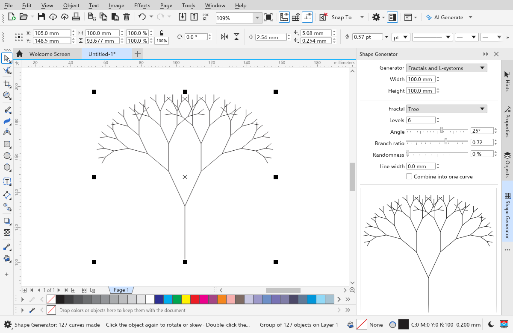

## Filling a shape {#fills}

These fill the box, or the outline picked with [[shapegen.use_selection]]
with its holes left empty; Create puts the result over the selection.

- [[shapegen.kind_hatch]]: lines [[shapegen.hatch_spacing]] apart at an
  [[shapegen.hatch_angle]], cut exactly at the outline. Crossed adds a
  second set turned by the [[shapegen.hatch_cross]]. By tone draws
  [[shapegen.hatch_layers]] sets at different angles, each only where the
  picked picture is darker, so shading builds up as in a pen drawing.
- [[shapegen.kind_contour]]: rings [[shapegen.contour_spacing]] apart, offset
  inward from the outline until no room is left, or lines that follow the
  picture's tones at a number of [[shapegen.contour_levels]], like the
  height lines of a map.
- [[shapegen.kind_maze]]: a maze with exactly one way between any two
  cells, its passages [[shapegen.maze_cell]] wide. Draw its walls, with an
  entrance at the bottom and an exit at the top, or its passages as one
  line through the cells (good for a single stroke on a plotter or laser).
  [[shapegen.new_seed]] makes another maze.
- [[shapegen.kind_space_curve]]: one line that winds through every cell of
  a grid without crossing itself. Each [[shapegen.curve_order]] makes it
  finer; inside an outline it breaks where it leaves the shape.

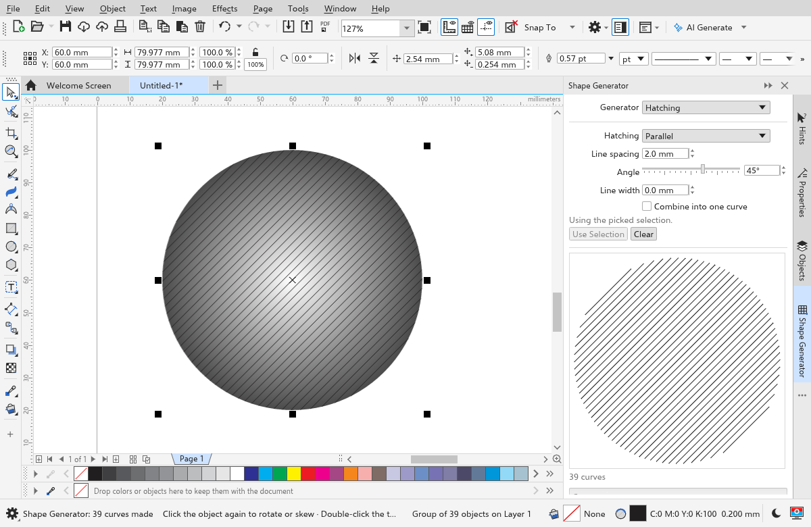

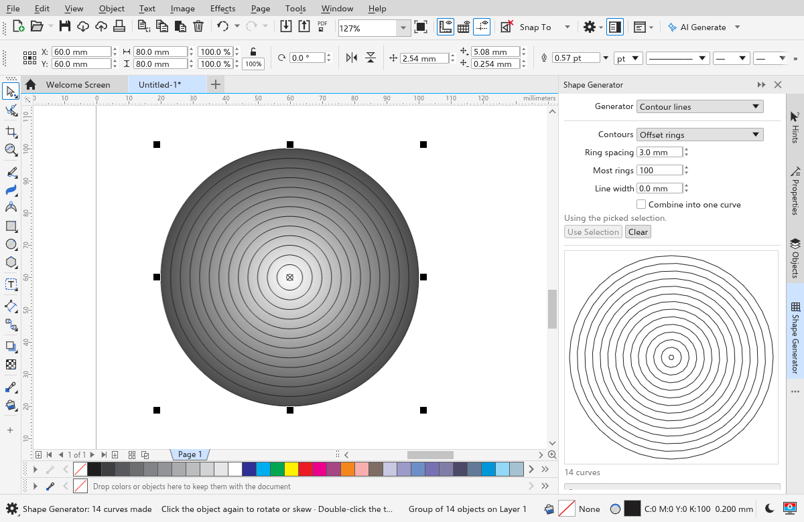

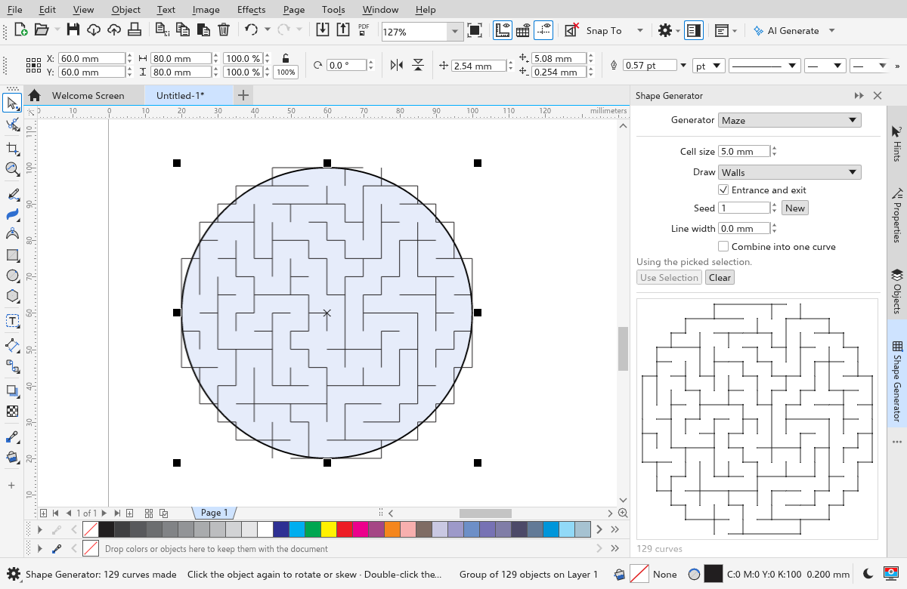

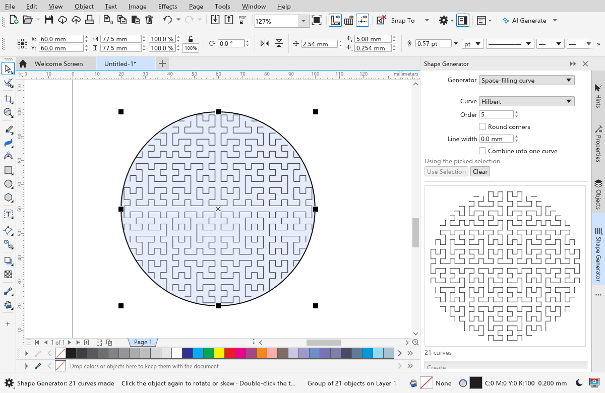

## Slicing a selection {#slice}

Select objects, text or pictures, choose how to [[shapegen.slice_layout]]
(rows, columns or a grid) and the [[shapegen.slice_pattern]], then click
[[shapegen.slice_apply]]. Each piece moves by up to
[[shapegen.slice_dx]] and [[shapegen.slice_dy]]: at random, along a wave,
from one side to the other, or every other piece each way. A
[[shapegen.slice_gap]] leaves space between the pieces. The preview shows
the cells as they will move.

Every piece is a clip frame holding a copy of the selection, so text stays
editable text and pictures keep their pixels; the pieces come in one
group, and [[shapegen.slice_keep]] leaves the original in place.

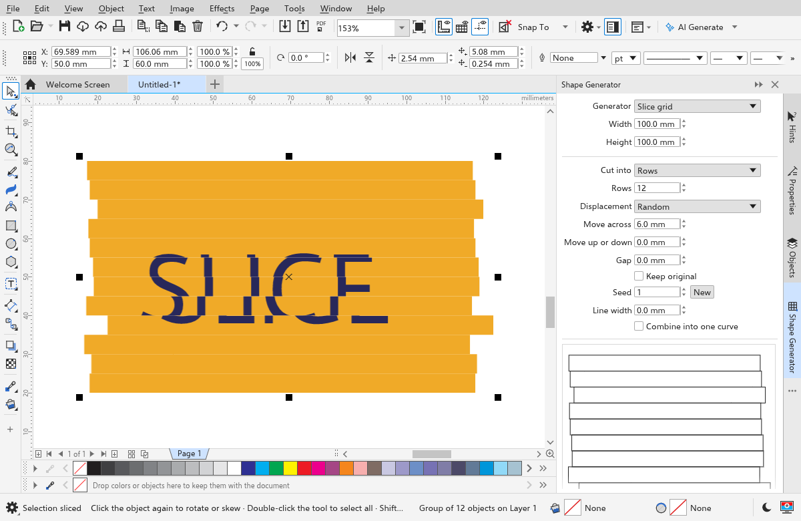

## Differential growth {#growth}

A line that grows and folds inside the box, or inside the selection's
outline after [[shapegen.use_selection]]. Choose what to
[[shapegen.growth_start]] (a circle, an open line or several circles), the
[[shapegen.growth_spacing]] between its points, how strongly they push
apart ([[shapegen.growth_repel]]) and line up ([[shapegen.growth_align]]),
and the [[shapegen.growth_rate]].

Click [[shapegen.growth_run]] to watch it grow in the preview, or press
Space with the pointer over the panel; press it again to pause. It stops
by itself when the space is full or the [[shapegen.growth_max_nodes]] is
reached. [[shapegen.growth_stop]] (Shift+Space) puts it on the page as
curves. [[shapegen.growth_steps]] follows the growth, and the same steps
always grow the same line, so a paused growth can be stepped by hand and
Update makes a group again exactly.

## Deform and split by a shape {#deform}

Open [[shapegen.deform]] and drag in the preview to add a pin and pull the
drawing with it: the lines near the pin follow, fading out over the
[[shapegen.warp_reach]], so rings and waves bend smoothly like a
fingerprint. Drag a pin's end to change its pull or its start to move it,
right-click it to remove it, and [[shapegen.warp_clear]] removes them all.

[[shapegen.split_mode]] cuts the lines where they cross a shape or text:
select it, click [[shapegen.split_pick]], and choose to draw the parts
inside in the [[shapegen.split_color]] and [[shapegen.split_width]], or to
keep only the parts inside or outside. Create centres the drawing on the
picked shape, and the pieces stay open lines.

## Backgrounds {#backgrounds}

Three generators make filled backgrounds the size of the box, in the
[[shapegen.bg_colors]] you choose (add colours with +, remove the last
with the minus button). Each [[shapegen.seed]] gives another variation.

- [[shapegen.kind_layer_waves]]: [[shapegen.bg_layers]] filled bands
  stacked from the back to the front; the back one, in the first colour,
  fills the box. Their edges are smooth waves: [[shapegen.bg_amplitude]] sets how high they
  go, [[shapegen.bg_frequency]] how many run across, [[shapegen.bg_complexity]]
  how lively their edges are, and [[shapegen.bg_side]] whether they rise from the bottom or hang from
  the top.
- [[shapegen.kind_blobs]]: soft organic shapes. One blob sits in the
  middle; with more [[shapegen.bg_blob_count]] they are scattered over the
  box in the palette's colours. [[shapegen.bg_blob_points]] and
  [[shapegen.bg_randomness]] set how lumpy they are.
- [[shapegen.kind_soft_gradient]]: one rectangle with a smooth mesh fill
  whose points take the palette's colours at random, so the colours melt
  into each other. [[shapegen.bg_mesh_size]] sets how many patches of
  colour there are and [[shapegen.bg_jitter]] how freely they flow.

The waves and blobs are ordinary filled curves and the gradient is an
ordinary mesh fill, so they can be edited, recoloured and exported like
any other object; add grain or blur with the effects if you like.
