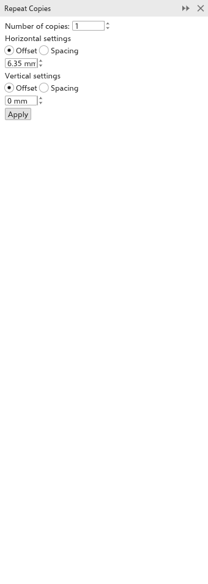

# Making copies with Repeat Copies

The [[docker.step_and_repeat]] panel makes several copies of the selection,
each moved by the same distance from the one before: a row of buttons, a
column of lines, a grid of tiles. Open it with
[[menu.edit > menu.edit.step_and_repeat]] (<kbd>Ctrl+Shift+D</kbd>).

## To make copies {#copies}

1. Select the objects to copy.
2. Set the number of [[docker.copies]] (1 to 999).
3. Under [[docker.horizontal_settings]], choose how the copies are spaced
   across:
   - [[docker.offset]]: the distance from one copy to the next, measured from
     the same point of each;
   - [[docker.spacing]]: the gap between one copy and the next, so the copies
     never overlap whatever their size.

   Then type the distance. 0 keeps the copies in line.
4. Do the same under [[docker.vertical_settings]].
5. Click [[docker.apply]].

While you work in the panel (the pointer is on it, you are typing in one of
its fields, or your last click was in it) the copies [[docker.apply]] would
make are outlined on the page, dashed in blue, and follow each value as you
change it. Nothing is added until you click [[docker.apply]], and one
[[menu.edit.undo]] takes all the copies away again. A click elsewhere, or
closing or hiding the panel, takes the outlines away. Very many copies of a
detailed object are outlined as their boxes.

The copies are added to the active layer and selected. Distances are in the
drawing units.

The values stay as you typed them: after an Apply (the copies it made are
selected) and for the next objects you select, the panel keeps the same
number of copies, distances and modes until you change them. With nothing
selected the fields wait, keeping their values. A new session starts from
one copy, 6.35 mm across and 0 down.

## To fill the page {#fill-page}

[[docker.sr_mode_fill]] tiles the selection over the page in a grid, as
many copies as fit: labels, stickers, business cards and tags printed
together on one sheet.

1. Select the object (or objects) to repeat.
2. At the top of the panel choose [[docker.sr_mode_fill]]. The panel shows
   the page size.
3. Choose to fill the [[docker.fillpage_area_page]], or an
   [[docker.fillpage_area_custom]] of it set by its left and bottom edge,
   width and height.
4. Set the [[docker.fillpage_margins]] kept clear inside the edges (one
   value for all sides, or clear [[docker.fillpage_same]] to set each
   side), and the [[docker.fillpage_gap]] between the copies (one value,
   or [[docker.fillpage_gap_x]] and [[docker.fillpage_gap_y]]).
5. For staggered rows, set [[docker.fillpage_row_shift]].
6. Under [[docker.fillpage_turn]], each choice shows how many copies fit,
   for example "4 x 6 = 24 copies". Choose
   [[docker.fillpage_as_is]], [[docker.fillpage_turned]], or
   [[docker.fillpage_best]].
7. Tick [[docker.fillpage_marks]] for marks at every cut line outside the
   copies, and set their length and distance.
8. Click [[docker.apply]].

The selection moves to the first place of the grid and copies fill the
others, centred in the room inside the margins; one [[menu.edit.undo]]
puts everything back. While you work in the panel, every place is
outlined on the page.

To copy with a rotation or a scale at each step, use the [[dialog.copies]]
field of the [[docker.transformations]] panel; see
[Moving, scaling, rotating and skewing](transforming.md#transformations-docker).
