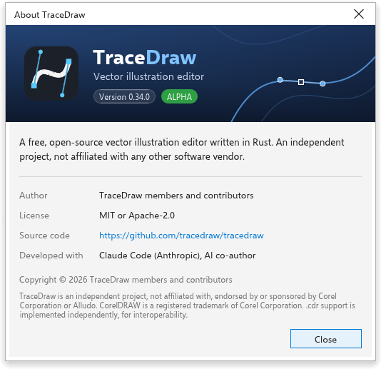

# About TraceDraw and updates

TraceDraw is free and open source. This page explains how to see which
version you have, how to get a newer one, and where to ask for help.

## The About box {#about}

Choose [[menu.help > menu.help.about]] to see the version you are running,
the author, the license, a link to the source code and what the program is
built with. Press [[dialog.close]], <kbd>Enter</kbd> or <kbd>Esc</kbd> to
close it.

## Checking for updates {#updates}

On the desktop, TraceDraw can tell you when a newer version is released.

To check now:

1. Choose [[menu.help > menu.help.updates]].
2. TraceDraw asks the project's release page for the latest version and
   says whether it is newer than yours. Test builds and nightly builds are
   never offered.
3. When a newer version exists, choose what to do:
   - **Download** opens the download of the file for your system (the
     installer or the portable archive on Windows, the disk image for your
     Mac's processor, the AppImage or the archive on Linux). Your system's
     installer then does the installing.
   - **Release notes** opens the list of changes of that version.
   - **Skip this version** stops offering that version.
   - [[dialog.close]] closes the box.

When a newer version is known, a card opens in the middle of the window when
TraceDraw starts, with the two version numbers and **Update now**, so you can
update without opening the menu. **What's new** opens the release notes and
**Dismiss** closes the card until the next start. Nothing is downloaded until
you choose Update now. Once you do, the card shows the same steps as the
Updating TraceDraw window described below, with **Cancel** while the file
downloads and **Restart Now** when the update is ready.

When your copy can update itself, the box also offers **Install**, so you do
not have to uninstall anything first. That is the case for every copy that has
a download: the Windows installer and portable zip, the Mac app, and the Linux
AppImage, archive and `.deb`.

Install opens the **Updating TraceDraw** window, which shows the two version
numbers and each step as it happens:

1. **Downloading**: a bar fills up with the percentage done, and the line
   under it gives the megabytes downloaded, the speed and, once it can be
   estimated, about how long is left. **Cancel** stops the download at once
   and deletes what was downloaded; nothing is changed. Closing the window
   lets the download go on, and the update card shows its progress.
2. **Checking the download**: TraceDraw makes sure the file is complete and
   genuine (its SHA-256 digest must match the release's).
3. **Installing**: the new version is put in place. This step cannot be
   cancelled half way.

When it is done, a green check mark says **TraceDraw is ready**, with
**Restart Now** and **Later**:

- on the **Windows installer**, Restart Now closes TraceDraw (asking about
  drawings with unsaved changes), the installer runs over this copy and keeps
  your settings and file associations, and the new version starts by itself;
- on the **Windows portable zip**, the program and its files were replaced in
  place, the settings folder untouched; Restart Now opens the new version;
- on a **Linux `.deb`**, Restart Now closes TraceDraw, the system asks for
  your administrator password, installs the package and TraceDraw starts
  again (the old version starts if you cancel the password);
- on a **Linux archive** (tar.gz), the program was replaced in place; Restart
  Now opens the new version;
- on a **Mac**, the TraceDraw app was replaced in place; Restart Now opens the
  new version;
- on a **Linux AppImage**, the new file took the place of the old one;
  Restart Now opens the new version.

Choose **Later** to keep working: the new version then runs the next time you
open TraceDraw (on Windows, the downloaded installer is not run until you
choose Restart Now; on a `.deb`, the downloaded package is not installed
until then). If anything goes wrong, the old version stays as it was and the
window says what happened in plain words (for example that the download
server could not be reached, or that the download was damaged), with
**Try Again** and **Download from the website**. Copies without a download
(other system packages, Flatpak, Snap) keep **Download**.

If the check fails (for example without an internet connection), the box
says so and offers the releases page.

### Checking automatically {#automatic-check}

[[menu.tools > menu.tools.options > menu.tools.options_global]], page
[[options.general]], has a setting to check for updates at start. It
is on at first: once a day, TraceDraw checks quietly when it starts and only
speaks up when a newer version that you have not skipped is out.

The first time TraceDraw starts, it asks whether to check for updates: [[updates.policy_always]] or [[updates.policy_never]]. Until you answer, TraceDraw makes no connection on its own. The answer sets this option, so you can change it here at any time.

> **Note:** The browser version is always the latest one. There,
> [[menu.help > menu.help.updates]] opens the releases page.

The copy installed from the Microsoft Store and the Android app are updated by
their store: they never check GitHub, [[menu.help > menu.help.updates]] opens
their store page, and the options have no update check. Every other
installation downloads the file made for its processor and for how it was
installed (installer, portable zip, AppImage, `.deb`, archive or disk
image).

## The Welcome Screen {#welcome-screen}

The Welcome Screen is the first tab when TraceDraw starts. From it you can
create a drawing, open one of the drawings you used last (each shown with a
thumbnail; [[menu.file.clear_recent]] forgets them), start from a template,
read the news and find learning material. When a page is taller than the
window (a long list of recent drawings), it scrolls with the mouse wheel or
its scroll bar; the row of tabs at the top stays in place. Choose
[[menu.help > menu.help.welcome_screen]] to bring it back.
[[menu.help > menu.help.video_tutorials]], [[menu.help.quick_start_guide]]
and [[menu.help.user_guide]] open its learning page, and
[[menu.help.whats_new]] its news.

## Community and support {#community}

- [[menu.help > menu.help.community]] opens the project's discussion forum,
  where you can ask questions and share ideas.
- [[menu.help > menu.help.support]] opens the issue tracker, where you can
  report a problem.
- [[menu.help > menu.help.message_settings]] opens the options where
  TraceDraw's messages are set.
