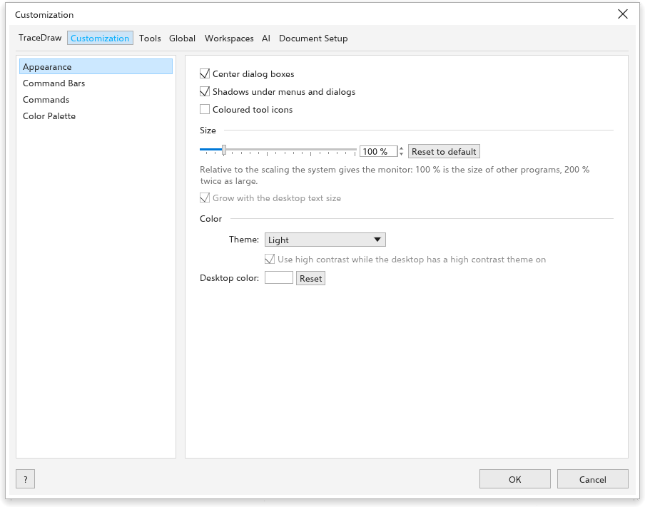
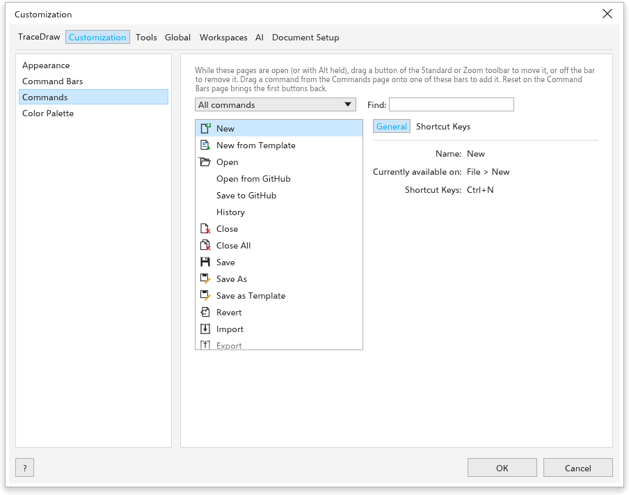
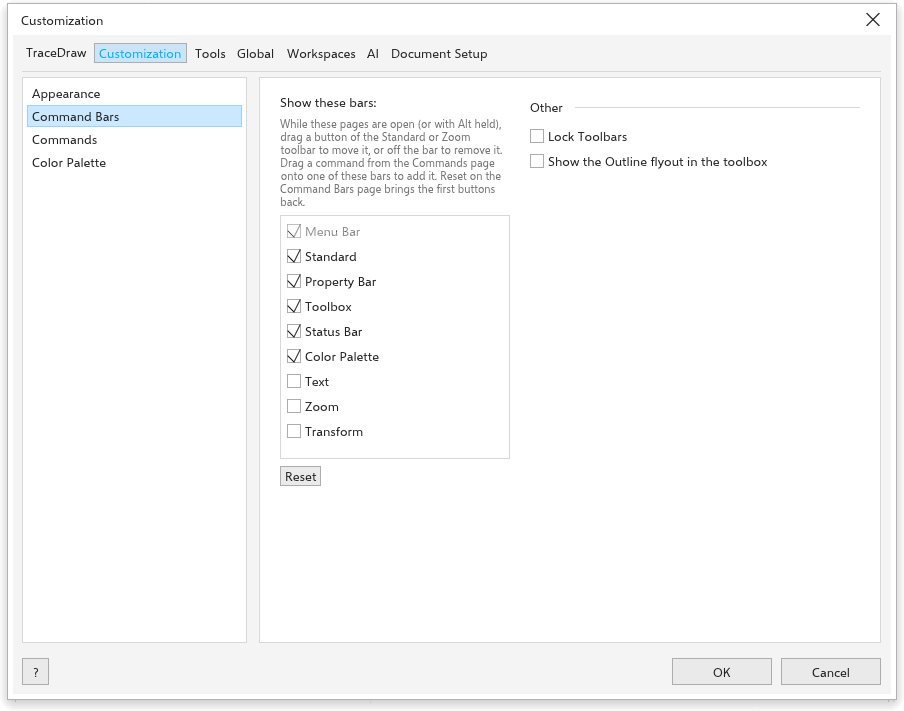
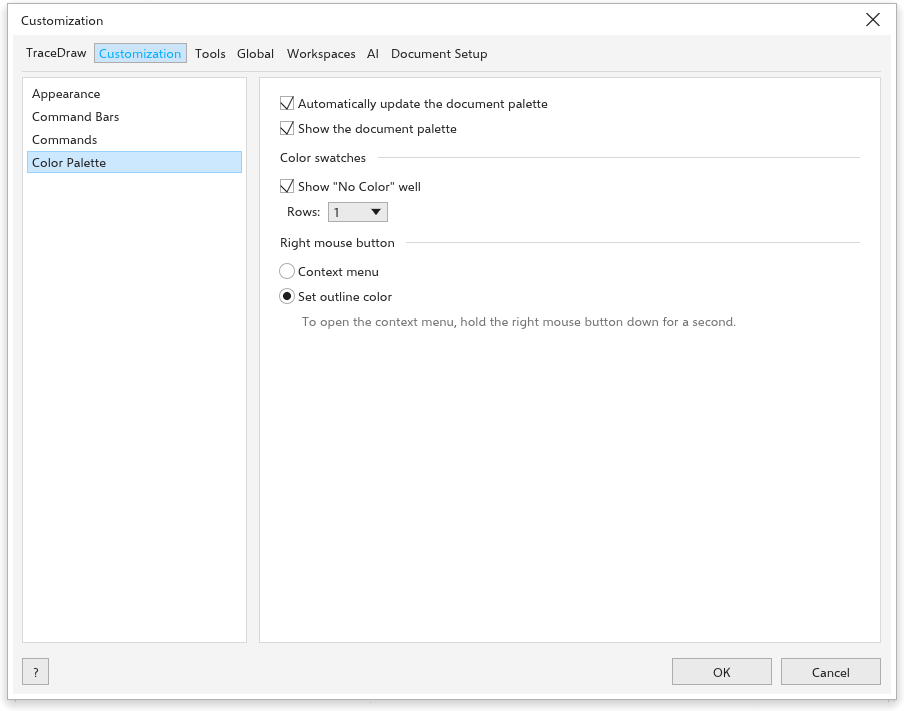

# Options de personnalisation

> *Traduction automatique : cette page peut être en retard sur la version anglaise.*

[[menu.tools > menu.tools.options > menu.tools.options_customization]] règle
l'apparence de l'interface, vos propres raccourcis clavier, les barres
affichées et le comportement de la palette de couleurs.

## Apparence {#appearance}

- [[options.center_dialogs]] : les boîtes de dialogue s'ouvrent au milieu de
  la fenêtre ; désactivé, elles s'ouvrent là où vous les avez laissées.
- [[options.ui_shadows]] (moins d'ombres aide les cartes graphiques lentes).
- [[options.translucent_menus]]: open menus let the drawing show through them, at the [[options.menu_opacity]] beside the box (off by default).
- [[options.colored_icons]] : chaque groupe d'outils reçoit sa propre
  couleur.
- [[options.docker_tabs_icons_only]] : les onglets des panneaux sur les
  côtés de la fenêtre n'affichent que leur image, le nom dans l'info-bulle.
  Désactivé, ils affichent l'image et le nom, et une colonne qui a plus
  d'onglets que de place défile.
- [[options.ui_size]] : la taille des menus, des barres, des icônes et des
  panneaux, par rapport à la mise à l'échelle que votre système donne à
  l'écran (100 % au départ). [[options.reset_to_default]] revient à 100 %.
  La taille de l'interface ne change jamais la taille de votre dessin.
  [[options.follow_text_size]] la fait grandir avec la taille du texte du
  bureau.
- [[options.color_section]] : le [[options.theme]] (Clair, Moyen clair,
  Moyen sombre, Sombre ou Contraste élevé), [[options.follow_high_contrast]],
  et la [[options.desktop_color]] autour de la page. Le bouton à l'extrémité
  droite de la barre d'état bascule entre clair et sombre.

## Commandes {#commands}

La page liste toutes les commandes des menus, avec leur raccourci, ainsi que
les touches des outils. Tapez dans [[options.find_command]] pour filtrer la
liste.

Pour donner votre propre raccourci à une commande :

1. Cliquez sur le bouton de raccourci de la commande.
2. Appuyez sur les touches, par exemple <kbd>Ctrl+Alt+K</kbd>. <kbd>Esc</kbd>
   arrête l'attente.

Vos raccourcis passent avant les raccourcis intégrés : quand vous prenez une
touche utilisée par une autre commande, la page indique quelle commande l'a
perdue. Les menus affichent votre raccourci. Le **x** à côté d'un raccourci
le supprime, et la réinitialisation aux valeurs par défaut les supprime
tous. Les touches des outils sont une lettre, ou <kbd>Shift</kbd> et une
lettre. Voir [Raccourcis clavier](../reference/keyboard-shortcuts.md).

Une commande peut avoir plusieurs raccourcis : une nouvelle touche s'ajoute à
celles qu'elle a (une touche intégrée continue de marcher à côté), et chaque
touche a son propre bouton de suppression. Les boutons des barres qui lancent
une commande de menu (Nouveau, Ouvrir, Enregistrer, Annuler, Zoom avant et
d'autres) prennent aussi des raccourcis, les mêmes touches que leur commande de
menu, tout comme les lignes que les menus n'affichent que par moments. Une
liste **Boutons des barres d'outils** contient tous les boutons des barres
Standard et Zoom : faites glisser de là, vers sa barre, un bouton retiré.

## Barres de commandes {#command-bars}

[[options.command_bars_hint]] [[menu.window.toolbar_menu_bar]],
[[menu.window.toolbar_standard]], [[menu.window.toolbar_property_bar]],
[[menu.window.toolbar_toolbox]], [[menu.window.toolbar_status_bar]],
[[bars.palette]], ainsi que les barres d'outils
[[menu.window.toolbar_text]], [[menu.window.toolbar_zoom]] et
[[menu.window.toolbar_transform]]. [[options.reset]] remet les barres en
place. Sous [[options.other]] : [[bars.lock]] et
[[options.show_outline_flyout]].

[[options.toolbar_drag_hint]]

## Palette de couleurs {#color-palette}

- [[options.palette_auto_update]] et [[options.palette_show_document]]
  (actifs tous les deux).
- [[options.palette_position]] (Haut, Bas, Gauche, Droite ou Flottante) de
  la palette par défaut, comme son propre menu la règle ; elle ne change
  pas tant que les barres d'outils sont verrouillées.
- [[options.palette_swatches]] : [[options.palette_no_color]] (actif), et ce
  que fait le [[options.palette_right_button]] :
  [[options.palette_set_outline]] (au départ) ou ouvrir le
  [[options.palette_context_menu]].

Voir [Palettes de couleurs](../color/palettes.md).

## Menus contextuels {#context-menus}

Dans Personnalisation, choisissez [[options.context_menus]] pour gérer séparément les 32 emplacements de menus contextuels. Sélectionnez un emplacement avec [[options.context_menu_scene]], puis utilisez [[options.context_menu_search]] pour trouver une opération et décochez sa case pour la masquer à cet emplacement. Les opérations restent dans cette liste même si la sélection actuelle ne peut pas les utiliser.

Toutes les opérations sont visibles par défaut. Chaque emplacement possède ses propres choix : masquer une opération d'objet sur le canevas ne la masque pas dans le panneau Objets. Les listes dynamiques, comme les calques cibles et les collections de polices, sont gérées comme une seule opération ; changer leur nom ne réinitialise donc pas vos choix.

[[options.context_menu_reset]] restaure le menu sélectionné et [[options.context_menu_reset_all]] restaure tous les menus. [[dialog.ok]] enregistre les choix dans les paramètres de l'application ; [[dialog.cancel]], Escape ou le bouton de fermeture restaure les choix présents à l'ouverture des Options. Les menus principaux, les raccourcis et la recherche de commandes continuent de proposer les commandes d'origine.

Développez un sous-menu pour voir ses éléments en retrait. Faites glisser la poignée d’une ligne, ou utilisez [[options.context_menu_move_up]] et [[options.context_menu_move_down]], pour réorganiser les éléments de même niveau. Déplacer un menu parent déplace aussi ses enfants ; un élément ne peut pas changer de parent. La recherche garde visibles les menus parents des résultats. Restaurer un menu réinitialise la visibilité et l’ordre ; annuler les Options rétablit ces deux réglages tels qu’ils étaient à l’ouverture du dialogue.

Le menu des échantillons de la palette du document et son entrée dans le Gestionnaire de palettes ont des réglages distincts. Les cibles dynamiques conservent leur ordre ; la liste des styles du document garde sa place entre les actions statiques des Styles d’objet. Les nouvelles opérations ajoutées dans une version ultérieure restent visibles, après les éléments enregistrés du même niveau.
