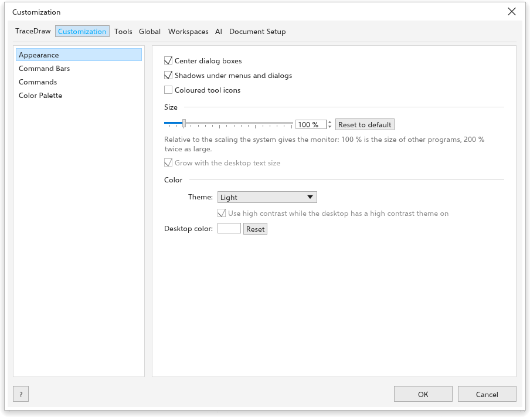
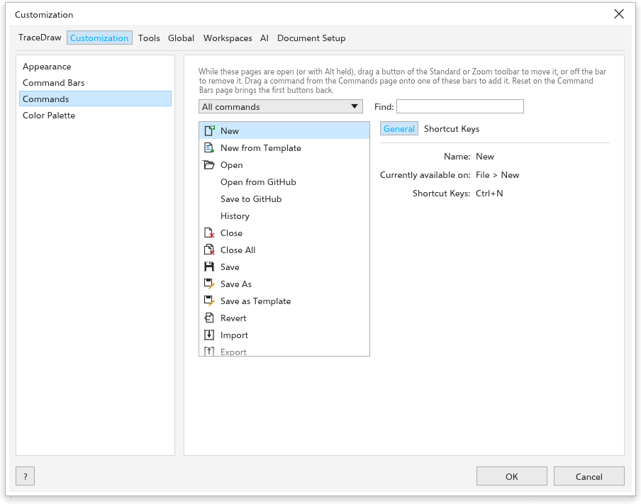
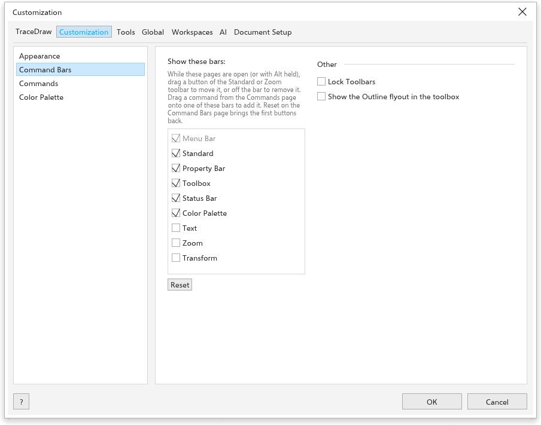
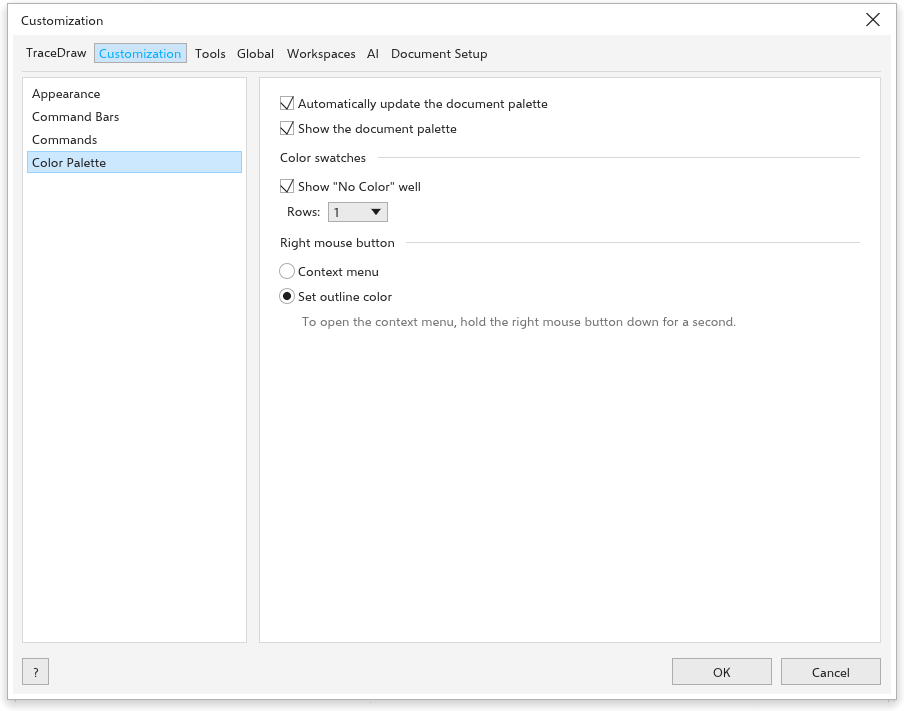

# Opzioni di personalizzazione

> *Traduzione automatica: questa pagina può essere meno aggiornata della versione inglese.*

[[menu.tools > menu.tools.options > menu.tools.options_customization]]
imposta l'aspetto dell'interfaccia, le tue scorciatoie da tastiera, quali
barre sono visibili e come si comporta la tavolozza dei colori.

## Aspetto {#appearance}

- [[options.center_dialogs]]: le finestre di dialogo si aprono al centro
  della finestra; se disattivato, si aprono dove le hai lasciate.
- [[options.ui_shadows]] (meno ombre aiutano le schede grafiche più lente).
- [[options.translucent_menus]]: open menus let the drawing show through them, at the [[options.menu_opacity]] beside the box (off by default).
- [[options.colored_icons]]: ogni gruppo di strumenti riceve un colore
  proprio.
- [[options.docker_tabs_icons_only]]: le schede dei pannelli ai lati della
  finestra mostrano solo l'immagine, con il nome nel suggerimento.
  Disattivato, mostrano immagine e nome, e una colonna con più schede di
  quante ne entrino scorre.
- [[options.ui_size]]: quanto sono grandi menu, barre, icone e pannelli,
  rispetto al ridimensionamento che il sistema dà al monitor (100% in
  partenza). [[options.reset_to_default]] torna al 100%. La dimensione
  dell'interfaccia non cambia mai la dimensione del disegno.
  [[options.follow_text_size]] la fa crescere con la dimensione del testo del
  desktop.
- [[options.color_section]]: il [[options.theme]] (Chiaro, Medio chiaro, Medio
  scuro, Scuro o Contrasto elevato), [[options.follow_high_contrast]] e il
  [[options.desktop_color]] intorno alla pagina. Il pulsante all'estremità
  destra della barra di stato passa da chiaro a scuro e viceversa.

## Comandi {#commands}

La pagina elenca tutti i comandi dei menu, con la loro scorciatoia, e i tasti
degli strumenti. Digita in [[options.find_command]] per filtrare l'elenco.

Per dare a un comando una scorciatoia tua:

1. Fai clic sul pulsante della scorciatoia del comando.
2. Premi i tasti, ad esempio <kbd>Ctrl+Alt+K</kbd>. <kbd>Esc</kbd> smette di
   attendere.

Le tue scorciatoie hanno la precedenza su quelle integrate: quando prendi un
tasto usato da un altro comando, la pagina indica quale comando l'ha perso. I
menu mostrano la tua scorciatoia. La **x** accanto a una scorciatoia la
rimuove, e il ripristino dei valori predefiniti le rimuove tutte. I tasti
degli strumenti sono una lettera o <kbd>Shift</kbd> e una lettera. Vedi
[Scorciatoie da tastiera](../reference/keyboard-shortcuts.md).

Un comando può avere più scorciatoie: un nuovo tasto si aggiunge a quelli che
ha (un tasto predefinito continua a funzionare accanto), e ogni tasto ha il suo
pulsante di eliminazione. Anche i pulsanti delle barre che eseguono un comando
di menu (Nuovo, Apri, Salva, Annulla, Zoom avanti e altri) accettano
scorciatoie, gli stessi tasti del comando di menu, così come le righe che i
menu mostrano solo a volte. Un elenco **Pulsanti delle barre degli strumenti**
contiene tutti i pulsanti delle barre Standard e Zoom: trascinate da lì nella
barra un pulsante che avete tolto.

## Barre dei comandi {#command-bars}

[[options.command_bars_hint]] [[menu.window.toolbar_menu_bar]],
[[menu.window.toolbar_standard]], [[menu.window.toolbar_property_bar]],
[[menu.window.toolbar_toolbox]], [[menu.window.toolbar_status_bar]],
[[bars.palette]] e le barre degli strumenti [[menu.window.toolbar_text]],
[[menu.window.toolbar_zoom]] e [[menu.window.toolbar_transform]].
[[options.reset]] rimette a posto le barre. Sotto [[options.other]]:
[[bars.lock]] e [[options.show_outline_flyout]].

[[options.toolbar_drag_hint]]

## Tavolozza dei colori {#color-palette}

- [[options.palette_auto_update]] e [[options.palette_show_document]]
  (entrambi attivi).
- [[options.palette_position]] (In alto, In basso, A sinistra, A destra o
  Mobile) della tavolozza predefinita, come la imposta il suo menu; non
  cambia mentre le barre degli strumenti sono bloccate.
- [[options.palette_swatches]]: [[options.palette_no_color]] (attivo), e cosa
  fa il [[options.palette_right_button]]: [[options.palette_set_outline]] (in
  partenza) o aprire il [[options.palette_context_menu]].

Vedi [Tavolozze dei colori](../color/palettes.md).

## Menu contestuali {#context-menus}

In Personalizzazione, scegli [[options.context_menus]] per gestire separatamente le 32 posizioni dei menu contestuali. Seleziona una posizione con [[options.context_menu_scene]], poi usa [[options.context_menu_search]] per cercare un'operazione e deseleziona la casella per nasconderla in quella posizione. Le operazioni restano nell'elenco anche quando la selezione corrente non può usarle.

Tutte le operazioni sono visibili per impostazione predefinita. Ogni posizione ha le proprie scelte: nascondere un'operazione degli oggetti nell'area di disegno non la nasconde nel pannello Oggetti. Gli elenchi dinamici, come i livelli di destinazione e le raccolte di caratteri, sono gestiti come una sola operazione, quindi cambiarne il nome non reimposta le scelte.

[[options.context_menu_reset]] ripristina il menu selezionato e [[options.context_menu_reset_all]] ripristina tutti i menu. [[dialog.ok]] salva le scelte nelle impostazioni dell'applicazione; [[dialog.cancel]], Escape o il pulsante di chiusura ripristina le scelte presenti all'apertura delle Opzioni. I menu principali, le scorciatoie e la ricerca dei comandi continuano a offrire i comandi originali.

Espandi un sottomenu per vedere le voci rientrate. Trascina la maniglia di una riga, oppure usa [[options.context_menu_move_up]] e [[options.context_menu_move_down]], per riordinare le voci dello stesso livello. Spostando un menu superiore si spostano anche tutte le sue voci; non è possibile trasferire una voce a un altro menu superiore. La ricerca mantiene visibili i menu che contengono i risultati. Il ripristino di un menu reimposta visibilità e ordine; annullando le Opzioni, entrambi tornano allo stato che avevano all’apertura della finestra.

Il menu dei campioni della tavolozza del documento e la sua voce nel Gestore tavolozze hanno impostazioni separate. Le destinazioni dinamiche mantengono il proprio ordine; l’elenco degli stili del documento resta tra le azioni statiche di Stili oggetto. Le nuove operazioni aggiunte in una versione successiva restano visibili, dopo le voci salvate dello stesso livello.
