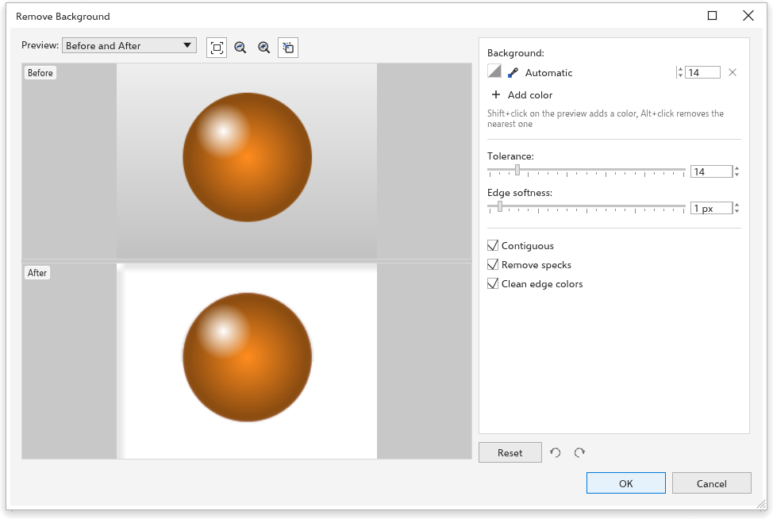

# Remover o fundo de um bitmap

[[menu.bitmaps > menu.bitmaps.remove_background_local]] deixa transparente o
fundo de uma foto ou digitalização e mantém o assunto. Funciona neste
computador e não precisa de serviço de IA. A barra de propriedades de um
bitmap selecionado tem o mesmo comando.

## Para remover um fundo {#remove}

1. Selecione um ou mais bitmaps.
2. Clique em [[menu.bitmaps > menu.bitmaps.remove_background_local]]. A
   prévia mostra o bitmap antes e depois, com um quadriculado onde ele fica
   transparente.
3. Com **[[dialog.bg_colors_auto_button]]**, o TraceDraw encontra o assunto
   sozinho e remove o resto. Se sobrar ou faltar alguma coisa, corrija com
   as opções e os pincéis abaixo.
4. Clique em [[dialog.ok]]. Todos os bitmaps selecionados mudam em uma única
   etapa de desfazer.

## Opções {#options}

- **[[dialog.bg_colors]]** O que remover, uma linha para cada coisa. No
  início há uma só linha, **[[dialog.bg_colors_auto_button]]**: o TraceDraw
  encontra o assunto da imagem (uma pessoa, um produto, um logotipo) e
  remove todo o resto, sejam quais forem as cores. Um assunto que sai da
  imagem, como ombros na borda de baixo, fica inteiro; um fundo com tons
  diferentes, como um céu com nuvens, sai inteiro; o fundo visto por um vão,
  como entre um braço e a cabeça, também sai. As outras linhas são cores a
  remover além disso. Cada linha tem:
  - a amostra da cor;
  - um conta-gotas: clique nele e depois em uma cor numa prévia ou no
    desenho, e a linha fica com essa cor. Na primeira linha,
    **[[dialog.bg_colors_auto_button]]** volta a encontrar o assunto;
  - a sua própria tolerância, um número inteiro de 0 a 100. Ela mostra a
    **[[dialog.tolerance]]** de baixo até você mudá-la;
  - **[[dialog.bg_row_remove]]** (x), que tira a linha da lista. A última
    linha sempre fica.

  **[[dialog.bg_add_color]]** (+) acrescenta uma linha: clique nele e depois
  na cor, na prévia Antes ou no desenho. Um pixel conta como fundo quando
  está perto o bastante de qualquer cor da lista, cada uma com a sua
  tolerância.
- **Atalhos com o conta-gotas ligado** Shift+clique numa prévia acrescenta a
  cor sob o ponteiro como nova linha e deixa o conta-gotas ligado, para
  escolher várias cores seguidas. Alt+clique tira a linha cuja cor é a mais
  próxima da que está sob o ponteiro. A cor escolhida numa prévia vem da
  imagem antes da mudança, então dá para escolher até uma parte que já
  sumiu.
- **[[dialog.tolerance]]** Para uma cor escolhida, quanto uma cor pode se
  afastar dela e ainda contar como fundo (0 a 100, em números inteiros):
  aumente quando sobrar dessa cor, diminua quando partes do assunto
  sumirem. Para **[[dialog.bg_colors_auto_button]]**, só diz quanto da borda
  suave sai: aumente para uma borda mais justa, diminua para manter fios
  finos de cabelo. É a tolerância de toda linha que não tem uma própria.
- **[[dialog.edge_softness]]** Suaviza a borda do assunto, em pixels. 0 mantém
  a borda nítida.
- **[[dialog.bg_contiguous]]** (ligado no início) Uma cor escolhida só sai
  onde está ligada às bordas da imagem ou ao que
  **[[dialog.bg_colors_auto_button]]** removeu. Em um fundo chapado, como o
  branco de um desenho ou de uma digitalização, as partes da mesma cor
  dentro do assunto ficam, então uma camisa branca desenhada sobre branco
  mantém o interior. Uma cor escolhida numa prévia também começa a remoção
  no ponto clicado, então um furo dentro do assunto pode sair com uma só
  escolha. Desligue para remover essas partes em toda a imagem, por exemplo
  todos os furos de uma letra ou de um anel.
- **[[dialog.bg_despeckle]]** (ligado no início) Pequenos pontos soltos que
  ficaram no fundo também saem.
- **[[dialog.bg_clean_edges]]** (ligado no início) Tira a cor do fundo antigo
  dos pixels semitransparentes da borda, para não aparecer halo claro ou
  escuro quando o assunto vai para outro fundo.
- **[[dialog.reset]]**, abaixo das configurações, volta todas as opções ao
  início, com uma só linha **[[dialog.bg_colors_auto_button]]**; as duas
  setas ao lado desfazem e refazem as mudanças feitas na caixa de diálogo.

[[dialog.ok]] guarda as opções e a lista de cores até você fechar o
TraceDraw, e o próximo Remover fundo começa com elas.

## Dicas {#tips}

- Funciona melhor com um fundo diferente do assunto: um fundo de estúdio, um
  céu, uma parede lisa. Para cenas carregadas, o comando de IA
  [[menu.bitmaps.remove_background]] (veja [IA](../customize/ai.md)) separa
  assunto e cena pelo significado.
- Um piso ou uma mesa em que o assunto está apoiado fica quando a cor não é
  a do fundo: clique em **[[dialog.bg_add_color]]** (+) e depois no piso
  para removê-lo também.
- Para corrigir um detalhe, clique em **[[dialog.bg_brush_erase]]** ou
  **[[dialog.bg_brush_restore]]** e pinte na prévia: o resultado acompanha o
  pincel. O botão do pincel em uso fica pressionado; clique nele de novo
  para soltar o pincel.
- O resultado substitui os pixels; os efeitos do bitmap ficam permanentes.
  Para ajustar depois, use [Mascarar cores](bitmap-mask.md).
