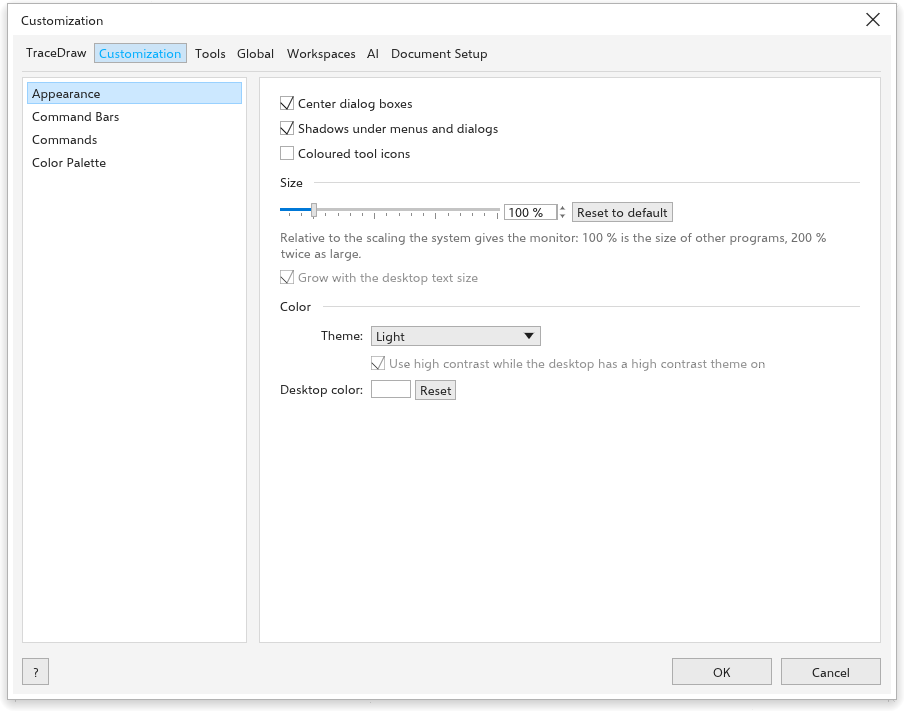
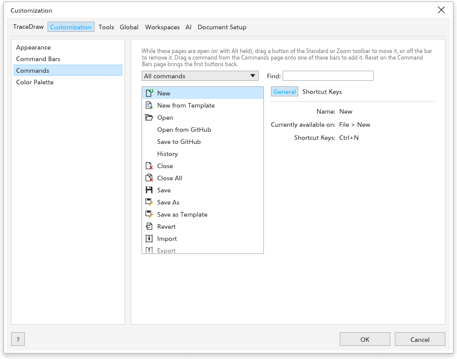
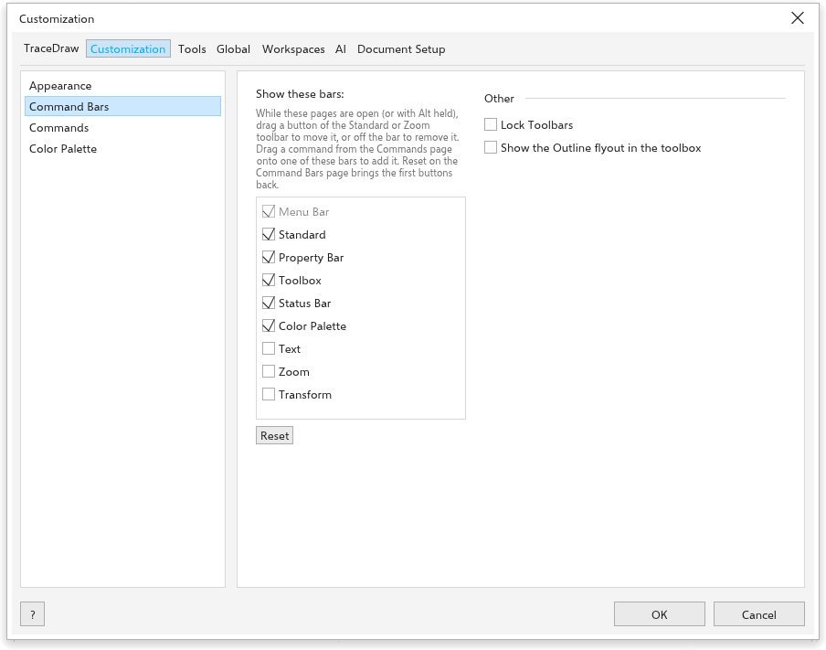
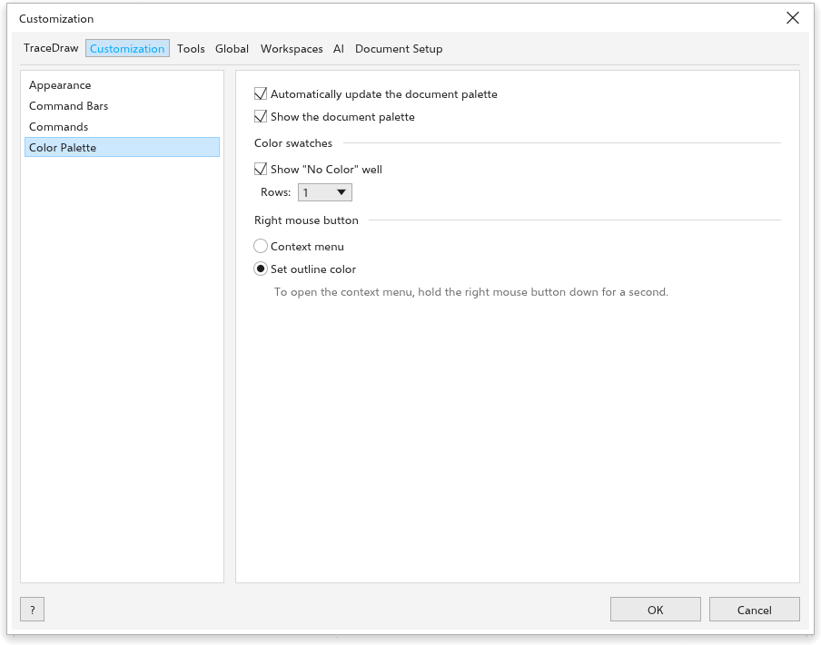

# Opções de personalização

> *Tradução automática: esta página pode estar atrasada em relação à versão em inglês.*

[[menu.tools > menu.tools.options > menu.tools.options_customization]] define a
aparência da interface, seus próprios atalhos de teclado, quais barras
aparecem e como a paleta de cores se comporta.

## Aparência {#appearance}

- [[options.center_dialogs]]: as caixas de diálogo abrem no meio da janela;
  desligado, abrem onde você as deixou.
- [[options.ui_shadows]] (menos sombras ajudam gráficos mais lentos).
- [[options.translucent_menus]]: os menus abertos deixam o desenho aparecer por trás, com a [[options.menu_opacity]] ao lado da caixa (desligado por padrão).
- [[options.colored_icons]]: cada grupo de ferramentas recebe uma cor própria.
- [[options.docker_tabs_icons_only]]: as abas dos painéis nas laterais da
  janela mostram só as figuras, com o nome na dica. Desligado, mostram a
  figura e o nome, e uma coluna com mais abas do que cabem rola.
- [[options.ui_size]]: o tamanho de menus, barras, ícones e painéis, em
  relação à escala que o sistema dá ao monitor (100% de início).
  [[options.reset_to_default]] volta a 100%. O tamanho da interface nunca muda
  o tamanho do desenho. [[options.follow_text_size]] faz ele crescer com o
  tamanho do texto da área de trabalho.
- [[options.color_section]]: o [[options.theme]] (Claro, Médio claro, Médio
  escuro, Escuro ou Alto contraste), [[options.follow_high_contrast]] e a
  [[options.desktop_color]] em volta da página. O botão na ponta direita da
  barra de status alterna entre claro e escuro.

## Comandos {#commands}

A página lista todos os comandos dos menus, com o atalho, e as teclas das
ferramentas. Digite em [[options.find_command]] para filtrar a lista.

Para dar a um comando um atalho seu:

1. Clique no botão de atalho do comando.
2. Pressione as teclas, como <kbd>Ctrl+Alt+K</kbd>. <kbd>Esc</kbd> para de
   esperar.

Seus atalhos vêm antes dos embutidos: quando você pega uma tecla que outro
comando usa, a página diz qual comando a perdeu. Os menus mostram o seu atalho.
O **x** ao lado de um atalho o remove, e voltar aos padrões remove todos. As
teclas de ferramenta são uma letra ou <kbd>Shift</kbd> e uma letra. Veja
[Atalhos de teclado](../reference/keyboard-shortcuts.md).

Um comando pode ter vários atalhos: uma tecla nova se junta às que ele já tem
(uma tecla padrão continua funcionando ao lado dela), e cada tecla tem o próprio
botão de excluir. Os botões das barras que executam um comando de menu (Novo,
Abrir, Salvar, Desfazer, Aproximar e outros) também aceitam atalhos, as mesmas
teclas do comando de menu, assim como linhas que os menus mostram só às vezes
(como Concluir edição do conteúdo). Uma lista **Botões das barras de
ferramentas** tem todos os botões das barras Padrão e Zoom: arraste dali de
volta para a barra um botão que você tirou.

Um comando arrastado para uma barra de ferramentas mostra ali a figura dele,
ou o nome quando não tem figura. Na aba **Geral**, **Ícone** mostra a figura
do comando: **Escolher...** abre as figuras dos outros comandos e das
ferramentas, e um clique dá aquela ao comando, nos menus e nas barras;
**Restaurar padrão** devolve a figura dele.

## Barras de comando {#command-bars}

[[options.command_bars_hint]] [[menu.window.toolbar_menu_bar]],
[[menu.window.toolbar_standard]], [[menu.window.toolbar_property_bar]],
[[menu.window.toolbar_toolbox]], [[menu.window.toolbar_status_bar]],
[[bars.palette]] e as barras [[menu.window.toolbar_text]],
[[menu.window.toolbar_zoom]] e [[menu.window.toolbar_transform]].
[[options.reset]] devolve as barras. Em [[options.other]]: [[bars.lock]] e
[[options.show_outline_flyout]].

[[options.toolbar_drag_hint]]

## Paleta de cores {#color-palette}

- [[options.palette_auto_update]] e [[options.palette_show_document]] (ambos
  ligados).
- [[options.palette_position]] (Em cima, Embaixo, À esquerda, À direita ou
  Flutuante), **Linhas** (de 1 a 8, ou Ajustar) e **Tamanho das amostras**
  (de Extrapequeno a Extragrande) da paleta padrão, como o menu da própria
  paleta os define: uma paleta flutuante ocupa as linhas ao longo do seu
  comprimento. A posição não muda enquanto as barras de ferramentas estão
  bloqueadas.
- [[options.palette_swatches]]: [[options.palette_no_color]] (ligado), e o que
  o [[options.palette_right_button]] faz: [[options.palette_set_outline]] (de
  início) ou abrir o [[options.palette_context_menu]].

Veja [Paletas de cores](../color/palettes.md).

## Menus de contexto {#context-menus}

Em Personalização, escolha [[options.context_menus]] para gerenciar separadamente os 32 locais de menus de contexto. Selecione um local com [[options.context_menu_scene]], use [[options.context_menu_search]] para procurar uma operação e desmarque sua caixa para ocultá-la nesse local. As operações continuam nesta lista mesmo quando a seleção atual não pode usá-las.

Todas as operações ficam visíveis por padrão. Cada local tem suas próprias escolhas: ocultar uma operação de objeto na tela de desenho não a oculta no painel Objetos. Listas dinâmicas, como camadas de destino e coleções de fontes, são gerenciadas como uma única operação, de modo que alterar seus nomes não redefine suas escolhas.

[[options.context_menu_reset]] restaura o menu selecionado e [[options.context_menu_reset_all]] restaura todos os menus. [[dialog.ok]] salva as escolhas nas configurações do aplicativo; [[dialog.cancel]], Escape ou o botão de fechar restaura as escolhas existentes quando as Opções foram abertas. Os menus principais, os atalhos e a pesquisa de comandos continuam oferecendo os comandos originais.

Expanda um submenu para ver seus itens recuados. Arraste a alça de uma linha ou use [[options.context_menu_move_up]] e [[options.context_menu_move_down]] para reordenar itens do mesmo nível. Mover um menu pai leva seus itens junto; não é possível mover um item para outro menu pai. A pesquisa mantém visíveis os menus pais dos resultados. Restaurar um menu redefine a visibilidade e a ordem; cancelar as Opções retorna ambas ao estado em que estavam ao abrir a caixa de diálogo.

O menu das amostras da paleta do documento e sua entrada no Gerenciador de paletas têm configurações separadas. Os destinos dinâmicos mantêm sua própria ordem; a lista de estilos do documento conserva sua posição entre as ações estáticas de Estilos de objeto. Novas operações adicionadas em versões posteriores permanecem visíveis, após os itens salvos do mesmo nível.
