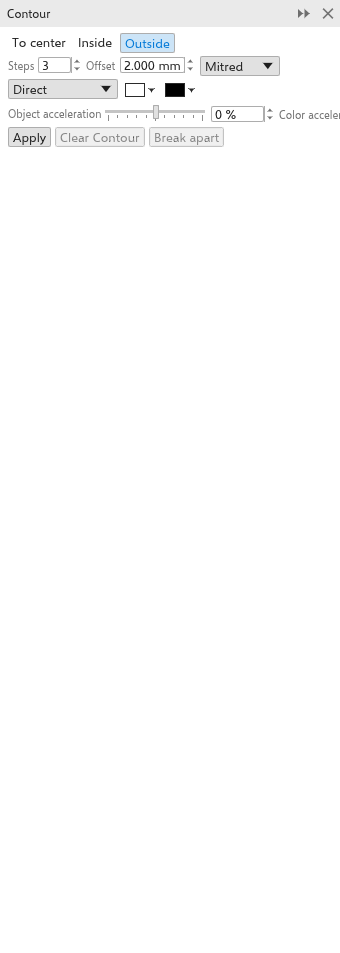

# Contornos concêntricos

Um contorno concêntrico desenha cópias do contorno de um objeto igualmente
espaçadas por dentro, por fora ou até o centro, como as linhas de um mapa. É um
efeito vivo: mude o objeto e o contorno acompanha.

## Para acrescentar um contorno concêntrico {#create}

Com a ferramenta:

1. Escolha a ferramenta [[tool.contour]] no submenu Efeitos.
2. Arraste a partir de um objeto: para longe do meio dele para um contorno
   externo, em direção ao meio para um interno. Quanto mais você arrasta, maior
   o espaçamento.

Com o painel:

1. Selecione um objeto.
2. Abra o painel [[docker.contour]] com
   [[menu.effects > menu.effects.contour]] (<kbd>Ctrl+F9</kbd>).
3. Defina as opções e clique em [[docker.apply]].

Grupos e bitmaps não recebem contorno concêntrico.

## Alças no desenho {#handles}

Com a ferramenta de contorno, um objeto com contorno concêntrico mostra uma
linha a partir do meio da borda direita: para fora num contorno externo,
para dentro num interno ou até o centro.

- Arraste o **quadrado** na ponta da linha para mudar até onde o contorno
  chega. Os passos continuam os mesmos, mais afastados ou mais juntos.
- Arraste a **barra** sobre a linha, no primeiro passo, para mudar o número de
  passos: em direção ao objeto para mais passos, para longe para menos. O
  último passo fica onde está. Um contorno até o centro não tem barra, pois
  usa quantos passos couberem.

O contorno acompanha enquanto você arrasta, e cada arraste se desfaz em um
só passo.

## Configurações {#settings}

A barra de propriedades e o painel mostram as configurações do contorno
selecionado e o mudam na hora.

- **Até o centro**, **Interno** ou **Externo** (de início).
- **Passos**: 3 de início, até 999. Até o centro faz quantos couberem.
- **Deslocamento**: a distância entre os passos (2 mm de início).
- **Cantos**: em ponta (de início), redondos ou chanfrados.
- **Direção da cor**: direta, no sentido horário ou anti-horário pela roda de
  cores, das cores do objeto até as do último passo.
- As **cores de preenchimento e contorno do último passo** (branco e preto de
  início). Um objeto sem preenchimento dá passos sem preenchimento.
- **Aceleração de objeto** e **aceleração de cor** (-100 a 100%) concentram os
  passos ou as cores perto do objeto ou do último passo.

Os passos externos são desenhados atrás do objeto, os internos na frente dele.

**Limpar contorno** remove o contorno concêntrico; **Separar** transforma os
passos em objetos.
Os passos saem agrupados ao lado do objeto. [[menu.object > menu.object.break_contour_apart]] (<kbd>Ctrl+K</kbd>, também no
menu do botão direito) faz o mesmo.
