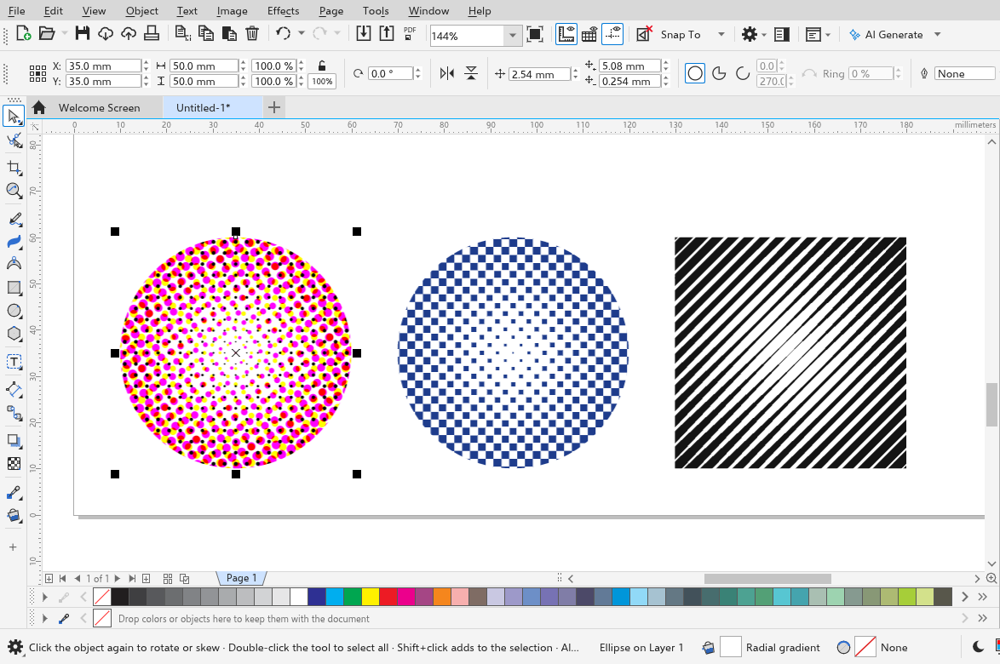
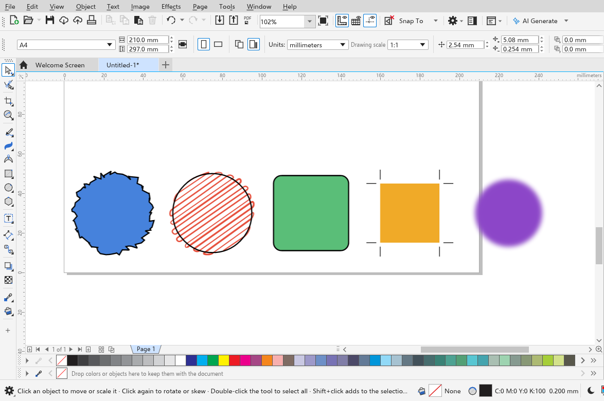

# O painel Efeitos

Um objeto pode ter vários efeitos vivos ao mesmo tempo, aplicados um depois do
outro. O painel [[docker.effects]] lista os efeitos do objeto selecionado na
ordem em que são aplicados, de cima para baixo. Abra-o com
[[menu.window > menu.window.dockers > menu.window.dockers_effects]].

## Gerenciar efeitos {#stack}

Cada linha da lista tem:

- uma caixa de seleção que ativa ou desativa o efeito. Um efeito desativado
  mantém o lugar e as configurações, mas não é desenhado, exportado nem
  impresso;
- o nome do efeito, esmaecido enquanto está desativado;
- setas para cima e para baixo que movem o efeito para antes ou depois, o que
  muda o resultado (por exemplo, um contorno de um envelope, ou um envelope de
  um contorno);
- um X que remove o efeito.

Cada alteração é um passo de desfazer. Cada efeito continua sendo editado com a
própria ferramenta ou painel.

Acima da lista, os efeitos de camada são ligados com suas caixas e ajustados à
direita, ao vivo na página. **Transformar** desenha cópias do objeto, cada
uma a anterior escalada (**Escala H** e **V**, em
porcentagem), deslocada, girada por **Ângulo** em torno do centro do
objeto e espelhada com **Refletir X** ou **Refletir Y**;
**Cópias** define quantas (0 transforma o próprio objeto).
**Girar em torno de H** e **V** afastam do centro o ponto em torno do qual as
cópias giram, de modo que um giro de 30° com 11 cópias dispõe o objeto num
anel em torno desse ponto.
**Aleatório** dá a cada passo uma parte aleatória desses valores. Os
contornos mantêm a espessura, a menos que **Escalar contornos** esteja
ligado. Um anel de contorno grosso com pontas redondas, escala de 85%, giro de
15° e uma dúzia de cópias forma uma espiral de anéis. O objeto continua como
está, então a forma, a cor e o efeito seguem editáveis;
**Efeitos > Achatar efeitos** transforma as cópias em objetos.

**Grade** repete o objeto em **Colunas** e **Linhas**,
para a direita e para baixo, sendo o próprio objeto a célula do canto superior
esquerdo. **Espaço H** e **V** definem o espaço entre as células (menos
que zero as sobrepõe), e **Deslocar linhas** move uma linha sim, outra
não, para a direita, para padrões de tijolo e colmeia. Com a ferramenta
Seleção, as alças redondas na segunda coluna e na segunda linha arrastam os
espaços (perto de zero, as células se encostam), e o quadrado depois do último
canto arrasta mais ou menos células. Desenhe um ladrilho, pinte as faces com o
Construtor de formas e dê a ele uma grade: o ladrilho continua editável e todo
o padrão o acompanha.

Abaixo da lista, os visuais prontos dão aos objetos selecionados um acabamento
com um clique: cromado, metal líquido, ouro, vidro líquido (que desfoca o que
está por baixo) e vidro transparente. Cada imagem mostra o objeto selecionado
com o visual; um desfazer o remove. As suas predefinições salvas vêm depois.

## Meio-tom

Na lista Efeitos de camada, **Meio-tom** transforma o objeto selecionado,
como ele fica com os outros efeitos (uma sombra interna para o visual de
tubo arredondado, um brilho, uma sobreposição), numa trama de pontos, e
continua ao vivo: mude o objeto ou os outros efeitos e os pontos acompanham.

- **Ponto**: redondo, quadrado, losango ou linha.
- **Modo de cor**: Luz RGB faz pontos de luz vermelha, verde e azul, do
  tamanho de cada canal de cor, para um visual pontilhado sobre fundo
  escuro; Tinta CMYK imprime pontos ciano, magenta, amarelo e preto sobre
  branco; Uma cor desenha pontos da cor ao lado, do tamanho da escuridão.
- **Espaço entre pontos**, **Escala do ponto** (em 100 % um tom cheio cobre
  a célula), **Suavidade** das bordas dos pontos e **Ângulo** da trama.
- **Centro X** e **Centro Y** posicionam um ponto na largura e na altura do
  objeto.
- **Cortar pela borda do objeto**: ligado, os pontos terminam na borda;
  desligado, pontos inteiros, menores onde o objeto os cobre menos.

Uma sombra interna na lista Efeitos de camada também tem **Espalhamento**:
mantém a sombra sólida nessa parte do desfoque antes de ela sumir, para
uma borda mais funda e arredondada.

## Outros comandos de efeito {#commands}

- [[menu.effects > menu.effects.flatten]] transforma os efeitos dos objetos
  selecionados em objetos simples.
- [[menu.effects > menu.effects.merge_shapes]] agrupa os objetos
  selecionados e dá ao grupo um [[effect.offset_path]] ao vivo que os junta
  num só contorno, arredondado onde se encontram e pintado como o objeto de
  baixo: mova um objeto do grupo e as formas se fundem ou se separam. Ajuste
  **Suavizar** nos efeitos de camada no alto do painel; em qualquer objeto,
  **Deslocamento** aumenta o contorno (ou o diminui, abaixo de zero) ao vivo.
- [[menu.effects.picker]] mostra uma lista de efeitos para aplicar à seleção.
- [[menu.object > menu.object.clear_effect]] remove o efeito da seleção.
- [[menu.object > menu.object.copy_effect]] copia um efeito de outro objeto, e
  [[menu.object.clone_effect]] faz um clone que o acompanha; veja
  [Copiar e clonar efeitos](copy-and-clone.md).

## Aparência feita à mão e molduras

Os efeitos de camada no alto do painel também têm estes, todos ao vivo e
atualizados enquanto você edita o objeto:

- [[effect.roughen]] redesenha o contorno com pequenas ondulações
  aleatórias. **Tamanho** define até onde elas vão, **Detalhe** quantas são
  a cada 10 mm, e **Suave** as transforma em ondas em vez de pontas.
- [[effect.jitter_nodes]] move os nós que a curva já tem, ao acaso, até as
  distâncias que você definir; **Alças também** move cada alça sozinha.
- [[effect.scribble]] desenha o preenchimento como uma linha em zigue-zague
  solta, na cor do preenchimento, com o ângulo, o espaçamento e a largura
  que você definir. **Folga** deixa os traços passarem da borda ou pararem
  antes. **Voltas arredondadas** curva cada volta da linha, até um laço
  largo como o de um lápis pastel; **Passar da borda** leva cada traço até
  essa distância além da borda (abaixo de zero, para antes, do lado de
  dentro); **Variação do espaçamento** e **Variação da espessura** deixam os
  intervalos e os traços desiguais, como à mão. O contorno continua.
- [[effect.shape_frame]] troca o contorno por um retângulo, retângulo
  arredondado ou elipse em volta do objeto, com a margem que você definir.
  Num grupo, faz uma só forma pintada como o objeto de cima.
- [[effect.trim_marks]] desenha linhas nos cantos do objeto, do lado de
  fora, para recortá-lo depois de impresso.
- [[effect.feather]] faz o objeto sumir aos poucos em direção à borda, ao
  longo do raio que você definir.

**Variação** dá outro padrão aos efeitos aleatórios. O mesmo valor sempre
desenha o mesmo resultado. Converter em curvas torna os efeitos de contorno
definitivos.

