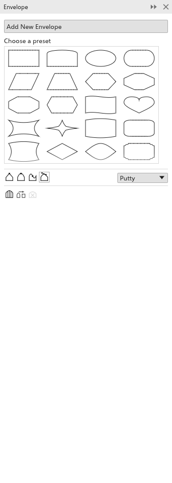
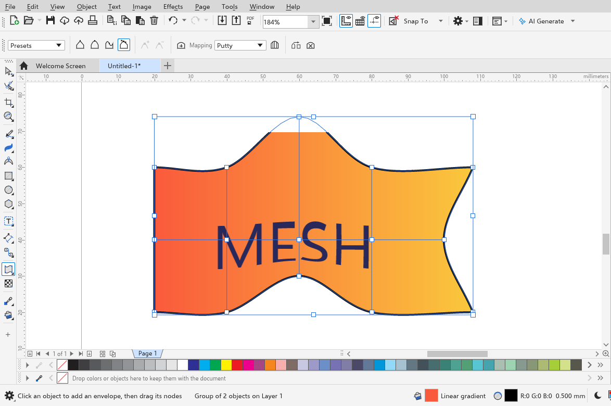

# Envelopes

> *Tradução automática: esta página pode estar atrasada em relação à versão em inglês.*

Um envelope é uma moldura de nós em volta de um objeto; o objeto é curvado para
preencher a moldura e acompanha quando você move os nós. Use-o para arquear
texto, inflar uma forma ou encaixar uma arte em uma bandeira ou um círculo. O
objeto mantém a própria forma, então o envelope pode ser mudado ou removido a
qualquer momento. Imagens também se deformam, sozinhas ou dentro de um grupo ou
quadro de recorte.

## Para acrescentar um envelope {#create}

Com a ferramenta:

1. Escolha a ferramenta [[tool.envelope]] no submenu Efeitos.
2. Clique em um objeto. Ele recebe uma moldura de oito nós: os cantos e o meio
   de cada lado.
3. Arraste os nós para mudar a forma da moldura.

Com o painel ([[menu.effects > menu.effects.envelope]], <kbd>Ctrl+F7</kbd>):

1. Selecione um objeto.
2. Clique em **Adicionar novo**, ou clique em uma das 24 formas prontas (arco,
   círculo, bandeira, coração, nuvem, balão de fala e outras) para usá-la como
   envelope.

## Editar a moldura {#edit}

O modo de edição, escolhido na barra de propriedades ou no painel, decide o que
acontece com os lados quando você arrasta um nó:

- **Linha reta**: os lados continuam retos;
- **Arco simples**: os lados viram um arco suave;
- **Arco duplo**: os lados viram curvas em S;
- **Livre** (de início): o nó leva as alças junto; clique em um nó para ver as
  duas alças e arraste-as para curvar cada lado separadamente.

Clique duas vezes na moldura para acrescentar um nó, ou em um nó (que não seja
um canto) para excluí-lo. No modo livre a barra de propriedades também tem
**Adicionar nó** e **Excluir nó**. A ferramenta [[tool.shape]] edita a moldura
do mesmo jeito.

## Configurações do envelope {#settings}

- **Predefinições** na barra de propriedades: arco, inflar, apertar, bandeira,
  perspectiva e círculo.
- **Mapeamento**, como o objeto preenche a moldura: **Massa** (de início),
  **Original** (distribuído por igual ao longo da moldura), **Horizontal** ou
  **Vertical** (só na largura ou só na altura).
- **Manter linhas**: os segmentos retos do objeto continuam retos.
- **Adicionar novo envelope** coloca uma moldura nova em volta do objeto como
  ele está agora, por cima do envelope que já tem.
- **Copiar propriedades do envelope**: clique em outro objeto para copiar o
  envelope dele (como
  [[menu.object > menu.object.copy_effect > menu.object.copy_envelope_from]]).
  Clique em um objeto sem envelope, como um círculo, uma estrela ou uma curva
  desenhada, para encaixar o texto ou os objetos selecionados na forma dele.
- [[menu.object > menu.object.copy_effect > menu.object.envelope_from_top]]:
  selecione os objetos e, por cima deles, a forma onde encaixá-los; os outros
  preenchem essa forma onde ela está, e a forma some.
- **Limpar envelope** remove o último envelope (moldura ou malha).

## Envelope de malha {#mesh}

Em vez de uma moldura, o objeto pode se dobrar por uma grade. No painel
Envelope, escolha **Colunas** e **Linhas** (de 1 a 8) e clique em
**Adicionar malha**: a grade é colocada sobre os objetos selecionados, que
ficam como estavam. Com a ferramenta [[tool.envelope]] (ou a [[tool.shape]])
arraste qualquer ponto da grade, de dentro ou da borda, e o objeto se dobra
suavemente em volta dele: setas viram uma estrela, uma palavra vira uma onda.
Imagens também se dobram pela grade.
**Adicionar malha** de novo começa uma grade nova com as colunas e linhas
escolhidas; [[effect.mesh_envelope]] aparece na pilha de efeitos do painel
Efeitos, e Converter em curvas a torna parte das curvas.

