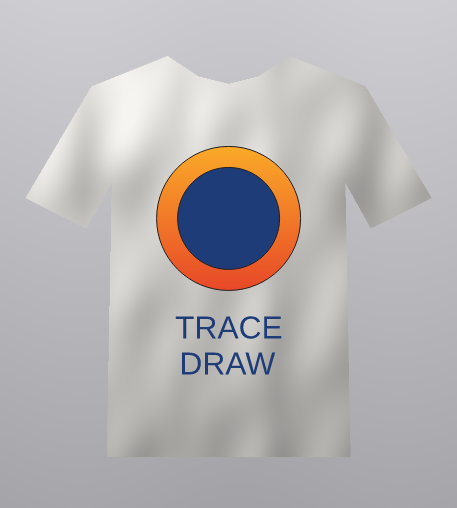
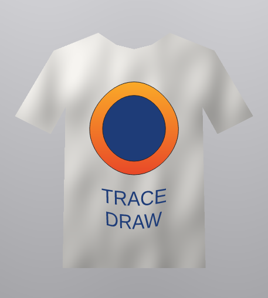
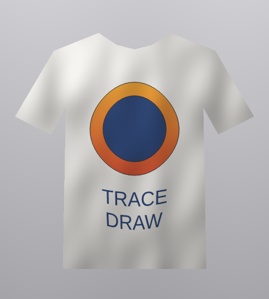
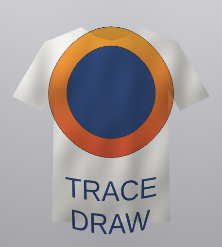
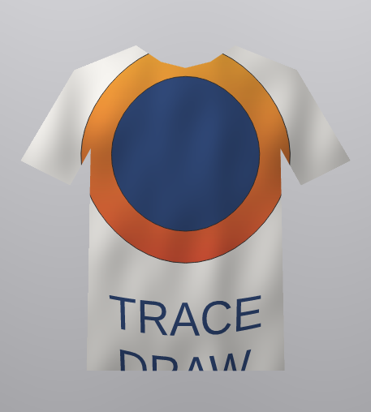

# Fazer um mockup de camiseta

Um mockup mostra um desenho sobre a foto do objeto real, aqui uma camiseta,
para você avaliar antes de imprimir. Quatro recursos desta Ajuda fazem o
trabalho: um envelope curva o desenho sobre o peito, um modo de mesclagem da
transparência deixa as dobras e sombras do tecido aparecerem através da
estampa, e uma moldura de recorte mantém a estampa na camiseta.

## O jeito rápido: o painel Mockup {#panel}

[[menu.effects > menu.effects.mockup]] faz tudo isso num clique, sobre
dezesseis fotos de produto prontas (camisetas, canecas, garrafa, ecobag,
almofada, quadro, fachada com letreiro, van, cartões de visita, panfleto,
bandeira, capinha de celular e caixa) ou sobre uma foto sua.

1. Selecione o desenho.
2. No painel [[docker.mockup]], clique num produto. A imagem maior mostra
   onde o desenho vai ficar.
3. Ajuste **[[docker.mockup_size]]**, **[[docker.mockup_across]]** e
   **[[docker.mockup_down]]** se precisar e clique em **[[docker.apply]]**.

O desenho se curva sobre o produto (um envelope de malha que segue a
perspectiva, a volta da caneca ou as ondas da bandeira), pega as dobras, as
sombras e os brilhos da foto (Deslocar) e, nos produtos claros, o modo de
mesclagem Multiplicar. Tudo continua editável. Com o mockup selecionado,
clique noutro produto e em **[[docker.apply]]** de novo para ver nele.

- **[[docker.mockup_shading]]** e **[[docker.mockup_texture]]** deixam a
  luz e as dobras da foto mais fortes ou mais fracas na estampa.
- **[[docker.mockup_blend]]**: Multiplicar para produtos claros, Normal para
  manter as cores da tinta nos escuros.
- **[[mockup.own_photo]]**: selecione a sua foto junto com o desenho. O
  desenho vai para o meio da foto; ajuste-o com a ferramenta
  [[tool.envelope]].
- **[[docker.mockup_export]]** salva o mockup como JPG para mandar ao
  cliente, com uma **[[docker.mockup_caption]]** opcional embaixo.

Os passos abaixo fazem o mesmo à mão, sobre uma foto sua.

## Colocar a foto e o desenho {#place}

1. Escolha [[menu.file > menu.file.import]] e importe a foto de uma camiseta
   lisa, de frente, com boa luz.
2. Desenhe ou importe o seu desenho, ponha sobre o peito e ajuste o tamanho.
3. Se o desenho tem vários objetos, selecione todos e escolha
   [[menu.object > menu.object.group]], para os próximos passos o tratarem
   como um só.

## Seguir o peito com um envelope {#envelope}

Tecido não é plano. Uma curva leve faz a estampa parecer deitada na camiseta.

1. Selecione o desenho e escolha a ferramenta [[tool.envelope]] (ou abra
   [[menu.effects > menu.effects.envelope]]).
2. Use **[[envelope.single_arc]]** e arraste um pouco os nós do meio: o de baixo para
   baixo, o de cima para cima e os dos lados para fora. Com moderação.

Cada objeto de um grupo é curvado a partir da caixa do grupo inteiro e mantém
as próprias cores. Veja [Envelopes](envelope.md).

## Deixar o tecido aparecer: Multiply {#multiply}

Uma estampa pega o sombreado do tecido por baixo dela. O modo de mesclagem
**Multiply** (multiplicar) faz o mesmo: cada cor é multiplicada pelo que está embaixo,
então as dobras e sombras da foto escurecem o desenho onde escurecem a
camiseta.

1. Selecione o desenho e escolha a ferramenta [[tool.transparency]], ou abra
   as configurações de transparência no painel [[docker.properties]].
2. Escolha [[transparency.uniform]] e deixe a quantidade baixa (0 a 10 %).
3. Ponha [[transparency.merge_mode]] em **Multiply**.

Veja [Transparência](../color/transparency.md).

## Manter a estampa na camiseta: uma moldura de recorte {#clip}

Uma estampa grande, ou perto de uma manga, pode passar das bordas da camiseta.

1. Desenhe o contorno da camiseta sobre a foto com a ferramenta
   [[tool.bezier]] ou [[tool.pen]], seguindo as bordas (não precisa ser exato
   onde a estampa não chega). Deixe sem preenchimento e sem contorno.
2. Selecione o desenho, escolha
   [[menu.object > menu.object.clip_frame > menu.object.clip_frame_place_inside]]
   e clique no contorno.

A estampa é cortada na forma da camiseta e mantém o modo Multiply: ela
continua se misturando com a foto embaixo da moldura. Veja
[Colocar objetos dentro de uma moldura](../objects/clip-frames.md).

## Dicas {#tips}

- Uma camiseta branca ou clara mostra melhor o Multiply. Numa camiseta
  escura, experimente **If Lighter** para uma estampa clara, ou mantenha
  **Normal** com um pouco de transparência.
- Para testar outro desenho, use [[menu.object.clip_frame_edit]], ou
  [[menu.object.clip_frame_extract]], troque o desenho e ponha o novo dentro
  de novo.
- Agrupe a foto, a moldura e o desenho para mover o mockup inteiro.
