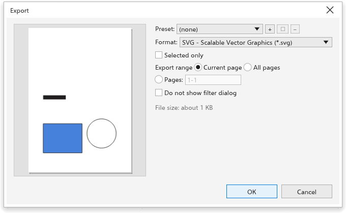

# Exportar

> *Tradução automática: esta página pode estar atrasada em relação à versão em inglês.*

[[menu.file > menu.file.export]] (<kbd>Ctrl+E</kbd>) grava o desenho, uma página
ou a seleção em outro formato. A caixa de diálogo Exportar mostra uma prévia à
esquerda e as configurações à direita.

## Para exportar {#export}

1. Escolha [[menu.file > menu.file.export]] (<kbd>Ctrl+E</kbd>, ou o botão da
   barra de ferramentas).
2. Na caixa de diálogo **Salvar**, escolha a pasta, digite o nome e escolha o
   formato em **Tipo**. Todos os formatos são oferecidos, o usado por último
   primeiro; a extensão do nome decide o formato. A pasta da última
   exportação é aberta.
3. A caixa de diálogo Exportar abre com as opções desse formato, e o título
   nomeia o arquivo (como "Exportar Cartaz.png"). Escolher um formato traz de
   volta as configurações usadas nele da última vez. Escolha uma
   **Predefinição** para começar de escolhas salvas, ou outro **formato**: a
   extensão do arquivo muda junto. Os formatos mais comuns (JPG, PDF, AI, PNG)
   vêm primeiro.
4. Defina as opções do formato (abaixo).
5. Marque **Somente selecionados** para exportar só a seleção, ou **Todas as
   páginas** para exportar cada página.
6. Clique em [[dialog.ok]] para gravar o arquivo. [[dialog.cancel]] não grava
   nada.

No navegador, que não tem caixa de diálogo Salvar, a caixa de diálogo
Exportar vem primeiro e [[dialog.ok]] baixa o arquivo; no Android,
[[dialog.ok]] abre o seletor do sistema para escolher onde salvar.

A caixa de diálogo estima o tamanho do arquivo e, para formatos de bitmap, diz
o que sai, como "1240 x 1754 pixels, 150 dpi, sRGB".

## Pular as opções {#skip}

Marque [[dialog.skip_export_dialog]] na parte de baixo da caixa de diálogo
Exportar e clique em [[dialog.ok]]: as próximas exportações gravam o arquivo
logo após a caixa de diálogo Salvar, com as opções da última exportação, e a
barra de status diz "Exportado com as últimas opções". Para ver as opções de
novo:

- segure <kbd>Shift</kbd> ao escolher [[menu.file > menu.file.export]] ou ao
  clicar no botão da barra de ferramentas, ou escolha
  [[menu.file > menu.file.export_with_options]] (<kbd>Ctrl+Shift+E</kbd>), e
  desmarque a caixa; ou
- desmarque [[options.skip_export_dialog]] na página [[options.file_formats]]
  das opções globais (clicar no aviso da barra de status a abre).

## Opções dos formatos {#options}

| Formato | Opções |
|---|---|
| PNG, WebP, GIF | resolução (ou o tamanho em pixels), fundo transparente; WebP também qualidade |
| JPEG | resolução, qualidade (1 a 100) |
| BMP, TIFF, PSD | resolução |
| PDF | padrão (PDF 1.4, PDF/X-1a, PDF/X-3 ou PDF/X-4), sangria, condição de saída para PDF/X |
| PDF, AI | título e etiquetas |
| SVG, EPS, AI, DXF, HTML, EMF, WMF, PLT, PS, PRN | nenhuma |

## Tamanho dos bitmaps {#size}

Para formatos de bitmap, **Tamanho** tem uma largura, uma altura e a unidade
delas (px, mm, cm ou pol); o outro lado segue as proporções da página.

- Em pixels, digitar uma largura ou altura define a resolução que a produz,
  então você digita direto o tamanho de um ícone (32 x 32 pixels).
- Em comprimento, o tamanho é o tamanho impresso: digitar uma largura ou
  altura muda a escala da arte na resolução definida, de 1 % a 10000 %. Um
  botão com a escala (como "200 %") aparece quando ela não é 100 % e a volta.

Arquivos PNG, JPEG e BMP guardam a resolução, então abrem no tamanho escolhido.
Arquivos PostScript e PRN guardam todas as páginas exportadas. Para PDF,
PostScript e PRN, a opção de exportar todas as páginas começa marcada;
desmarque-a para exportar só a página atual.

## Predefinições {#presets}

A lista **Predefinição** tem todas as predefinições que você salvou, cada uma
com o formato entre parênteses, como "Web PNG (PNG)". Escolher uma predefinição
de outro formato muda a caixa de diálogo para esse formato; mudar o formato
deixa nenhuma predefinição escolhida. **+** salva as escolhas atuais com um
nome (o mesmo nome substitui aquela predefinição), o lápis renomeia a
escolhida e **-** a exclui.

## Escolhas iniciais {#defaults}

As escolhas iniciais são definidas na página [[options.file_formats]] das opções
globais, onde **Lembrar as configurações da última exportação** (ligado de
início) faz a caixa de diálogo começar com o formato, a resolução e a qualidade
da última exportação, também na sessão seguinte. [[menu.file.export_for]] tem predefinições para a web e para
documentos de escritório; veja
[Exportar para a web](../web-graphics/export-for-web.md). Para arquivos PDF com
marcadores e segurança, use [Publicar em PDF](publish-pdf.md).
