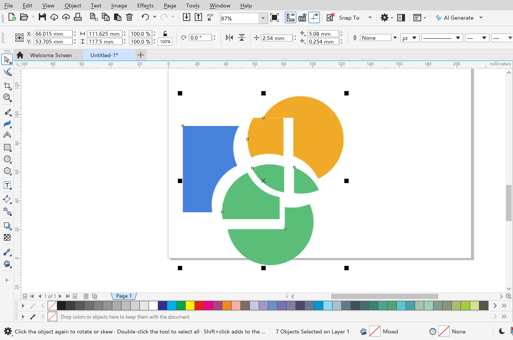
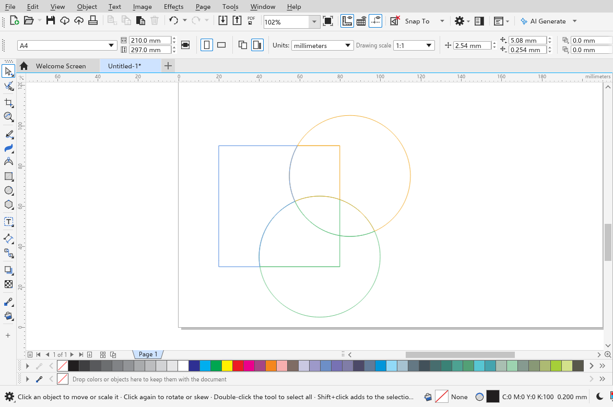
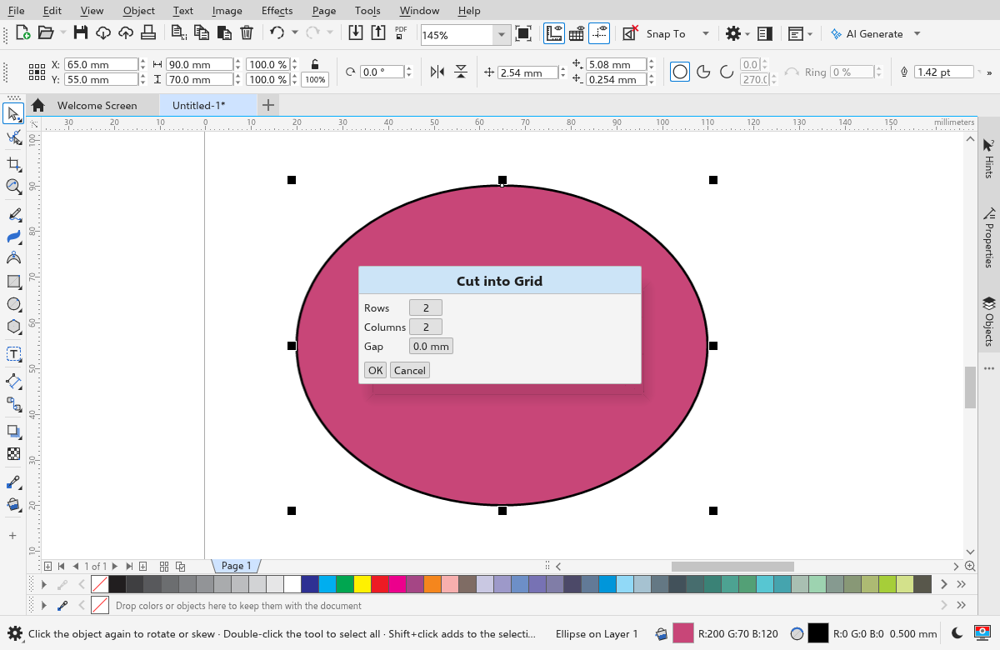
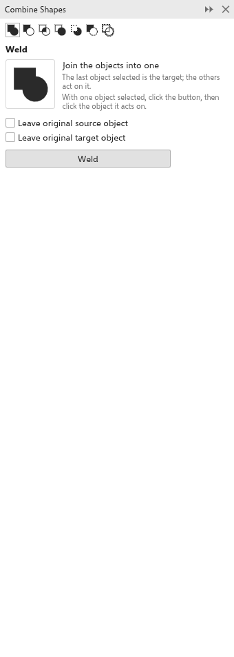

# Combinar formas: soldar, aparar e interseção

> *Tradução automática: esta página pode estar atrasada em relação à versão em inglês.*

A modelagem cria formas novas a partir de objetos sobrepostos: une-os em um,
corta um com outro ou mantém só onde se sobrepõem. Os comandos ficam em
[[menu.object > menu.object.shaping]], na barra de propriedades quando dois ou
mais objetos estão selecionados, e no painel [[docker.shaping]].

## O alvo e as origens {#target}

O **último objeto que você seleciona é o alvo**: ele dá ao resultado o
preenchimento, o contorno e a transparência. Os outros objetos selecionados são
as **origens**. Para escolher o alvo, selecione as origens primeiro e depois
<kbd>Shift</kbd>+clique no alvo.

O resultado vai para o topo da camada ativa e fica selecionado. Cada operação é
um passo de desfazer. Quando não há resultado (por exemplo, dois objetos que
não se sobrepõem), nada muda e a barra de status avisa.

## As operações {#operations}

| Operação | Precisa de | Resultado |
|---|---|---|
| [[menu.object.weld]] | 2 objetos | um objeto que cobre todos eles |
| [[menu.object.trim]] | 2 objetos | o alvo sem o que as origens cobrem |
| [[menu.object.intersect]] | 2 objetos | só a área que todos compartilham |
| [[menu.object.simplify]] | 1 objeto | cada objeto sem o que os objetos acima dele cobrem |
| [[menu.object.front_minus_back]] | 2 objetos | o objeto da frente sem os de trás |
| [[menu.object.back_minus_front]] | 2 objetos | o objeto de trás sem os da frente |
| [[menu.object.boundary]] | 1 objeto | um contorno em volta de toda a seleção |

Pelo menu e pela barra de propriedades, [[menu.object.weld]] remove os
originais, [[menu.object.trim]] mantém as origens, [[menu.object.intersect]]
mantém todos e [[menu.object.boundary]] mantém todos.

### Linhas abertas e imagens {#open-lines}

- **Uma linha aberta corta uma forma.** [[menu.object.trim]] com uma linha,
  polilinha ou curva aberta como origem cruzando um alvo fechado corta o alvo
  ao longo dela em pedaços separados, cada um com o preenchimento e o contorno
  do alvo. Várias linhas fazem mais pedaços; uma linha que termina dentro da
  forma não corta nada, e a barra de status avisa.
  [[menu.object.front_minus_back]] e [[menu.object.back_minus_front]] dividem
  ao longo de linhas abertas do mesmo jeito.
- **Uma linha aberta como alvo** de [[menu.object.weld]], [[menu.object.trim]]
  ou [[menu.object.intersect]] é cortada pelos objetos fechados e continua
  aberta: Aparar guarda as partes de fora, Interseção a parte de dentro, e
  Soldar acrescenta as partes de fora à forma soldada.
- Uma linha aberta usada como origem de Soldar ou Interseção sobre um objeto
  fechado não participa; para cortar uma forma ao longo de uma linha, use
  Aparar ou a ferramenta Faca (veja
  [Cortar e apagar](cut-and-erase.md#knife)).
- **Uma imagem como alvo** de Aparar, Interseção ou Soldar é recortada no
  resultado: a moldura dela toma a nova forma e a imagem aparece dentro.

Áreas preenchidas lado a lado, e os resultados de Soldar, Aparar e Interseção,
se encontram exatamente onde os contornos se cruzam, sem fresta entre eles.

## Pedaços e combinação ao vivo {#pieces}

Estes comandos ficam no mesmo submenu. Cada um troca os objetos selecionados
num só passo de desfazer:

- [[menu.object.break_pieces]] corta os objetos sobrepostos em todos os
  pedaços que os contornos formam, cada um com o preenchimento do objeto de
  cima. Mesmo embaixo do objeto de cima, as bordas dos objetos de baixo
  continuam cortando.
- [[menu.object.merge_colors]] mantém o que aparece de cada objeto e junta
  os pedaços que se tocam e têm o mesmo preenchimento.
- [[menu.object.cut_to_top]] recorta os objetos de baixo pelo contorno do
  objeto de cima, depois remove o objeto de cima.
- [[menu.object.piece_outlines]] transforma cada pedaço num contorno sem
  preenchimento, na cor do pedaço.
- [[menu.object.exclude]] faz uma só curva onde um número ímpar de objetos
  se sobrepõe: onde dois se sobrepõem, a sobreposição é recortada.

Os resultados ficam juntos num grupo, sem contorno (menos em Excluir
sobreposições, que mantém o contorno do objeto de cima).

[[menu.object.combine_live]] mantém os objetos. Ele os agrupa e desenha o
grupo como uma curva combinada, com a pintura do objeto de cima. Na entrada
[[effect.combine]] do painel Efeitos, escolha [[menu.object.weld]],
[[menu.object.back_minus_front]] (com a pintura do objeto de baixo),
[[menu.object.intersect]] ou [[menu.object.exclude]]. Mover ou editar um
objeto dentro do grupo atualiza a curva, e Converter em curvas a torna
definitiva.

## Cortar por um objeto, em grade, e limpar {#cutting}

- [[menu.object.cut_below]] usa o único objeto selecionado como faca. Cada
  objeto embaixo dele na página que ele cobre é cortado pelo contorno nas
  partes de dentro e de fora. Cada parte mantém a pintura e o lugar do
  objeto. A faca é removida. Grupos, textos e imagens ficam como estão.
- [[menu.object.cut_grid]] transforma cada objeto selecionado em linhas e
  colunas de peças, na pintura e no lugar do objeto. A janela tem os
  mesmos quatro campos para as linhas e para as colunas: o número, a
  altura ou largura de cada uma, o espaço entre elas e o total que
  ocupam juntas. O total começa com o tamanho do objeto; mudar o número,
  o espaço ou o total reparte o total de novo, e digitar uma altura ou
  largura mantém o número e muda o total. Um total menor que o objeto
  monta a grade a partir do canto superior esquerdo do objeto. Manter a
  forma do objeto faz das peças as partes do objeto dentro de cada caixa
  (um círculo é dividido em pedaços de círculo) em vez de caixas
  inteiras; Adicionar linhas-guia coloca uma linha-guia em cada borda
  das linhas e colunas; Agrupar as peças mantém todas em um grupo. Com
  Prévia ligada, o desenho mostra as peças como linhas sobre o objeto
  enquanto a janela está aberta, e a janela diz quantas peças serão e o
  tamanho delas.
- [[menu.object.remove_strays]] remove pontos isolados, curvas sem
  preenchimento, sem contorno e sem efeito, e textos artísticos vazios das
  camadas destravadas da página. A barra de status diz quantos saíram.

Cada um é um só passo de desfazer.

## O painel Modelagem {#shaping-docker}

Abra o painel [[docker.shaping]] com
[[menu.object > menu.object.shaping > menu.object.shaping_docker]].

1. Clique em um dos sete botões ilustrados para escolher a operação. O painel
   mostra o nome, uma imagem e o que ela faz.
2. Para [[menu.object.weld]], [[menu.object.trim]] e
   [[menu.object.intersect]], escolha o que manter:
   [[docker.leave_original_source]] e [[docker.leave_original_target]]. Cada
   operação lembra sua própria escolha.
3. Selecione os objetos, o alvo por último.
4. Clique no botão com o nome da operação. Ele fica claro até haver objetos
   suficientes selecionados, e uma linha diz quantos são necessários.

## Deslocamento de contorno {#outline-offset}

[[menu.object.outline_offset]] (menu Objeto) desenha um novo contorno a uma
distância definida dos objetos selecionados, como uma curva separada:

1. Selecione os objetos e escolha [[menu.object.outline_offset]].
2. Digite a [[dialog.outline_offset_distance]], nas unidades do desenho.
3. Escolha [[dialog.outline_offset_outside]] ou [[dialog.outline_offset_inside]]
   e clique em OK.

Cada objeto ganha uma curva nova com o preenchimento e o contorno do
objeto; o original fica como está. Uma curva externa vai para trás do seu
objeto e uma interna, para a frente, e as curvas novas ficam
selecionadas. Uma linha aberta ganha uma faixa fechada em volta dos dois
lados. Cantos deixa os cantos do novo contorno vivos, arredondados ou
chanfrados, e Contornos cria vários de uma vez, cada um à distância do
anterior. Com a prévia ligada, o desenho mostra os novos contornos
enquanto a janela está aberta. A janela lembra a última distância, os
cantos e o número. Para contornos que continuam ligados ao objeto, use a
ferramenta Contorno.

Relacionado: [[menu.object.combine]] (<kbd>Ctrl+L</kbd>) torna vários objetos
uma única curva sem mudar as formas, e [[menu.object.break_apart]] separa uma
curva em suas partes de novo. Veja
[Objetos e camadas](../objects/objects-and-layers.md#combine).
