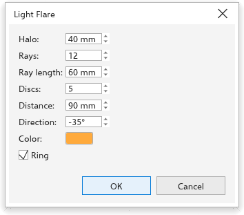
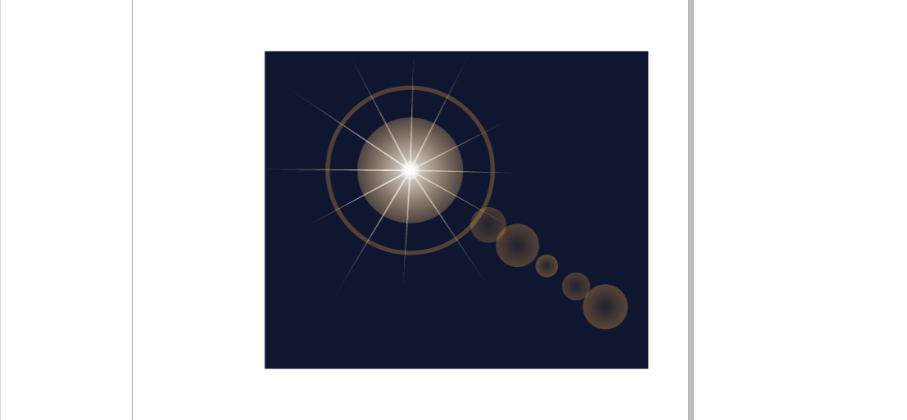

# Reflexo de luz

Um reflexo de luz é o brilho que uma luz forte deixa numa imagem: um halo, um
núcleo claro, raios, um anel fino e uma fileira de discos esmaecidos. O
TraceDraw desenha-o com objetos vetoriais, então ele fica nítido em qualquer
tamanho e imprime como o resto do desenho.

## Inserir um reflexo {#insert}

Escolha [[menu.object > menu.object.insert > menu.object.insert_flare]] para
abrir [[flare.title]]:

- [[flare.halo]] define o diâmetro do halo.
- [[flare.rays]] e [[flare.ray_length]] definem quantos raios saem do meio e
  até onde chegam os mais longos; 0 raios deixa-os de fora.
- [[flare.discs]], [[flare.distance]] e [[flare.angle]] definem a fileira de
  discos esmaecidos: quantos, a que distância do meio fica o último e em que
  direção.
- [[flare.color]] tinge o halo, o anel e os discos; o núcleo e os raios ficam
  brancos no meio.
- [[flare.ring]] acrescenta um anel fino em volta do halo.

Clique em OK. O reflexo entra como um só grupo no meio da página, selecionado;
leve-o até a luz da sua imagem. Cada parte é um objeto comum com um degradê
transparente, então você pode desagrupar o reflexo, mudar a cor de uma parte
ou mover um disco sozinho. O diálogo guarda as configurações para o próximo
reflexo.

