# Gerador de formas

O painel [[docker.shape_generator]] desenha padrões, arte em linhas, blocos
isométricos e moldes de cone a partir de poucas configurações, como curvas
comuns que você pode editar, recolorir, cortar ou exportar. Abra-o em
[[menu.object > menu.object.create > menu.object.shape_generator]] ou em
[[menu.window > menu.window.dockers]].

Escolha um [[shapegen.kind]], mude as configurações e acompanhe a prévia
logo abaixo: ela mostra exatamente o que [[shapegen.create]] desenha. O
número sob a prévia conta as curvas.

## Como usar {#use}

**1.** Escolha [[menu.object > menu.object.create > menu.object.shape_generator]].
O painel abre à direita.

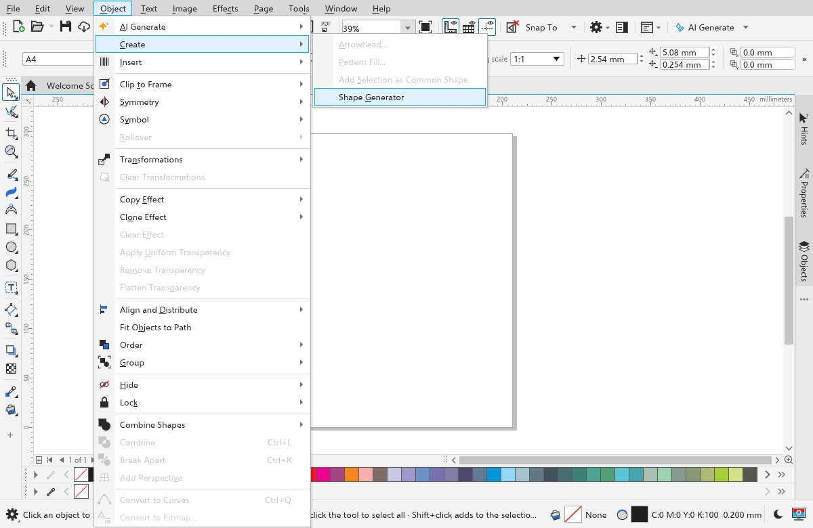

**2.** Abra a lista [[shapegen.kind]] no topo do painel e escolha o que
desenhar. As configurações abaixo mudam conforme o gerador.

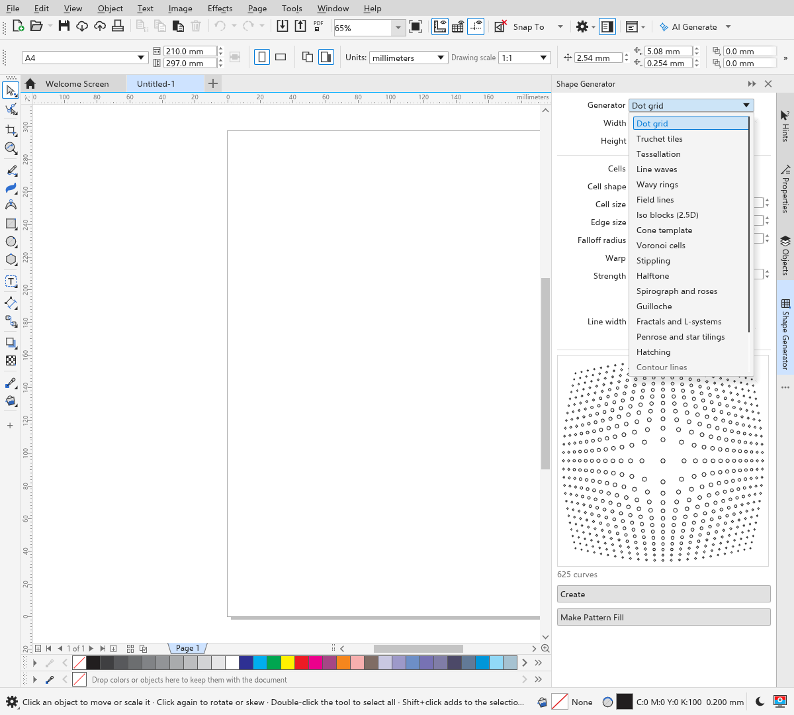

**3.** Mude as configurações. A prévia logo abaixo mostra o resultado na hora;
aqui [[shapegen.cell_shape]] foi mudada para [[shapegen.cell_square]].
Nada é desenhado na página ainda.

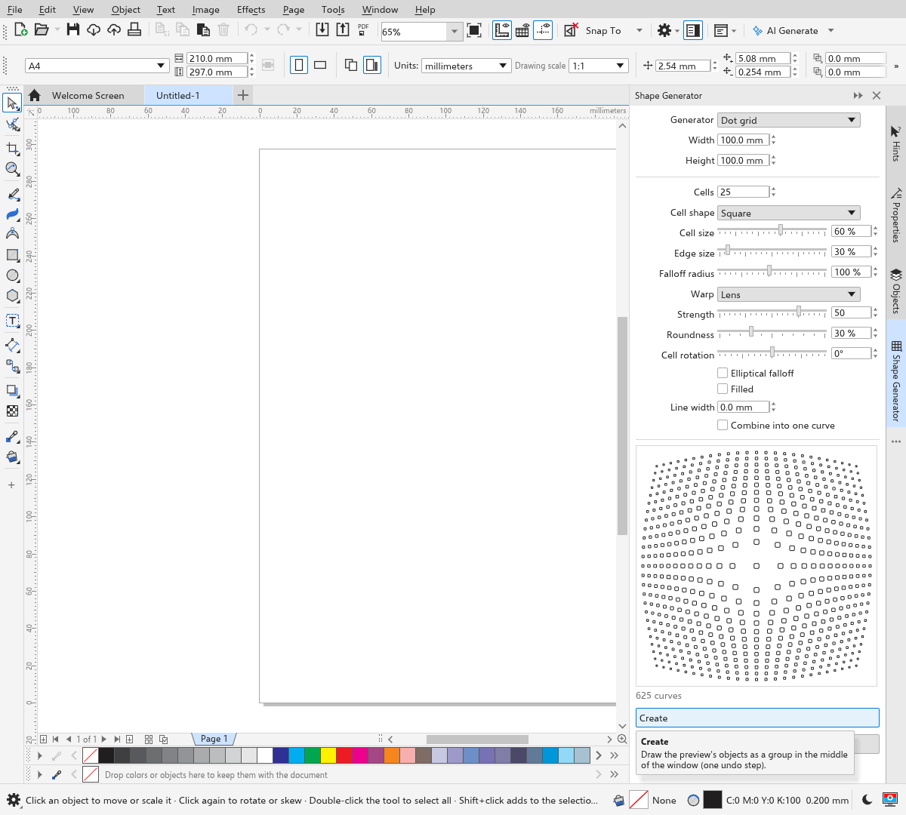

**4.** Clique em [[shapegen.create]]. O padrão entra como um grupo no meio da
janela, selecionado, feito de curvas comuns.

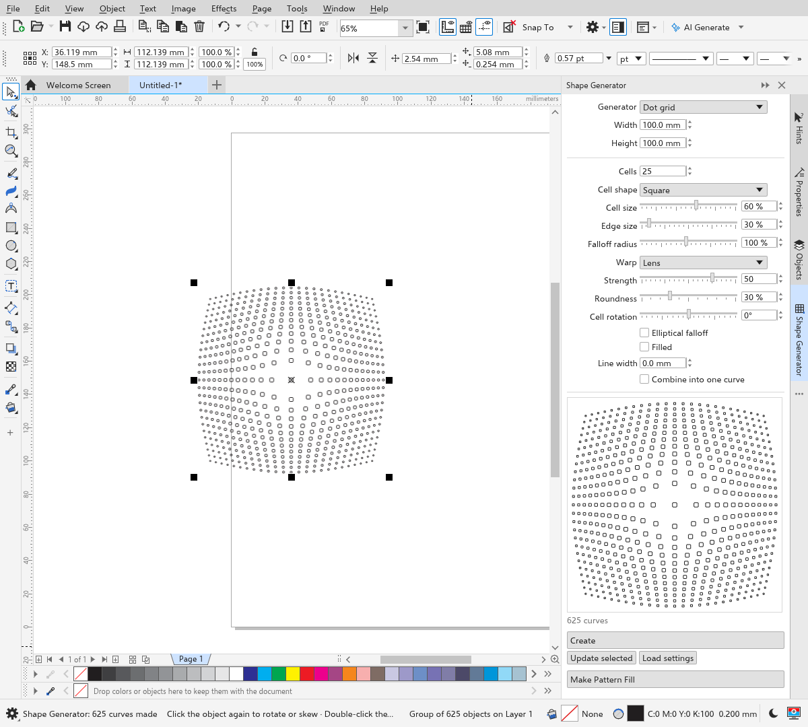

**5.** Para mudar depois, selecione o grupo, mude as configurações e clique em
[[shapegen.update]]: o grupo é refeito no mesmo lugar. [[shapegen.load]]
traz antes as configurações do grupo de volta para o painel. Aqui as
células foram mudadas para [[shapegen.cell_diamond]] e a prévia já as
mostra antes de Atualizar.

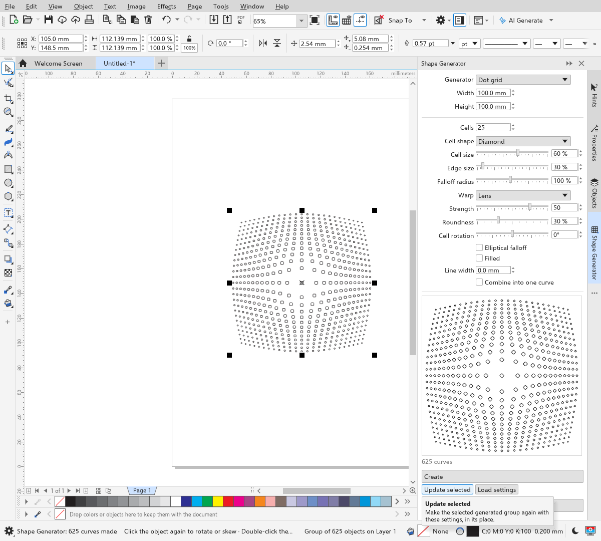

## A ferramenta {#tool}

A ferramenta [[tool.shape_generator]], junto das ferramentas de formas na
caixa de ferramentas, desenha o padrão do painel onde você quer e no
tamanho que você quer:

- Escolha a ferramenta. A barra de propriedades tem a lista
  [[shapegen.kind]], a [[shapegen.seed]] com [[shapegen.new_seed]] para
  outra variação, e [[toolbar.shape_gen_options]], que abre o painel com
  todas as configurações do padrão.
- Arraste na página. O próprio padrão acompanha a área enquanto você
  arrasta, então você vê o resultado antes de soltar. <kbd>Ctrl</kbd>
  mantém a área quadrada, <kbd>Shift</kbd> desenha a partir do centro.
- Solte: o padrão preenche a área como um grupo selecionado, em um passo
  de desfazer. O painel recebe a largura e a altura da área, então mudar
  uma configuração e clicar em [[shapegen.update]] refaz o padrão no
  mesmo lugar.

A ferramenta sempre preenche a área arrastada: uma seleção escolhida no
painel com [[shapegen.use_selection]] é usada só por [[shapegen.create]].
Um molde de cone mantém o próprio tamanho e fica centralizado na área.

## Geradores {#generators}

Cada imagem mostra o painel com as primeiras configurações do gerador e, na
janela de desenho, o que [[shapegen.create]] fez com elas.

### [[shapegen.kind_dot_grid]] {#dot-grid}

Uma grade de círculos, quadrados ou losangos cujo tamanho muda do meio até a
borda do [[shapegen.falloff]] ([[shapegen.scale_ratio]]), com uma
[[shapegen.warp]] (uma lente que empurra as células para fora, puxa para
dentro ou faz ondulações) e uma opção [[shapegen.elliptical]].

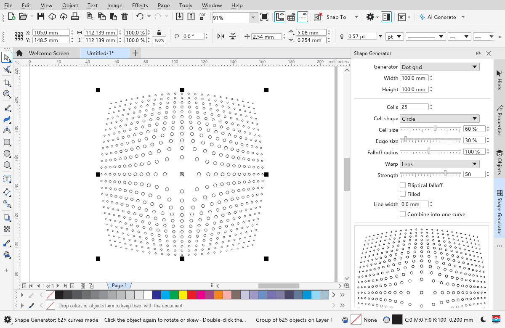

### [[shapegen.kind_truchet]] {#truchet}

Ladrilhos quadrados de quartos de arco (com uma ou mais
[[shapegen.bands]]), quartos de disco preenchidos ou diagonais, cada um
girado ao acaso. As bordas de cada ladrilho encontram as dos vizinhos, então
o resultado se repete sem emenda.

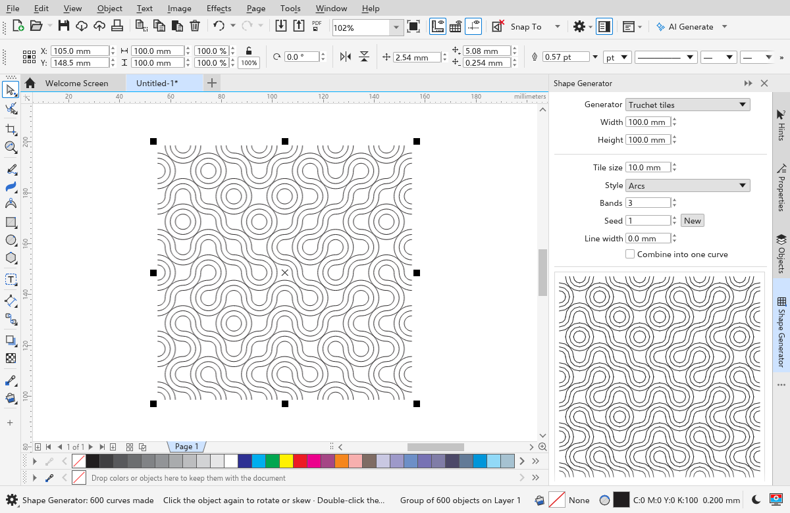

### [[shapegen.kind_tessellation]] {#tessellation}

Triângulos, hexágonos, escamas, chevrons, [[shapegen.tess_masonry]]
(tijolos em amarração corrida) ou [[shapegen.tess_pinwheel]] (triângulos
retângulos girados em ângulos que nunca se repetem) com um
[[shapegen.gap]] e uma [[shapegen.rotation]].

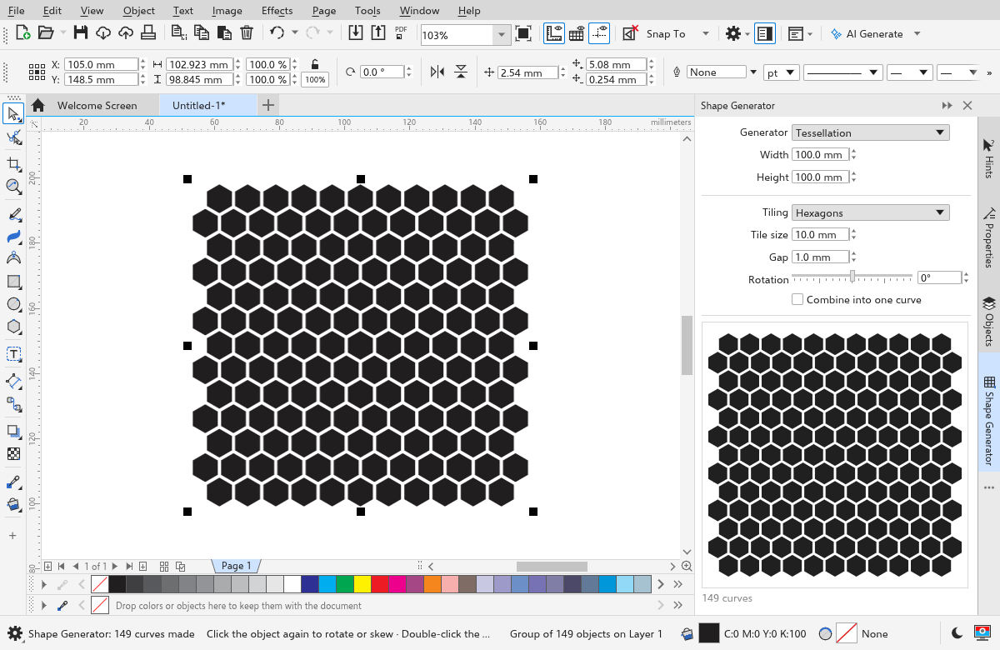

### [[shapegen.kind_line_waves]] {#line-waves}

Linhas curvadas por um ruído suave dentro de uma elevação:
[[shapegen.wave_width]], [[shapegen.amplitude]], [[shapegen.noise_x]],
[[shapegen.noise_y]], [[shapegen.spread]], [[shapegen.sharpness]],
[[shapegen.fade]] e [[shapegen.softness]].

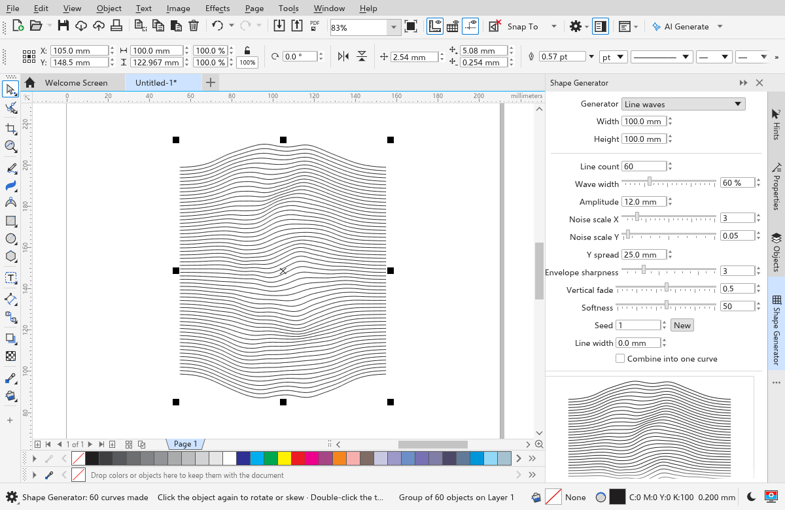

### [[shapegen.kind_rings]] {#rings}

Anéis fechados entre [[shapegen.min_radius]] e [[shapegen.max_radius]],
cada um ondulado por um ruído que dá uma volta completa.

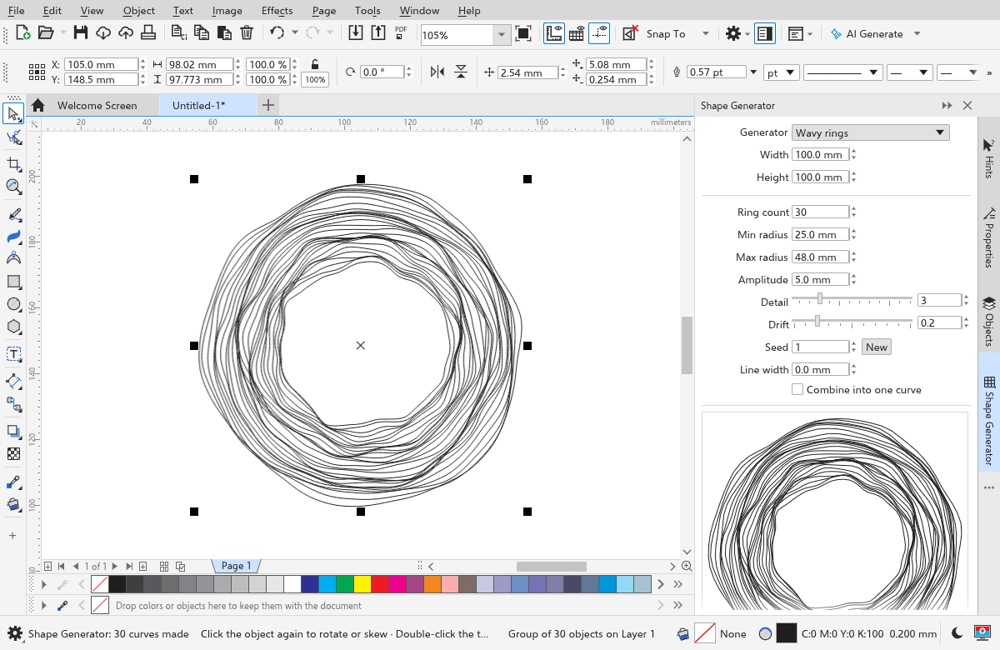

### [[shapegen.kind_field_lines]] {#field-lines}

Linhas igualmente espaçadas que fluem em volta de alguns
[[shapegen.poles]], com um [[shapegen.flow]] atravessando a área e um
[[shapegen.swirl]] opcional.

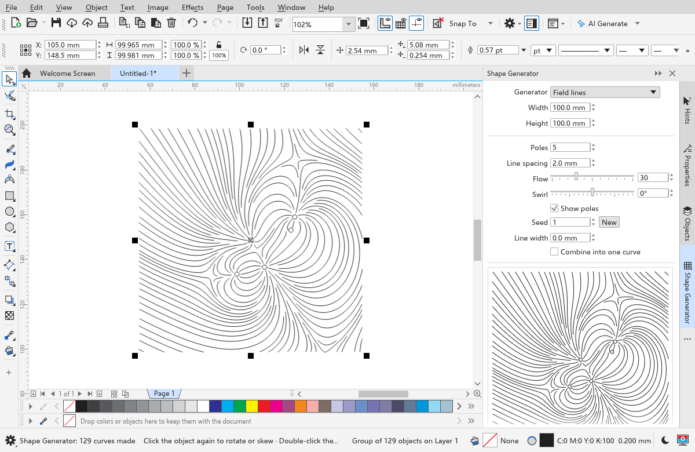

### [[shapegen.kind_iso_blocks]] {#iso-blocks}

Pilhas de cubos numa grade isométrica, com alturas planas, aleatórias, em
pirâmide ou em onda, e três faces sombreadas.

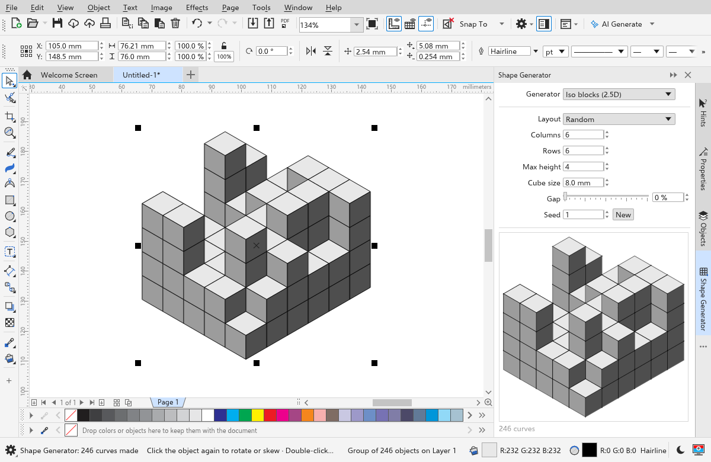

### [[shapegen.kind_spirograph]] {#spirograph}

Uma roda girando por dentro ou por fora de um anel
([[shapegen.spiro_fixed]], [[shapegen.spiro_rolling]],
[[shapegen.spiro_pen]]), figuras de Lissajous, rosáceas e mandalas.

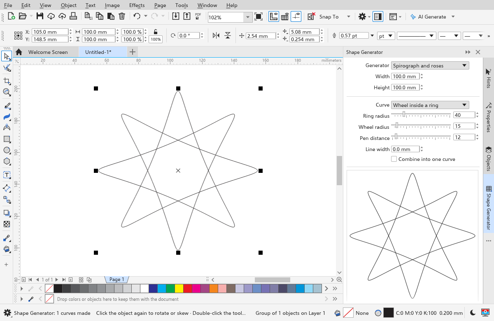

### [[shapegen.kind_guilloche]] {#guilloche}

Anéis curvados por duas ondas, cada um girado pela [[shapegen.guil_twist]]
para que as linhas se entrelacem, como nas cédulas de dinheiro. A
[[shapegen.guil_layout]] também pode levar as linhas numa
[[shapegen.guil_band_layout]] atravessando a caixa ou numa
[[shapegen.guil_frame_layout]] na borda ([[shapegen.guil_band]]), com
ondas de [[shapegen.guil_period]] e [[shapegen.guil_period2]]: as bordas de
certificados, diplomas e vales.

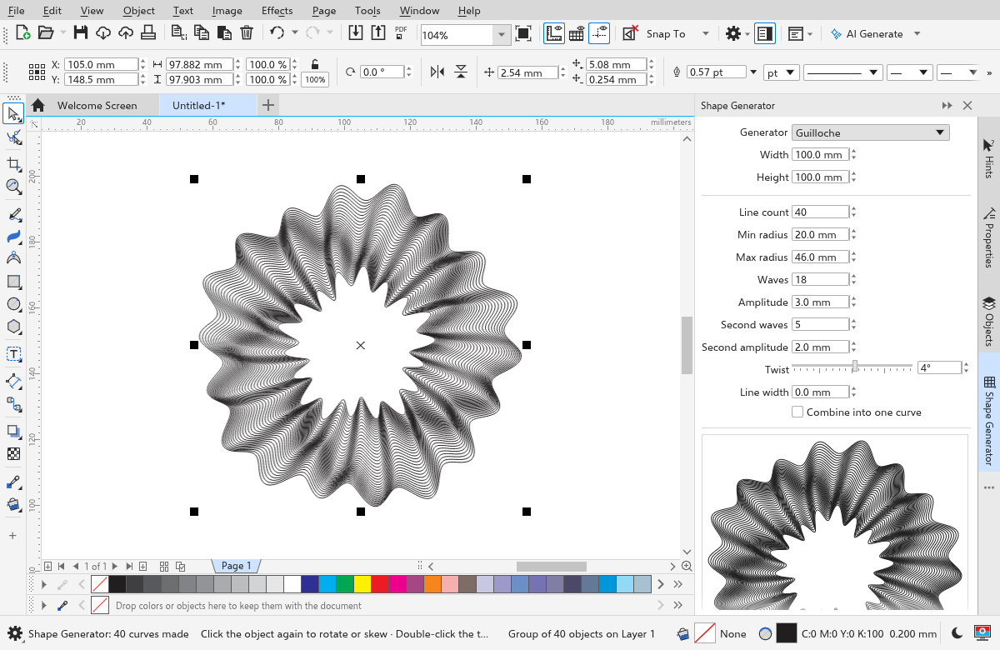

### [[shapegen.kind_tiling]] {#tiling}

Losangos de Penrose, que nunca se repetem, e padrões de estrelas sobre
quadrados ou hexágonos formados pelo [[shapegen.tile_angle]].

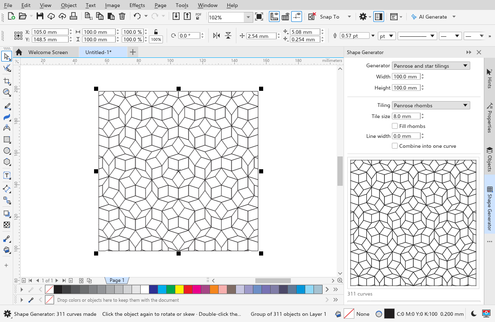

### Os outros geradores {#other-generators}

- [[shapegen.kind_cone]]: o molde plano de um cone, de um cilindro afunilado
  ou de um cilindro, veja [Moldes de cone](#cone).
- [[shapegen.kind_voronoi]]: células em volta de pontos espalhados, veja
  [Células de Voronoi](#voronoi).
- [[shapegen.kind_stipple]] e [[shapegen.kind_halftone]]: pontos e marcas
  com tamanho dado pelos tons de uma imagem, veja
  [Imagens como pontos](#tones).
- [[shapegen.kind_fractal]]: uma árvore com galhos, o floco de neve de Koch,
  a ponta de flecha de Sierpinski, a curva do dragão, uma planta ou o seu
  próprio L-system, veja [L-systems](#lsystems).
- [[shapegen.kind_hatch]], [[shapegen.kind_contour]], [[shapegen.kind_maze]]
  e [[shapegen.kind_space_curve]]: linhas que preenchem uma forma, veja
  [Preencher uma forma](#fills).
- [[shapegen.kind_slice]]: corta a seleção em faixas ou numa grade e move
  cada pedaço, veja [Fatiar uma seleção](#slice).
- [[shapegen.kind_layer_waves]], [[shapegen.kind_blobs]] e
  [[shapegen.kind_soft_gradient]]: fundos preenchidos nas cores que
  você escolher, veja [Fundos](#backgrounds).
- [[shapegen.kind_circle_packing]], [[shapegen.kind_phyllotaxis]],
  [[shapegen.kind_quadtree]], [[shapegen.kind_reaction_diffusion]] e
  [[shapegen.kind_interlace]]: veja
  [Empacotamentos, nós e padrões orgânicos](#more-patterns).

Os geradores que fazem escolhas aleatórias têm uma [[shapegen.seed]]: a
mesma semente sempre dá o mesmo resultado, e [[shapegen.new_seed]] escolhe
outra.

## Criar e alterar {#create}

- [[shapegen.create]] desenha os objetos como um grupo no meio da janela. Um
  único Desfazer o remove.
- O grupo guarda as configurações. Selecione-o e clique em
  [[shapegen.update]] para refazê-lo com as configurações do painel no mesmo
  lugar, ou em [[shapegen.load]] para trazer as configurações dele de volta
  ao painel.
- [[shapegen.combine]] faz uma curva por cor em vez de um grupo de curvas
  separadas, mais leve para padrões grandes.
- [[shapegen.make_pattern]] cria os objetos e os transforma num
  preenchimento de padrão vetorial.

As configurações ficam guardadas entre as sessões. Uma geração faz no máximo
40.000 curvas; passando disso ela é cortada e o painel avisa.

## Moldes de cone {#cone}

Digite o [[shapegen.cone_top]], o [[shapegen.cone_bottom]] e a
[[shapegen.cone_height]] do objeto. O molde é um segmento de anel (um setor
quando um dos diâmetros é 0, um retângulo quando os dois são iguais) em
tamanho real, com uma [[shapegen.cone_tab]] de um lado e um contorno de
[[shapegen.cone_bleed]] opcional. [[shapegen.cone_pieces]] o corta em
vários pedaços, cada um com a própria aba. O painel mostra a geratriz, os
raios e o ângulo.

Para pôr um desenho no objeto, desenhe-o plano como uma faixa, selecione-o e
clique em [[shapegen.wrap]]: o molde é desenhado e a faixa é curvada sobre
ele, a largura dela dando a volta no objeto [[shapegen.cone_repeat]] vezes e
o topo dela seguindo a borda de cima, para que fique reta ao enrolar no
objeto de verdade.

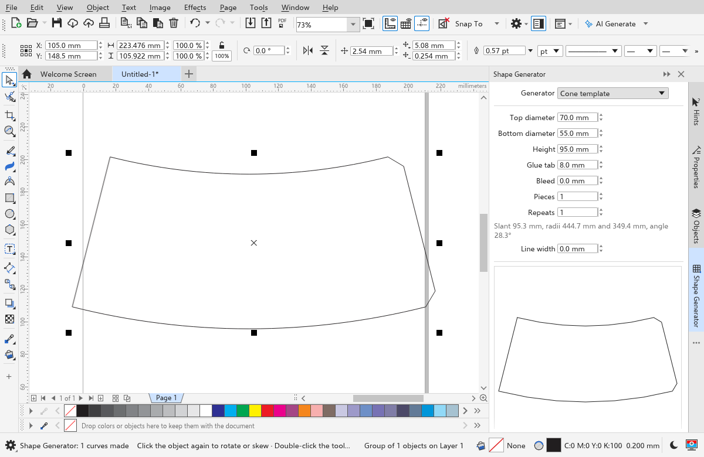

## Células de Voronoi {#voronoi}

Cada célula contém a parte da área mais perto do seu ponto do que de
qualquer outro. Posicione os pontos com [[shapegen.points]] e
[[shapegen.spacing]] (pontos em grade se movem pelo [[shapegen.jitter]]) e
depois deixe as células mais uniformes com passos de [[shapegen.relax]] ou
com o botão [[shapegen.relax_once]]. Um [[shapegen.gradient]] deixa as
células menores em direção ao meio ou ao longo de uma direção. Para corte,
[[shapegen.inset]] deixa um espaço entre as células e
[[shapegen.corner_radius]] arredonda os cantos. [[shapegen.show_cells]],
[[shapegen.show_sites]] e [[shapegen.show_delaunay]] escolhem o que é
desenhado.

Edite os pontos direto na prévia: arraste um para movê-lo e veja os
vizinhos acompanharem, clique duas vezes para adicionar um, clique com o
botão direito num ponto para apagá-lo. Os pontos colocados à mão ficam
guardados com as configurações; [[shapegen.reset_points]] volta aos pontos
gerados.

Para preencher uma forma, selecione-a e clique em
[[shapegen.use_selection]]: as células preenchem o contorno dela, os furos
ficam vazios, e Criar põe o resultado sobre ela.

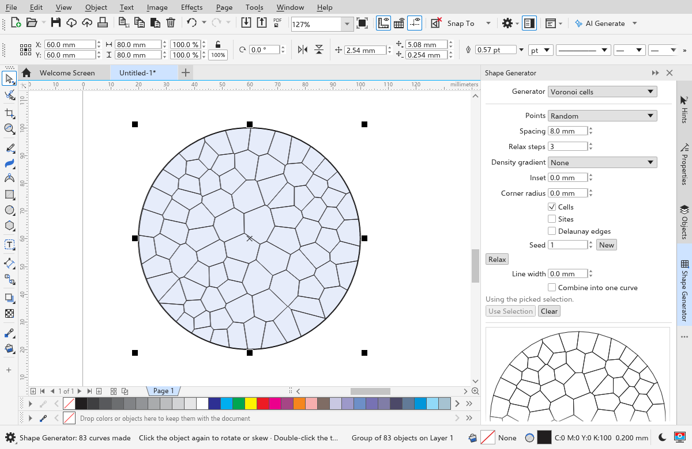

## Imagens como pontos {#tones}

Selecione uma imagem ou quaisquer objetos e clique em
[[shapegen.use_selection]]: a seleção é desenhada numa imagem cujo escuro
define o tamanho das marcas, e as marcas ficam dentro do contorno dela. Sem
seleção, um degradê redondo é usado no lugar.

- [[shapegen.kind_stipple]] espalha [[shapegen.dots]] conforme o escuro e
  os distribui por igual ao longo de [[shapegen.st_iter]] passos; com
  [[shapegen.st_by_tone]], os lugares escuros ganham pontos maiores.
- [[shapegen.kind_halftone]] põe uma [[shapegen.ht_shape]] em cada
  [[shapegen.ht_cell]] de uma retícula girada pelo [[shapegen.ht_angle]],
  com tamanho entre [[shapegen.ht_min]] e [[shapegen.ht_max]]; Linhas
  desenha faixas que engrossam onde é escuro. [[shapegen.ht_cmyk]] faz
  quatro retículas, uma por tinta, cada uma no próprio grupo.

[[shapegen.invert]] põe as marcas nos lugares claros.

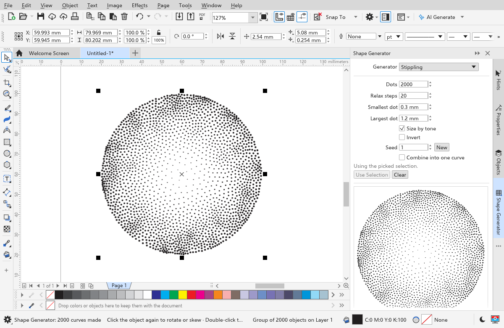

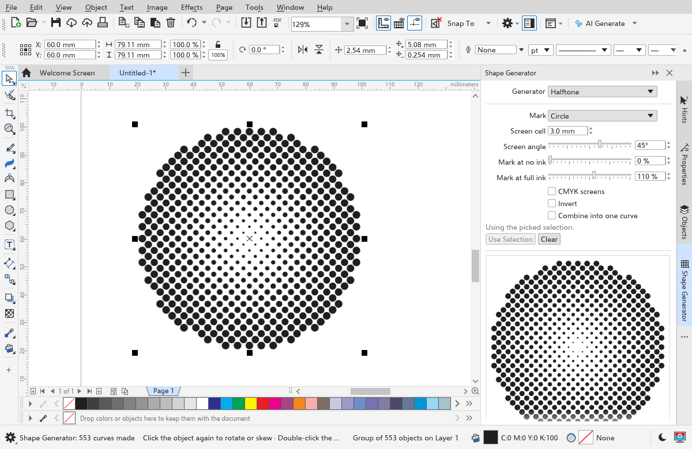

## L-systems {#lsystems}

Um L-system começa do [[shapegen.frac_axiom]] e troca cada símbolo pela sua
regra, uma vez por nível. O resultado é desenhado por uma tartaruga: F, G, A
e B desenham um passo, f anda sem desenhar, + e - giram pelo ângulo, [ e ]
guardam um lugar e voltam a ele (para galhos), | dá meia-volta. Escreva as
[[shapegen.frac_rules]] como `F=F+F--F+F`, uma por linha ou separadas por
ponto e vírgula. [[shapegen.frac_edit]] copia um fractal pronto para um
personalizado, para você alterá-lo. Níveis muito profundos param de crescer
em 400.000 símbolos.

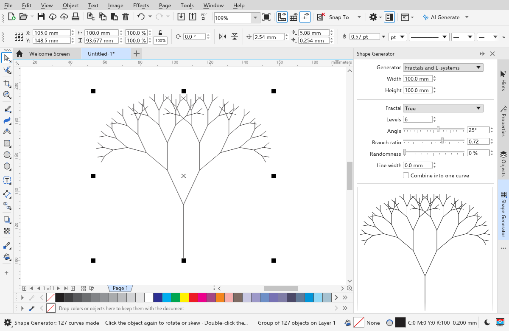

## Preencher uma forma {#fills}

Estes preenchem a caixa, ou o contorno escolhido com
[[shapegen.use_selection]] com os furos vazios; Criar põe o resultado sobre
a seleção.

- [[shapegen.kind_hatch]]: linhas a [[shapegen.hatch_spacing]] umas das
  outras num [[shapegen.hatch_angle]], cortadas exatamente no contorno.
  Cruzado acrescenta um segundo conjunto girado pelo
  [[shapegen.hatch_cross]]. Por tom desenha [[shapegen.hatch_layers]]
  conjuntos em ângulos diferentes, cada um só onde a imagem escolhida é mais
  escura, e o sombreado se acumula como num desenho a nanquim.
- [[shapegen.kind_contour]]: anéis a [[shapegen.contour_spacing]] uns dos
  outros, recuados para dentro a partir do contorno até não sobrar espaço,
  ou linhas que seguem os tons da imagem num número de
  [[shapegen.contour_levels]], como as curvas de nível de um mapa.
- [[shapegen.kind_maze]]: um labirinto com exatamente um caminho entre
  quaisquer duas células, com corredores de [[shapegen.maze_cell]] de
  largura. Desenhe as paredes, com uma entrada embaixo e uma saída em cima,
  ou os corredores como uma única linha pelas células (bom para um traço só
  num plotter ou laser). [[shapegen.new_seed]] faz outro labirinto.
- [[shapegen.kind_space_curve]]: uma única linha que passa por todas as
  células de uma grade sem se cruzar. Cada [[shapegen.curve_order]] a deixa
  mais fina; dentro de um contorno ela se interrompe onde sai da forma.

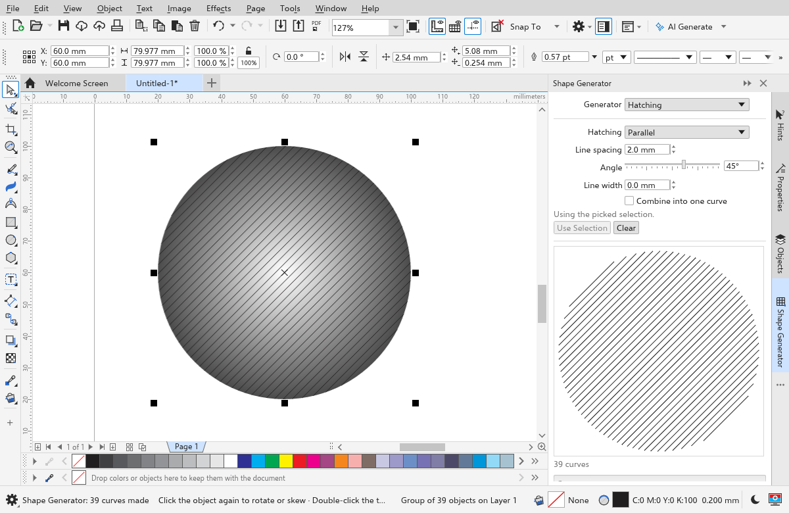

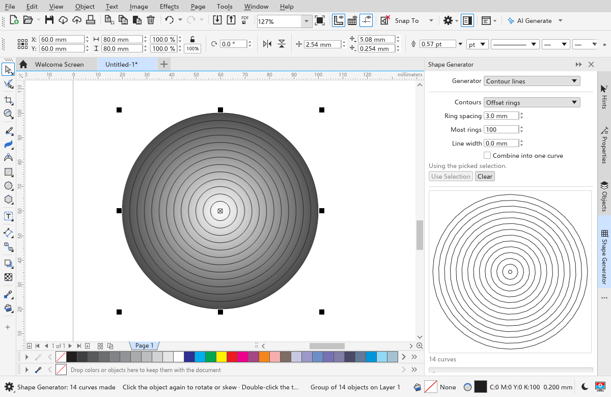

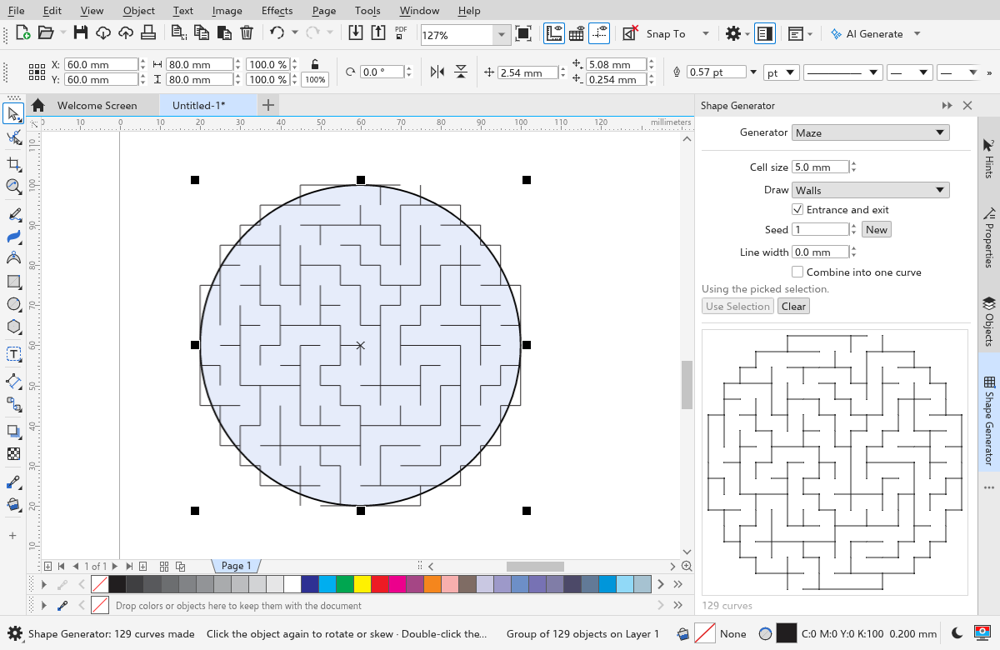

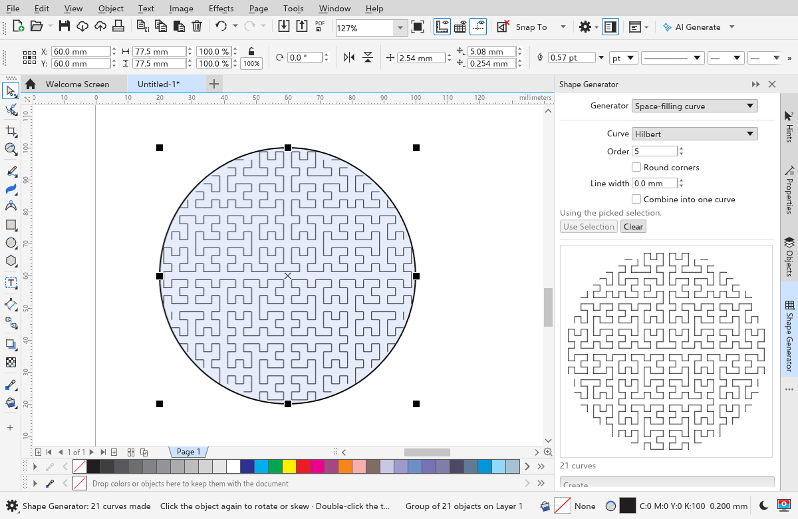

## Fatiar uma seleção {#slice}

Selecione objetos, textos ou imagens, escolha como [[shapegen.slice_layout]]
(linhas, colunas ou grade) e o [[shapegen.slice_pattern]] e clique em
[[shapegen.slice_apply]]. Cada pedaço se move até [[shapegen.slice_dx]] e
[[shapegen.slice_dy]]: ao acaso, ao longo de uma onda, de um lado ao outro,
ou um pedaço sim, outro não, para cada lado. Um [[shapegen.slice_gap]] deixa
espaço entre os pedaços. A prévia mostra as células como vão se mover.

Cada pedaço é um quadro de recorte com uma cópia da seleção, então o texto
continua editável e as imagens mantêm os pixels; os pedaços vêm num grupo, e
[[shapegen.slice_keep]] deixa o original no lugar.

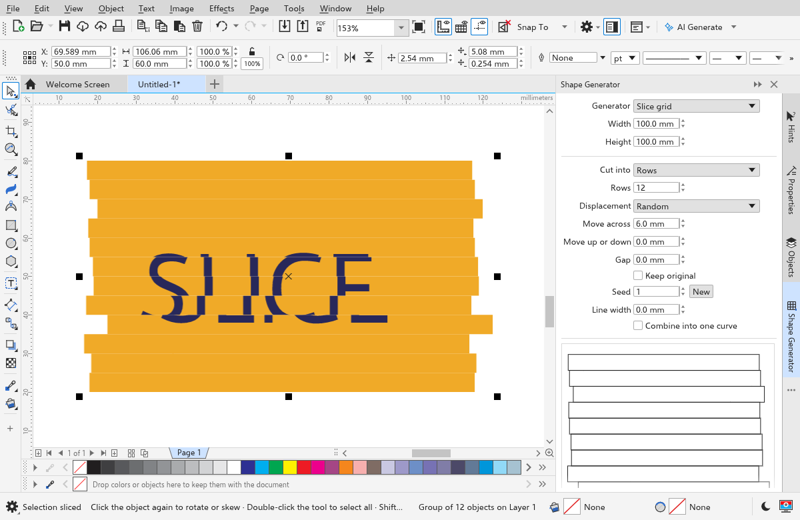

## Crescimento diferencial {#growth}

Uma linha que cresce e se dobra dentro da caixa, ou dentro do contorno da
seleção depois de [[shapegen.use_selection]]. Escolha com o que
[[shapegen.growth_start]] (um círculo, uma linha aberta ou vários círculos),
o [[shapegen.growth_spacing]], o quanto os pontos se afastam
([[shapegen.growth_repel]]) e se alinham ([[shapegen.growth_align]]), e o
[[shapegen.growth_rate]].

Clique em [[shapegen.growth_run]] para ver crescer na pré-visualização, ou
pressione Espaço com o ponteiro sobre o painel; pressione de novo para
pausar. Ele para sozinho quando o espaço enche ou o
[[shapegen.growth_max_nodes]] é atingido. [[shapegen.growth_stop]]
(Shift+Espaço) coloca o resultado na página como curvas.
[[shapegen.growth_steps]] acompanha o crescimento, e os mesmos passos
sempre fazem a mesma linha, então um crescimento pausado pode ser avançado
à mão e Atualizar refaz o grupo exatamente igual.

## Deformar e dividir por uma forma {#deform}

Abra [[shapegen.deform]] e arraste na pré-visualização para criar um pino e
puxar o desenho com ele: as linhas perto do pino acompanham, diminuindo ao
longo do [[shapegen.warp_reach]], então anéis e ondas se curvam suavemente
como uma impressão digital. Arraste a ponta de um pino para mudar a força ou
o início para movê-lo, clique com o botão direito para removê-lo, e
[[shapegen.warp_clear]] remove todos.

[[shapegen.split_mode]] corta as linhas onde elas cruzam uma forma ou um
texto: selecione-o, clique em [[shapegen.split_pick]] e escolha desenhar as
partes de dentro com a [[shapegen.split_color]] e a [[shapegen.split_width]],
ou manter só as partes de dentro ou de fora. Criar centraliza o desenho na
forma escolhida, e os pedaços continuam linhas abertas.

## Fundos {#backgrounds}

Três geradores fazem fundos preenchidos do tamanho da caixa, nas
[[shapegen.bg_colors]] que você escolher (adicione cores com +, remova a
última com o botão de menos). Cada [[shapegen.seed]] dá outra variação.

- [[shapegen.kind_layer_waves]]: [[shapegen.bg_layers]] faixas preenchidas
  empilhadas de trás para a frente; a de trás, na primeira cor, preenche a
  caixa. As bordas são ondas suaves: [[shapegen.bg_amplitude]] define a
  altura, [[shapegen.bg_frequency]] quantas passam pela largura,
  [[shapegen.bg_complexity]] o quanto as bordas são vivas, e
  [[shapegen.bg_side]] se as faixas sobem da base ou descem do topo.
- [[shapegen.kind_blobs]]: formas orgânicas suaves. Um blob fica no meio;
  com mais [[shapegen.bg_blob_count]] eles se espalham pela caixa nas cores
  da paleta. [[shapegen.bg_blob_points]] e [[shapegen.bg_randomness]]
  definem o quanto são irregulares.
- [[shapegen.kind_soft_gradient]]: um retângulo com um preenchimento de
  malha suave cujos pontos recebem as cores da paleta ao acaso, para as
  cores se fundirem. [[shapegen.bg_mesh_size]] define quantas manchas de cor
  há e [[shapegen.bg_jitter]] o quanto elas fluem livremente.

As ondas e os blobs são curvas preenchidas comuns e o degradê é um
preenchimento de malha comum, então podem ser editados, recoloridos e
exportados como qualquer outro objeto; adicione grão ou desfoque com os
efeitos, se quiser.

## Empacotamentos, nós e padrões orgânicos {#more-patterns}

- [[shapegen.kind_circle_packing]]: círculos de vários tamanhos preenchem a
  caixa sem se encostar, do [[shapegen.pack_min]] ao [[shapegen.pack_max]],
  com um [[shapegen.gap]] entre eles, até [[shapegen.pack_count]] círculos.
  Escolha uma forma ou texto com [[shapegen.use_selection]] para preenchê-lo
  no lugar da caixa: bom para arte de laser, fundos e logos.
- [[shapegen.kind_phyllotaxis]]: [[shapegen.phy_count]] pontos na espiral
  do miolo de um girassol, cada um girado do anterior pelo
  [[shapegen.phy_angle]] (o ângulo áureo por padrão). O
  [[shapegen.cell_shape]], o [[shapegen.cell_size]] e a
  [[shapegen.scale_ratio]] (pontos de fora comparados aos do centro)
  definem os pontos.
- [[shapegen.kind_quadtree]]: a caixa é cortada em quadrados e cada um é
  dividido em quatro ao acaso ([[shapegen.qt_split]]) até os
  [[shapegen.qt_depth]]; cada quadrado recebe uma cor de
  [[shapegen.bg_colors]] e um motivo geométrico em outra cor: um quarto ou
  meio disco, um disco, um anel, um triângulo, um quadrado menor, uma folha
  ou barras.
- [[shapegen.kind_reaction_diffusion]]: padrões orgânicos como pele de
  animal, labirinto ou coral, formados por dois químicos numa grade e
  traçados como curvas preenchidas. Escolha o [[shapegen.rd_preset]], o
  [[shapegen.rd_cells]] (mais deixa as formas menores e demora mais), os
  [[shapegen.rd_steps]] e o [[shapegen.rd_level]] onde as bordas são
  traçadas; [[shapegen.rd_invert]] preenche o espaço entre as formas.
- [[shapegen.kind_interlace]]: fitas que passam por cima e por baixo umas
  das outras, alternando. [[shapegen.knot_celtic]] desenha nós sobre
  quadrados, com [[shapegen.knot_breaks]] que fazem os fios voltarem
  (espelhadas quando [[shapegen.knot_symmetric]]); os padrões de estrelas
  desenham fitas retas de estrelas de dez pontas (girih), oito ou seis
  pontas, formadas pelo [[shapegen.tile_angle]]. [[shapegen.knot_ribbon]]
  desenha cada fio como duas linhas a [[shapegen.knot_width]] de distância,
  e [[shapegen.knot_gap]] é o espaço deixado onde um fio passa por baixo de
  outro.
