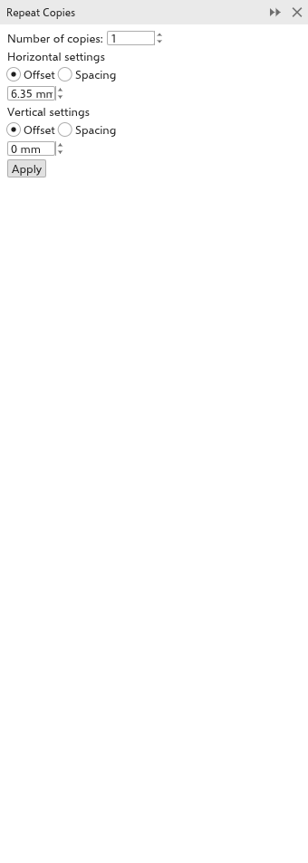

# Fazer cópias com Duplicar e repetir

O painel [[docker.step_and_repeat]] faz várias cópias da seleção, cada uma
deslocada da mesma distância em relação à anterior: uma fileira de botões, uma
coluna de linhas, uma grade de peças. Abra-o com
[[menu.edit > menu.edit.step_and_repeat]] (<kbd>Ctrl+Shift+D</kbd>).

## Para fazer cópias {#copies}

1. Selecione os objetos a copiar.
2. Defina o [[docker.copies]] (1 a 999).
3. Em [[docker.horizontal_settings]], escolha como as cópias se espaçam na
   horizontal:
   - [[docker.offset]]: a distância de uma cópia à seguinte, medida a partir do
     mesmo ponto de cada uma;
   - [[docker.spacing]]: o espaço entre uma cópia e a seguinte, de modo que as
     cópias nunca se sobrepõem, seja qual for o tamanho.

   Depois digite a distância. 0 mantém as cópias alinhadas.
4. Faça o mesmo em [[docker.vertical_settings]].
5. Clique em [[docker.apply]].

Enquanto você trabalha no painel (o ponteiro está sobre ele, você está
digitando num dos campos ou seu último clique foi nele), as cópias que
[[docker.apply]] faria aparecem contornadas na página, tracejadas em azul, e
acompanham cada valor que você muda. Nada é adicionado até você clicar em
[[docker.apply]], e um [[menu.edit.undo]] tira todas as cópias de novo. Um
clique fora, ou fechar ou esconder o painel, tira os contornos. Muitas cópias
de um objeto detalhado são contornadas pelas suas caixas.

As cópias vão para a camada ativa. As distâncias ficam nas unidades de desenho.

## Para preencher a página {#fill-page}

[[docker.sr_mode_fill]] repete a seleção em grade sobre a página, quantas
cópias couberem: etiquetas, adesivos, cartões de visita e tags impressos
juntos numa folha.

1. Selecione o objeto (ou objetos) a repetir.
2. No alto do painel escolha [[docker.sr_mode_fill]]. O painel mostra o
   tamanho da página.
3. Escolha preencher a [[docker.fillpage_area_page]] ou uma
   [[docker.fillpage_area_custom]] dela, definida pela borda esquerda e
   inferior, largura e altura.
4. Defina as [[docker.fillpage_margins]] livres dentro das bordas (um valor
   para todos os lados, ou desmarque [[docker.fillpage_same]] para definir
   cada lado) e o [[docker.fillpage_gap]] entre as cópias (um valor, ou
   [[docker.fillpage_gap_x]] e [[docker.fillpage_gap_y]]).
5. Para fileiras escalonadas, defina [[docker.fillpage_row_shift]].
6. Em [[docker.fillpage_turn]], cada opção mostra quantas cópias cabem,
   por exemplo "4 x 6 = 24 cópias". Escolha [[docker.fillpage_as_is]],
   [[docker.fillpage_turned]] ou [[docker.fillpage_best]].
7. Marque [[docker.fillpage_marks]] para marcas em cada linha de corte fora
   das cópias, e defina o comprimento e a distância.
8. Clique em [[docker.apply]].

A seleção vai para o primeiro lugar da grade e cópias preenchem os outros,
centradas no espaço dentro das margens; um [[menu.edit.undo]] desfaz tudo.
Enquanto você trabalha no painel, cada lugar fica contornado na página.

Para copiar com uma rotação ou uma escala a cada passo, use o campo
[[dialog.copies]] do painel [[docker.transformations]]; veja
[Mover, escalonar, girar e inclinar](transforming.md#transformations-docker).
