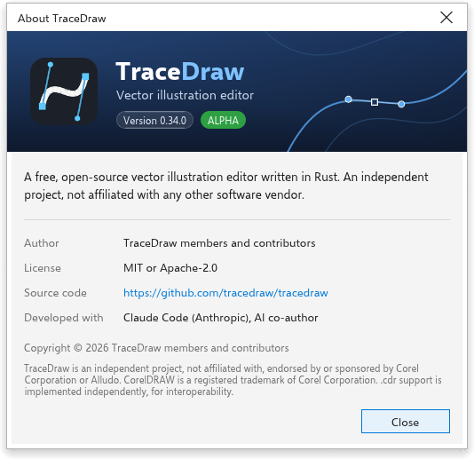

# Sobre o TraceDraw e atualizações

> *Tradução automática: esta página pode estar atrasada em relação à versão em inglês.*

O TraceDraw é livre e de código aberto. Esta página explica como ver qual
versão você tem, como obter uma mais nova e onde pedir ajuda.

## A caixa Sobre {#about}

Escolha [[menu.help > menu.help.about]] para ver a versão em uso, o autor, a
licença, um link para o código-fonte e com o que o programa é feito. Pressione
[[dialog.close]], <kbd>Enter</kbd> ou <kbd>Esc</kbd> para fechá-la.

## Procurar atualizações {#updates}

No computador, o TraceDraw pode avisar quando uma versão mais nova é lançada.

Para procurar agora:

1. Escolha [[menu.help > menu.help.updates]].
2. O TraceDraw consulta a página de versões do projeto e diz se há uma versão
   mais nova que a sua. Versões de teste e compilações noturnas nunca são
   oferecidas.
3. Quando há uma versão mais nova, escolha o que fazer:
   - **Baixar** abre o download do arquivo para o seu sistema (o instalador ou
     o arquivo portátil no Windows, a imagem de disco para o processador do seu
     Mac, o AppImage ou o arquivo compactado no Linux). O instalador do sistema
     faz a instalação.
   - **Notas da versão** abre a lista de mudanças dessa versão.
   - **Pular esta versão** deixa de oferecer essa versão.
   - [[dialog.close]] fecha a caixa.

Quando uma versão mais nova é conhecida, um cartão abre no meio da janela ao
iniciar o TraceDraw, com os dois números de versão e **Atualizar agora**, e você
atualiza sem abrir o menu. **Novidades** abre as notas da versão e **Dispensar**
fecha o cartão até a próxima abertura. Nada é baixado até você escolher
Atualizar agora.

Quando a sua cópia pode se atualizar sozinha, a caixa também oferece
**Instalar**, e você não precisa desinstalar nada antes. Isso vale para toda
cópia que tem um download: o instalador e o zip portátil do Windows, o app do
Mac e, no Linux, o AppImage, o arquivo compactado e o `.deb`. Instalar baixa a
nova versão, confere se o download está completo e é autêntico e depois:

- no **instalador do Windows**, espera você escolher **Fechar e instalar**: o TraceDraw
  fecha (perguntando sobre desenhos com alterações não salvas), o instalador
  roda por cima desta cópia, mantém suas configurações e associações de
  arquivo, e a nova versão abre sozinha;
- no **zip portátil do Windows**, troca o programa e seus arquivos no próprio
  lugar e nunca mexe na pasta de configurações; **Reiniciar agora** abre a
  nova versão;
- num **`.deb` no Linux**, espera você escolher **Fechar e instalar**: o
  TraceDraw fecha, o sistema pede sua senha de administrador, instala o pacote
  e o TraceDraw abre de novo (se você cancelar a senha, abre a versão antiga);
- num **arquivo compactado (tar.gz) no Linux**, troca o programa no próprio
  lugar; **Reiniciar agora** abre a nova versão;
- no **Mac**, troca o app do TraceDraw no próprio lugar; **Reiniciar agora**
  abre a nova versão;
- num **AppImage no Linux**, coloca o novo arquivo no lugar do antigo;
  **Reiniciar agora** abre a nova versão.

Escolha **Mais tarde** para continuar trabalhando: a nova versão roda na
próxima vez que você abrir o TraceDraw (no Windows, o instalador baixado só
roda quando você escolhe Fechar e instalar; num `.deb`, o pacote baixado só é
instalado nessa hora). Se algo não conferir, a versão antiga fica como estava e
a caixa diz por quê e oferece **Baixar**. As cópias sem download (outros
pacotes do sistema, Flatpak, Snap) ficam com **Baixar**.

Se a verificação falhar (por exemplo, sem conexão com a internet), a caixa diz
isso e oferece a página de versões.

### Verificação automática {#automatic-check}

Em [[menu.tools > menu.tools.options > menu.tools.options_global]], na página
[[options.general]], há uma opção para procurar atualizações ao iniciar. Ela
vem ativada: uma vez por dia, o TraceDraw verifica em silêncio ao iniciar e só
avisa quando sai uma versão mais nova que você não pulou.

Na primeira vez que o TraceDraw inicia, ele pergunta se deve procurar atualizações: [[updates.policy_always]] ou [[updates.policy_never]]. Até você responder, o TraceDraw não faz nenhuma conexão por conta própria. A resposta define esta opção, então você pode mudá-la aqui quando quiser.

> **Observação:** A versão para navegador é sempre a mais recente. Nela,
> [[menu.help > menu.help.updates]] abre a página de versões.

A cópia instalada pela Microsoft Store e o app para Android são atualizados
pela loja: nunca consultam o GitHub, [[menu.help > menu.help.updates]] abre a
página deles na loja, e as opções não têm verificação de atualizações. Toda
outra instalação baixa o arquivo feito para o seu processador e para o modo
como foi instalada (instalador, zip portátil, AppImage, `.deb`, arquivo
compactado ou imagem de disco).

## A Tela de boas-vindas {#welcome-screen}

A Tela de boas-vindas é a primeira guia quando o TraceDraw inicia. Nela você
pode criar um desenho, abrir um dos desenhos usados por último (cada um com uma
miniatura; [[menu.file.clear_recent]] esquece a lista), começar a partir de um
modelo, ler as notícias e encontrar material de aprendizado. Quando uma página
é mais alta que a janela (uma lista longa de desenhos recentes), ela rola com a
roda do mouse ou com a barra de rolagem; a fileira de guias no alto fica no
lugar. Escolha
[[menu.help > menu.help.welcome_screen]] para trazê-la de volta.
[[menu.help > menu.help.video_tutorials]], [[menu.help.quick_start_guide]] e
[[menu.help.user_guide]] abrem a página de aprendizado, e
[[menu.help.whats_new]] as notícias.

## Comunidade e suporte {#community}

- [[menu.help > menu.help.community]] abre o fórum de discussões do projeto,
  onde você pode fazer perguntas e compartilhar ideias.
- [[menu.help > menu.help.support]] abre o rastreador de problemas, onde você
  pode relatar um problema.
- [[menu.help > menu.help.message_settings]] abre as opções em que as
  mensagens do TraceDraw são definidas.
