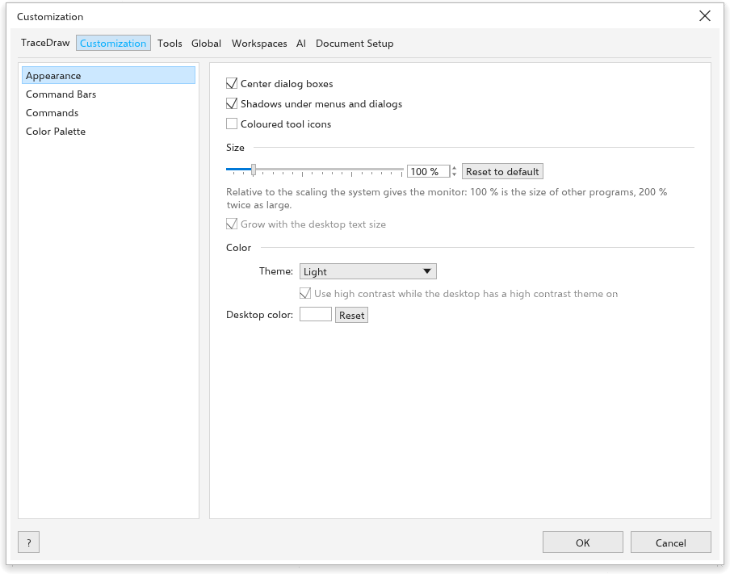
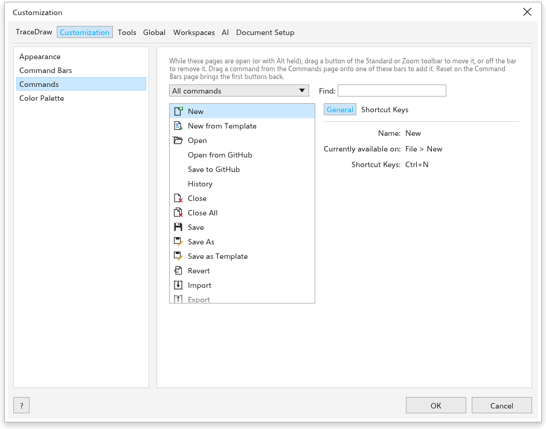
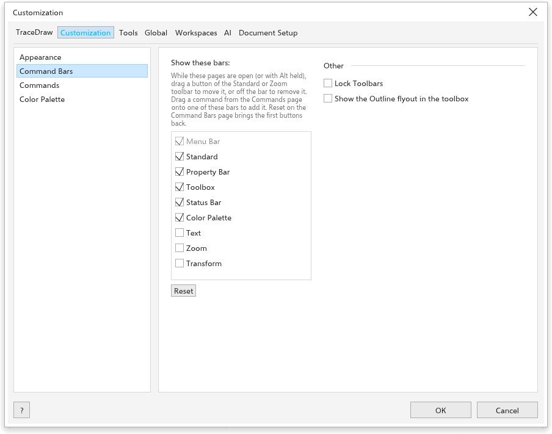
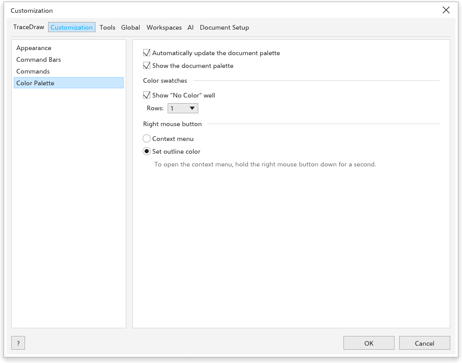

# Параметры настройки

> *Машинный перевод: эта страница может отставать от английской версии.*

[[menu.tools > menu.tools.options > menu.tools.options_customization]] задаёт
внешний вид интерфейса, ваши собственные сочетания клавиш, видимые панели и
поведение цветовой палитры.

## Внешний вид {#appearance}

- [[options.center_dialogs]]: диалоговые окна открываются посередине окна;
  если выключено, они открываются там, где вы их оставили.
- [[options.ui_shadows]] (меньше теней помогает медленной графике).
- [[options.translucent_menus]]: open menus let the drawing show through them, at the [[options.menu_opacity]] beside the box (off by default).
- [[options.colored_icons]]: каждая группа инструментов получает свой цвет.
- [[options.docker_tabs_icons_only]]: вкладки панелей по краям окна
  показывают только значок, а название во всплывающей подсказке. Если
  выключено, видны значок и название, а столбец с вкладками, которые не
  помещаются, прокручивается.
- [[options.ui_size]]: насколько крупны меню, панели, значки и панели
  параметров относительно масштаба, который система задаёт монитору (по
  умолчанию 100%). [[options.reset_to_default]] возвращает 100%. Размер
  интерфейса никогда не меняет размер вашего рисунка.
  [[options.follow_text_size]] увеличивает его вместе с размером текста
  рабочего стола.
- [[options.color_section]]: [[options.theme]] (светлая, умеренно светлая,
  умеренно тёмная, тёмная или высококонтрастная),
  [[options.follow_high_contrast]] и [[options.desktop_color]] вокруг
  страницы. Кнопка у правого края строки состояния переключает светлую и
  тёмную.

## Команды {#commands}

На странице перечислены все команды меню с их сочетаниями клавиш, а также
клавиши инструментов. Вводите текст в [[options.find_command]], чтобы
отфильтровать список.

Чтобы назначить команде своё сочетание клавиш:

1. Нажмите кнопку сочетания клавиш команды.
2. Нажмите клавиши, например <kbd>Ctrl+Alt+K</kbd>. <kbd>Esc</kbd> прекращает
   ожидание.

Ваши сочетания важнее встроенных: если вы занимаете клавишу, которую
использует другая команда, страница сообщает, какая команда её потеряла. Меню
показывают ваше сочетание. **x** рядом с сочетанием удаляет его, а сброс к
значениям по умолчанию удаляет их все. Клавиши инструментов это буква или
<kbd>Shift</kbd> и буква. См. [Сочетания клавиш](../reference/keyboard-shortcuts.md).

У команды может быть несколько сочетаний клавиш: новое добавляется к уже
имеющимся (встроенное продолжает работать рядом), и у каждого есть своя кнопка
удаления. Кнопки панелей, выполняющие команду меню («Создать», «Открыть»,
«Сохранить», «Отменить», «Увеличить» и другие), тоже принимают сочетания, те же,
что у команды меню, как и строки, которые меню показывают лишь иногда. Список
**Кнопки панелей инструментов** содержит все кнопки панелей «Стандартная» и
«Масштаб»: удалённую с панели кнопку можно перетащить оттуда обратно.

## Панели команд {#command-bars}

[[options.command_bars_hint]] [[menu.window.toolbar_menu_bar]],
[[menu.window.toolbar_standard]], [[menu.window.toolbar_property_bar]],
[[menu.window.toolbar_toolbox]], [[menu.window.toolbar_status_bar]],
[[bars.palette]], а также панели инструментов [[menu.window.toolbar_text]],
[[menu.window.toolbar_zoom]] и [[menu.window.toolbar_transform]].
[[options.reset]] возвращает панели на место. В разделе [[options.other]]:
[[bars.lock]] и [[options.show_outline_flyout]].

[[options.toolbar_drag_hint]]

## Цветовая палитра {#color-palette}

- [[options.palette_auto_update]] и [[options.palette_show_document]] (оба
  включены).
- [[options.palette_position]] (сверху, снизу, слева, справа или плавающая)
  основной палитры, как её задаёт собственное меню палитры; не меняется,
  пока панели инструментов заблокированы.
- [[options.palette_swatches]]: [[options.palette_no_color]] (включено) и что
  делает [[options.palette_right_button]]: [[options.palette_set_outline]] (по
  умолчанию) или открывает [[options.palette_context_menu]].

См. [Цветовые палитры](../color/palettes.md).

## Контекстные меню {#context-menus}

В разделе настройки выберите [[options.context_menus]], чтобы независимо управлять 32 расположениями контекстных меню. Выберите расположение с помощью [[options.context_menu_scene]], затем используйте [[options.context_menu_search]], чтобы найти операцию, и снимите её флажок, чтобы скрыть её в этом расположении. Операции остаются в списке, даже если текущее выделение не может их использовать.

По умолчанию видны все операции. У каждого расположения свои параметры: скрытие операции объекта на холсте не скрывает её на панели объектов. Динамические списки, например целевые слои и коллекции шрифтов, управляются как одна операция, поэтому изменение их имён не сбрасывает выбор.

[[options.context_menu_reset]] восстанавливает выбранное меню, а [[options.context_menu_reset_all]] восстанавливает все меню. [[dialog.ok]] сохраняет выбор в настройках приложения; [[dialog.cancel]], Escape или кнопка закрытия восстанавливают выбор, существовавший при открытии параметров. Основные меню, сочетания клавиш и поиск команд по-прежнему предлагают исходные команды.

Разверните подменю, чтобы увидеть его пункты с отступом. Перетащите маркер строки или используйте [[options.context_menu_move_up]] и [[options.context_menu_move_down]], чтобы изменить порядок пунктов одного уровня. Родительское меню перемещается вместе со всеми дочерними пунктами; перенести пункт в другое родительское меню нельзя. Поиск оставляет видимым путь к найденным пунктам. Восстановление меню сбрасывает видимость и порядок, а отмена Параметров возвращает оба значения к состоянию на момент открытия диалога.

Меню образцов палитры документа и её пункт в Диспетчере палитр имеют отдельные настройки. Динамические цели сохраняют свой порядок; список стилей документа остаётся между статическими действиями в Стилях объектов. Новые операции из более поздних версий остаются видимыми и следуют за сохранёнными пунктами того же уровня.
