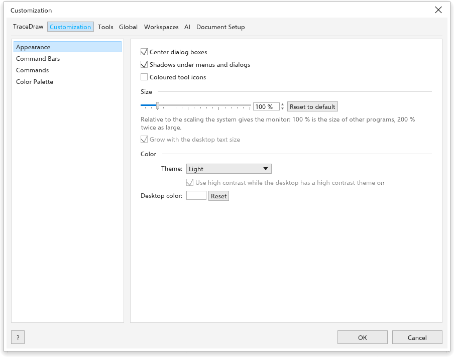
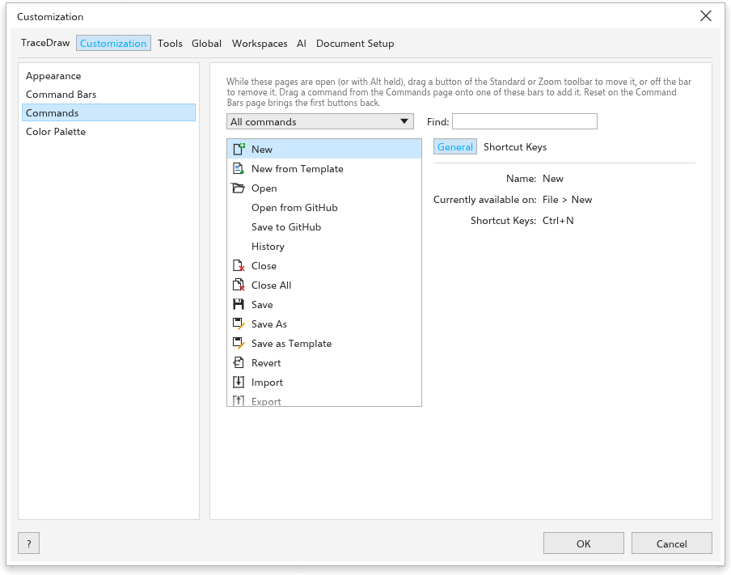
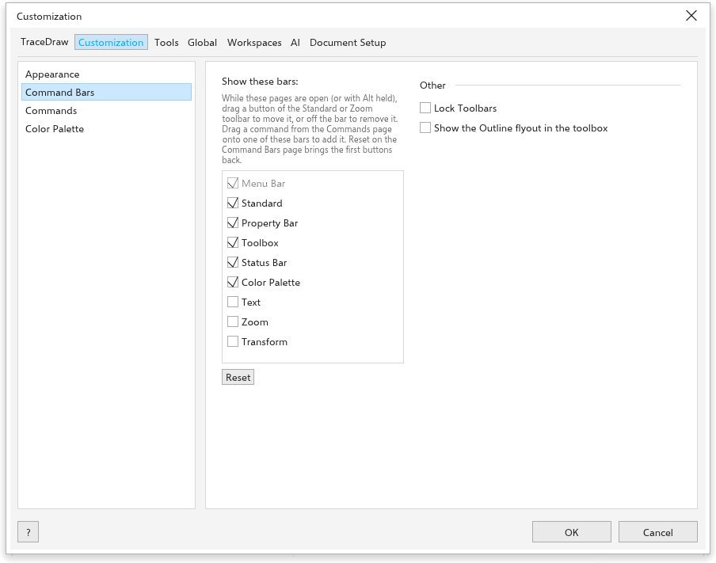
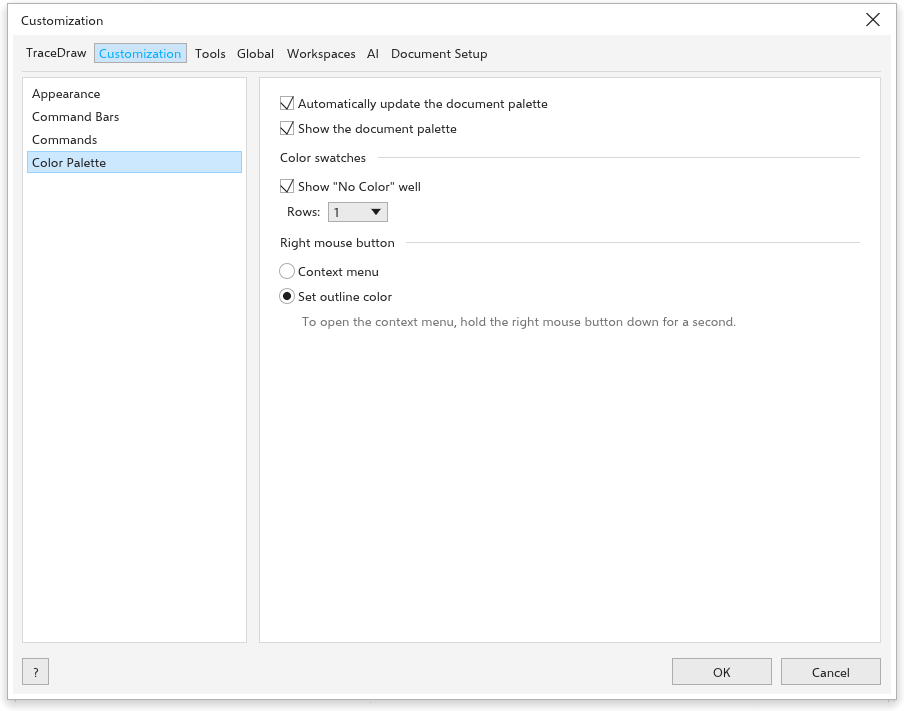

# 自定义选项

> *机器翻译：本页可能落后于英文版。*

[[menu.tools > menu.tools.options > menu.tools.options_customization]] 设置界面外观、你自己的键盘快捷键、显示哪些栏以及调色板的行为。

## 外观 {#appearance}

- [[options.center_dialogs]]：对话框在窗口中央打开；关闭时，它们在你上次放置的位置打开。
- [[options.ui_shadows]]（阴影越少，对较慢的显卡越有利）。
- [[options.translucent_menus]]: open menus let the drawing show through them, at the [[options.menu_opacity]] beside the box (off by default).
- [[options.colored_icons]]：每组工具都有自己的颜色。
- [[options.docker_tabs_icons_only]]：窗口两侧的面板标签只显示图标，名称显示在提示中。关闭时显示图标和名称，放不下所有标签的列可以滚动。
- [[options.ui_size]]：菜单、栏、图标和面板的大小，相对于系统为显示器设置的缩放比例（起初为 100%）。[[options.reset_to_default]] 恢复为 100%。界面大小从不改变绘图的大小。[[options.follow_text_size]] 使其随桌面文本大小变大。
- [[options.color_section]]：[[options.theme]]（浅色、中浅色、中深色、深色或高对比度）、[[options.follow_high_contrast]]，以及页面周围的 [[options.desktop_color]]。状态栏右端的按钮在浅色和深色之间切换。

## 命令 {#commands}

该页面列出菜单中的每个命令及其快捷键，以及工具按键。在 [[options.find_command]] 中输入可筛选列表。

为命令设置你自己的快捷键：

1. 单击该命令的快捷键按钮。
2. 按下按键，例如 <kbd>Ctrl+Alt+K</kbd>。<kbd>Esc</kbd> 停止等待。

你的快捷键优先于内置快捷键：当你占用另一个命令使用的按键时，页面会说明哪个命令失去了它。菜单显示你的快捷键。快捷键旁的 **x** 删除它，重置为默认值会将它们全部删除。工具按键为一个字母，或 <kbd>Shift</kbd> 加一个字母。请参阅 [键盘快捷键](../reference/keyboard-shortcuts.md)。

一个命令可以有多个快捷键：新按键会加入已有的按键（内置按键仍可同时使用），每个按键都有自己的删除按钮。运行菜单命令的工具栏按钮（新建、打开、保存、撤销、放大等）也可以设置快捷键，与其菜单命令相同；菜单只在某些时候显示的行也是如此。“工具栏按钮”列表包含标准工具栏和缩放工具栏的所有按钮：可从这里把移除的按钮拖回工具栏。

## 命令栏 {#command-bars}

[[options.command_bars_hint]] [[menu.window.toolbar_menu_bar]]、[[menu.window.toolbar_standard]]、[[menu.window.toolbar_property_bar]]、[[menu.window.toolbar_toolbox]]、[[menu.window.toolbar_status_bar]]、[[bars.palette]]，以及 [[menu.window.toolbar_text]]、[[menu.window.toolbar_zoom]] 和 [[menu.window.toolbar_transform]] 工具栏。[[options.reset]] 恢复各栏。在 [[options.other]] 下：[[bars.lock]] 和 [[options.show_outline_flyout]]。

[[options.toolbar_drag_hint]]

## 调色板 {#color-palette}

- [[options.palette_auto_update]] 和 [[options.palette_show_document]]（均打开）。
- 默认调色板的 [[options.palette_position]]（顶部、底部、左侧、右侧或浮动），与其自身菜单的设置相同；工具栏锁定时不可更改。
- [[options.palette_swatches]]：[[options.palette_no_color]]（打开），以及 [[options.palette_right_button]] 的作用：[[options.palette_set_outline]]（起初选用）或打开 [[options.palette_context_menu]]。

请参阅 [调色板](../color/palettes.md)。

## 右键菜单 {#context-menus}

在“自定义”中选择 [[options.context_menus]]，可以独立管理 32 个位置的右键菜单。
使用 [[options.context_menu_scene]] 选择位置，再通过
[[options.context_menu_search]] 查找操作，取消勾选即可在该位置隐藏。
即使当前选区无法使用某项操作，它仍会显示在管理列表中。

所有操作默认显示，各位置独立保存。例如，在画布中隐藏对象操作，
不会影响对象面板中的同名操作。目标图层、字体集合等动态列表按整个操作管理，
名称变化不会重置显示设置。

[[options.context_menu_reset]] 恢复当前菜单，
[[options.context_menu_reset_all]] 恢复全部菜单。[[dialog.ok]] 会将选择保存到应用设置；
[[dialog.cancel]]、Escape 或关闭按钮会恢复打开设置时的选择。
主菜单、快捷键和命令搜索仍可使用原有命令。

展开子菜单即可查看缩进显示的下级项目。拖动行首的手柄，或使用 [[options.context_menu_move_up]] 和 [[options.context_menu_move_down]]，可调整同级项目的顺序。移动父菜单时，其子项会一起移动；项目不能拖入其他父菜单。搜索结果会保留匹配项目的父级路径。恢复菜单会同时重置显示状态和顺序；取消设置会将两者恢复到打开对话框时的状态。

文档调色板的色块菜单与它在调色板管理器中的菜单分别设置。
动态目标保留自身顺序；“对象样式”中的文档样式列表保留在静态操作之间的位置。
后续版本新增的操作默认显示，并排在已自定义顺序的同级项目之后。
