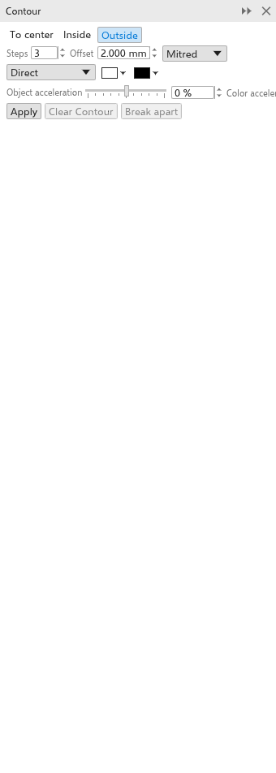

# 轮廓图

轮廓图在对象内部、外部或向其中心绘制等距的对象轮廓副本，就像地图上的等高线。它是一种实时效果：更改对象，轮廓图会随之改变。

## 添加轮廓图 {#create}

使用工具：

1. 从效果展开工具栏中选择 [[tool.contour]] 工具。
2. 从对象上拖动：远离其中心拖动得到外部轮廓图，朝向中心拖动得到内部轮廓图。拖得越远，间距越大。

使用面板：

1. 选择一个对象。
2. 使用 [[menu.effects > menu.effects.contour]]（<kbd>Ctrl+F9</kbd>）打开 [[docker.contour]] 面板。
3. 设置选项并单击 [[docker.apply]]。

群组和位图不能应用轮廓图。

## 绘图上的手柄 {#handles}

使用轮廓图工具时，带有轮廓图的对象会从其右边缘的中点显示一条线：外部轮廓图向外，内部轮廓图或到中心的轮廓图向内。

- 拖动线末端的**方块**可改变轮廓图延伸的距离。步数不变，只是间距变大或变小。
- 拖动线上第一步处的**横条**可改变步数：朝对象拖动步数增加，远离对象拖动步数减少。最后一步保持不动。到中心的轮廓图没有横条，因为它会用尽能容纳的步数。

拖动时轮廓图会随之变化，每次拖动都可一步撤销。

## 轮廓图设置 {#settings}

属性栏和面板显示所选轮廓图的设置，并立即对其进行更改。

- **到中心**、**内部** 或 **外部**（起初选用）。
- **步数**：起初为 3，最多 999。到中心会生成能容纳的最大数量。
- **偏移**：步骤之间的距离（起初为 2 mm）。
- **角**：斜接（尖角，起初选用）、圆角或斜切。
- **颜色方向**：从对象的颜色到最后一步的颜色，沿色轮直接、顺时针或逆时针过渡。
- **最后一步的填充和轮廓颜色**（起初为白色和黑色）。没有填充的对象会得到无填充的步骤。
- **对象加速** 和 **颜色加速**（-100 到 100%）使步骤或颜色向对象或向最后一步聚集。

外部步骤绘制在对象后面，内部步骤绘制在对象前面。

**清除轮廓图** 删除轮廓图；**拆分** 将步骤变为对象。
这些步骤会编组放在对象旁边。[[menu.object > menu.object.break_contour_apart]]（<kbd>Ctrl+K</kbd>，右键菜单中也有）效果相同。
