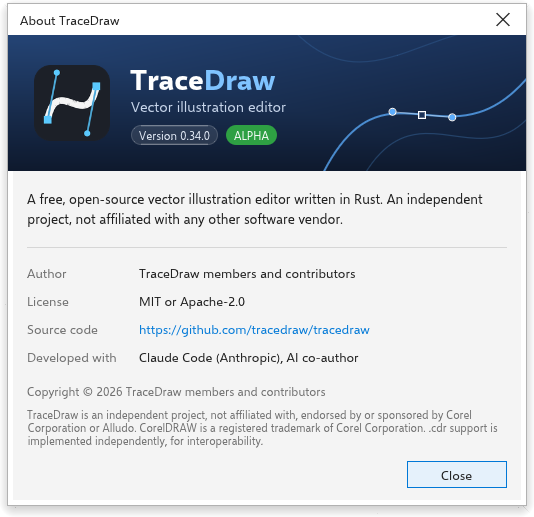

# 关于 TraceDraw 和更新

TraceDraw 免费且开源。本页介绍如何查看你的版本、如何获取更新的版本，以及在
哪里寻求帮助。

## 关于对话框 {#about}

选择 [[menu.help > menu.help.about]] 可查看正在运行的版本、作者、许可证、源
代码链接以及程序的构成。按 [[dialog.close]]、<kbd>Enter</kbd> 或
<kbd>Esc</kbd> 关闭。

## 检查更新 {#updates}

在桌面版中，TraceDraw 可以在新版本发布时通知你。

立即检查：

1. 选择 [[menu.help > menu.help.updates]]。
2. TraceDraw 向项目的发布页面查询最新版本，并说明它是否比你的版本新。测试
   版本和每夜构建从不提供。
3. 有更新的版本时，选择要做的操作：
   - **下载** 打开适用于你系统的文件下载（Windows 上为安装程序或便携压缩包，
     Mac 上为适合其处理器的磁盘映像，Linux 上为 AppImage 或压缩包）。之后
     由系统的安装程序完成安装。
   - **发行说明** 打开该版本的更改列表。
   - **跳过此版本** 不再提供该版本。
   - [[dialog.close]] 关闭对话框。

当 TraceDraw 以 Linux AppImage 运行时，对话框还可能提供 **安装**：它把新的
AppImage 下载到正在运行的文件旁边，检查下载是否完整且真实，然后替换旧文件。
新版本会在你下次打开 TraceDraw 时启动。如果有任何检查不通过，旧文件保持原样，
对话框会告诉你原因。

如果检查失败（例如没有网络连接），对话框会说明并提供发布页面。

### 自动检查 {#automatic-check}

[[menu.tools > menu.tools.options > menu.tools.options_global]] 的
[[options.general]] 页面有一个在启动时检查更新的设置。它默认开启：TraceDraw
每天在启动时静默检查一次，只有在出现你未跳过的新版本时才提示。

TraceDraw 首次启动时会询问是否检查更新：[[updates.policy_always]] 或 [[updates.policy_never]]。在您回答之前，TraceDraw 不会自行建立任何连接。您的回答会设置此选项，之后可随时在此处更改。

> **注意：** 浏览器版本始终是最新的。在浏览器版本中，
> [[menu.help > menu.help.updates]] 会打开发布页面。

## 欢迎屏幕 {#welcome-screen}

欢迎屏幕是 TraceDraw 启动时的第一个选项卡。你可以在这里新建绘图、打开最近
使用的绘图（每个都带缩略图；[[menu.file.clear_recent]] 会清除它们）、从模板
开始、阅读新闻和查找学习资料。选择 [[menu.help > menu.help.welcome_screen]]
可再次显示它。[[menu.help > menu.help.video_tutorials]]、
[[menu.help.quick_start_guide]] 和 [[menu.help.user_guide]] 打开它的学习页面，
[[menu.help.whats_new]] 打开它的新闻。

## 社区和支持 {#community}

- [[menu.help > menu.help.community]] 打开项目的讨论论坛，你可以在那里提问和
  分享想法。
- [[menu.help > menu.help.support]] 打开问题跟踪器，你可以在那里报告问题。
- [[menu.help > menu.help.message_settings]] 打开设置 TraceDraw 消息的选项。

## TraceDraw 停止响应时 {#problem-reports}

当 TraceDraw 的某一步超过 10 秒时，它会保存一份当时正在做什么的报告（版本、系统、工具、上一个命令、绘图的大小以及日志的末尾），从不包含绘图的名称或内容。TraceDraw 恢复响应时，或者它不得不被关闭或因错误关闭后的下一次启动时，会有消息提示发送报告。

1. 单击 **[[report.show]]** 阅读报告。
2. 单击 **[[report.send]]**：会打开一个填好摘要的 GitHub 新问题以及报告所在的文件夹。
3. 把报告拖到问题中，写下你当时在做什么，然后提交。在此之前不会发送任何内容。

**[[report.not_now]]** 关闭消息。每份报告只提示一次。
